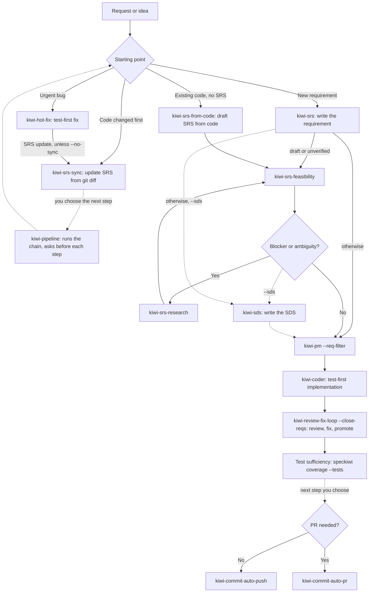
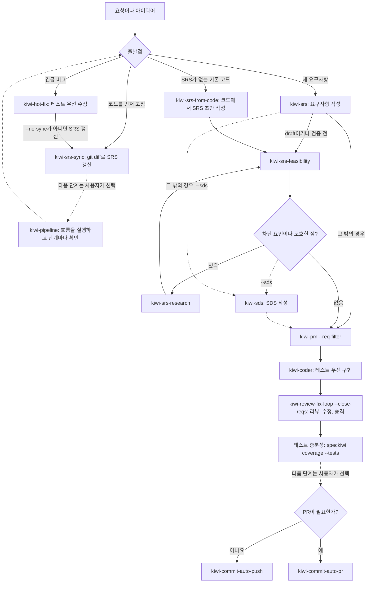

<p align="center">
  <a href="#english-version"><strong>📖 View English documentation</strong></a>
  &nbsp;·&nbsp;
  <a href="#korean-version"><strong>📖 한국어 문서 보기</strong></a>
</p>

---

<a id="english-version"></a>

# SpecKiwi

SpecKiwi keeps your requirements as Markdown SRS (Software Requirements Specification) documents inside your Git repository. People and coding agents read and change them through the same **CLI** and the same **stdio MCP server**.

**Kiwi skills** are coding-agent skills built on SpecKiwi. They carry a request from requirement to commit: write the requirement, check that it is feasible, implement it test-first, review the code, confirm that tests cover every acceptance criterion, and commit.

- Requirements live in `docs/spec/**/*.srs.md` (GitHub-Flavored Markdown). There is no YAML, no database and no requirements server.
- The CLI and the MCP server share one parser, validator, query engine and mutation engine.
- Everything is a normal Git-tracked file, so requirements are reviewed and versioned like code.

## Table of Contents

**New here? Read §1 to §4.** The rest is reference.

1. [Quick start](#en-quickstart)
2. [Concepts](#en-concepts)
3. [What to ask your agent](#en-entry)
4. [How work flows](#en-pipeline), including [the SDS on request](#en-sds-opt-in) and [parallel waves](#en-waves)
5. [Install and initialize](#en-install)
6. [Connect the MCP server](#en-mcp)
7. [Kiwi skills](#en-skill-types), including [installing them for other agents](#en-skills)
8. [Command reference](#en-commands)
9. [Upgrade and remove](#en-lifecycle)
10. [Troubleshooting](#en-troubleshooting)
11. [SRS working principles](#en-principles)
12. [Package development](#en-dev)

<a id="en-quickstart"></a>

## 1. Quick start

You need Node.js 22 or newer, Git, and a coding agent: Claude Code, Codex, OpenCode or Hermes. Run these steps at the top level of your Git repository.

1. Install the CLI.

   ```sh
   npm install -g speckiwi@latest
   ```

2. Initialize the project. This creates the SRS under `docs/spec/`, installs the Kiwi skills for Claude Code and Codex, and registers the SpecKiwi MCP server with both.

   ```sh
   speckiwi init --target v0.1.0 --scope "App:APP"
   ```

3. Make `v0.1.0` the Active Target, the release that new requirements go to. `init --target` only registers it.

   ```sh
   speckiwi set-active-target v0.1.0
   ```

4. Check the setup. In a new project `doctor` warns that there are no requirements yet. That is expected.

   ```sh
   speckiwi doctor
   ```

5. **Restart your coding agent**, so that it starts the MCP server.

6. Ask for work in plain language:

   > *Use kiwi-pipeline: a user can reset their password by email.*

   `kiwi-pipeline` writes the requirement, implements it test-first, reviews the code and checks that tests cover it. It asks you before each step. [How work flows](#en-pipeline) explains each step.

If your situation differs:

- **The project already uses SpecKiwi.** Run `speckiwi upgrade` instead of `init`. See [Update a project](#en-upgrade).
- **An agent is not installed.** `init` skips it with a warning. If an agent CLI is missing or fails, `init` warns with the command to run yourself.
- **You want the skills and the MCP registration inside the project.** See [`--project-install`](#en-project-install).
- **You use OpenCode or Hermes.** See [Install skills for other agents](#en-skills).
- **You only want to record a requirement.** Ask for `kiwi-srs` instead: *"Use kiwi-srs to capture a requirement: …"*.

<a id="en-concepts"></a>

## 2. Concepts

- **SRS document**: a Markdown file under `docs/spec/` that holds requirements. `docs/spec/00.index.md` is the hub: it lists targets, scopes and completed work. Each functional area has its own **scope document**, such as `docs/spec/01.app.srs.md`.
- **Requirement** and **Requirement ID**: one requirement block, with an ID such as `FR-APP-001`. The tools allocate IDs. Never write one by hand.
- **Scope**: a functional area with an ID prefix. `App:APP` gives IDs such as `FR-APP-001`.
- **Target**: a release that groups requirements, such as `v0.1.0`. The **Target Map** in the index lists every target. The **Active Target** is the one new work goes to.
- **Acceptance criteria (AC)**: the numbered checks a requirement must pass: `AC-1`, `AC-2` and so on. A test covers an AC when the test's own line cites both IDs, such as `FR-APP-001 AC-2`.
- **Status**: implementation and verification progress. The values are `planned`, `in_progress`, `blocked`, `implemented`, `verified` and `discarded`.
- **Stability**: how settled a requirement is. It moves `draft` → `evolving` → `stable` → `frozen`, and `deprecated` retires it. Status and Stability change independently.
- **Evidence**: a row on a requirement that records how it was verified, such as a test command or a commit.
- **Work mode**: how the project takes work: `wait` (the default), `sdd`, `vibe` or `tdd`. See [Work modes and steps](#en-work-modes).
- **Step**: a small unit of work drafted under `docs/spec/steps/<name>/` and later promoted into a scope document. The step a `vibe` or `tdd` session works on is the **Active Task**.
- **SDS** (Software Design Specification): a short design that an agent writes right before coding. It is written only when you ask for one. See [The SDS on request](#en-sds-opt-in).
- **Host checkout**: the main working tree that holds the SRS, as opposed to a linked git worktree.
- **Wave**: one part of a large job, with its own requirements and its own worker. Waves whose dependencies are done form a **stage**, and the waves of a stage run in parallel. See [Parallel waves](#en-waves).
- **MCP server**: `speckiwi mcp`, the stdio server through which agents read and change the SRS. Registered at **user scope**, it serves every project of your user account.

<a id="en-entry"></a>

## 3. What to ask your agent

**Start with `kiwi-pipeline`.** It fits most features and changes. Pick another skill when one of the rows below matches your situation better. You can name the skill, or describe the work and let the agent pick it.

| Your situation | Ask for | What happens |
| --- | --- | --- |
| A feature or change you can describe in a sentence or two | `kiwi-pipeline`: *"Use kiwi-pipeline: users can export reports as CSV."* | Writes the requirement, implements it test-first, reviews the code and checks test coverage. Asks before each step. |
| Work that spans several scopes, or arrives as a list of parts | `kiwi-orchestrator`: *"Use kiwi-orchestrator: add SSO login."* | Proposes a path and asks you to confirm it: one `kiwi-tdd` step, or a run split into parallel waves. Resumable. |
| An epic, a roadmap or long research | `kiwi-wave-master` | Splits the work into ordered waves with a target each. Runs the waves whose dependencies are done in parallel. Resumable. |
| Record a requirement only | `kiwi-srs` | Writes the requirement and its acceptance criteria, then stops. |
| An existing codebase with no SRS | `kiwi-srs-from-code` | Drafts SRS documents from the code, one per scope. |
| You already changed the code | `kiwi-srs-sync` | Reads `git diff` and brings the SRS up to date. |
| An urgent bug | `kiwi-hot-fix` | Fixes it test-first and runs regression. Then hands the SRS update to `kiwi-srs-sync`. |
| Review local changes or PR comments | `kiwi-review-fix-loop` | Reviews, fixes and reviews again. |
| Commit and push, or open a PR | `kiwi-commit-auto-push` or `kiwi-commit-auto-pr` | Commits and pushes, then records the commit as evidence on the matching requirements. `kiwi-commit-auto-pr` also creates or updates the PR. |
| "What should I do next?" | `kiwi-pipeline --none-cycle` | Recommends the next step without running anything. |

**Options you may want**

| Option | Effect |
| --- | --- |
| `--auto` | Makes the routine decisions the skill would otherwise ask you about. It still stops on a failure, or on a question only you can answer. |
| `--max` | Verifies more strictly, with more independent reviewers and a stricter pass condition. |
| `--mini` / `--loops N` | Caps each review-and-fix loop at 3 rounds, or at N rounds. |
| `--serial` | Runs the parallel steps of `kiwi-orchestrator` and `kiwi-wave-master` one at a time. Saying "one at a time" works too. |
| `--sds` | On `kiwi-pipeline`, `kiwi-orchestrator` and `kiwi-wave-master`, writes a design (SDS) before implementing. Off by default. Saying "use SDS" works too. See [The SDS on request](#en-sds-opt-in). |

<a id="en-pipeline"></a>

## 4. How work flows

A new feature or change goes through four skills: `kiwi-srs` → (`kiwi-srs-feasibility`) → `kiwi-pm` → `kiwi-review-fix-loop --close-reqs`. They work from the Requirement IDs that `kiwi-srs` wrote. `kiwi-pipeline` runs this chain for you.

1. **`kiwi-srs`** writes or updates the requirement and its acceptance criteria.
2. **`kiwi-srs-feasibility`** checks feasibility and stability. It runs only when a requirement is still `draft`, or when its implementability is unverified. A blocker or an ambiguity can send the work to `kiwi-srs-research`, and the pipeline then asks you which way to go.
3. **`kiwi-pm --req-filter <REQ-ID,...>`** hands those requirements to one `kiwi-coder` run. `kiwi-coder` works test-first: a failing test that cites `<REQ-ID> AC-<n>`, the smallest change that passes it, then refactoring. `kiwi-pm` then marks each requirement whose criteria all have tests `implemented`.
4. **`kiwi-review-fix-loop --close-reqs`** reviews the code and fixes what it finds. It promotes a requirement to `verified` once regression passes, no finding is open, and every acceptance criterion has a test.

**Every workflow that implements code ends the same way: a code review, then a test-sufficiency check.** The check runs `speckiwi coverage --tests` (MCP `check_test_sufficiency`). Every acceptance criterion in scope needs a test whose line cites `<REQ-ID> AC-<n>`. When tests are missing, one subagent adds them, once. A gap that remains keeps the requirement from becoming `verified`.



The chain does not commit on its own. Committing is a separate step that you choose, or that `kiwi-pipeline` recommends afterwards.

<a id="en-sds-opt-in"></a>

### The SDS on request

`kiwi-sds` runs only when you ask for it: `/kiwi-sds`, `--sds` on `kiwi-pipeline`, `kiwi-orchestrator` or `kiwi-wave-master`, an `--sds-id <id>` you give, or words such as "use SDS". It is not a default stage of any chain.

- It writes a lite SDS at `docs/sds/<sds-id>.sds.md`: the files and symbols to touch, one contract per interpretation decision, and the test that proves each contract. It is written for agents, not for people.
- `speckiwi sds check` checks it. `kiwi-sds` then marks it agreed without asking you, and `kiwi-coder` implements from it.
- `kiwi-sds --close` runs twice. Before the promoting review, it moves the SDS's decisions into the SRS. After the test-sufficiency check, it deletes the SDS file, once every requirement it covers is `verified` or `discarded`.
- An orchestrated run commits the SDS before deleting it, so git history keeps it. A `kiwi-pipeline` run and a standalone `kiwi-pm --sds` run do not commit it, so it survives only if you committed it yourself.
- To implement from an SDS that is already agreed, pass it to `kiwi-pm` with `--sds <path>`. `kiwi-pm` writes no new SDS. When it runs on its own, it also closes that SDS out. An SDS that merely sits in `docs/sds/` is not a request: `kiwi-pm` reports its path and leaves it alone.
- In a step, `--sds` on `kiwi-tdd` or `kiwi-step` does not run `kiwi-sds`: `kiwi-tdd` writes the step SDS (`docs/spec/steps/<name>/design.md`) itself, and `kiwi-step` only creates its stub.

On existing code an SDS can help a weaker implementer model, which is why it stays available.

<a id="en-tdd-steps"></a>

### Step-scoped work in the `tdd` work mode

In the `tdd` work mode, `kiwi-tdd` takes one step through the TDD First cycle instead of going through `kiwi-pm`:

1. It records EARS acceptance lines (`AC-<n>: WHEN … THE SYSTEM SHALL …`) in the step's `intent.md` under `## Acceptance` and checks them with `speckiwi step validate`.
2. It turns them into failing tests, implements to green and runs regression.
3. It synthesizes the step SRS and promotes the step requirement into a scope document, with evidence (MCP `promote_step_requirement`).

[Work modes and steps](#en-work-modes) lists the commands.

<a id="en-waves"></a>

### Parallel waves and `--serial`

`kiwi-orchestrator` (when it routes to an orchestrated run) and `kiwi-wave-master` split the work into waves. Each wave goes into the wave declaration file, `waves/waves.json` under the run's artifact folder. A declaration entry names its `wave` (`wave-1`, `wave-2`, …), the waves it `depends_on`, the `files` it expects to write and its `requirements`. Under `--sds` it also lists the wave's `sds` files. A wave with no `depends_on` waits for every earlier wave.

- Each wave gets one worker in its own git worktree. The worker runs `kiwi-pm --req-filter` over the wave's requirements and reviews its own commits.
- A wave is ready when it is not complete and every wave it depends on is complete. `speckiwi orchestrate wave status --waves <file>` lists the ready waves.
- `speckiwi orchestrate schedule waves --waves <file> --run-id <id>` plans the ready waves into stages. The waves of a stage whose `files` do not overlap run in parallel, up to `--lanes N` at a time (default 4). A wave that declares no `files` runs alone in its stage.
- Only the host checkout writes the SRS. After the workers finish, the host merges, verifies and promotes each wave in turn, then moves to the next stage.
- `--serial`, or asking for "one at a time", runs every parallel step one after another instead: workers, SDS authors, investigators and verifiers. The code path is the same.
- `speckiwi orchestrate resume` reports where an interrupted `kiwi-orchestrator` run picks up. It reads the git state itself and, without `--run-id`, chooses the latest run that is neither complete nor aborted. `kiwi-wave-master` keeps no resume card; it resumes from `speckiwi orchestrate wave status --engine kiwi-wave-master`.

Both skills close a run with a `kiwi-review-fix-loop` pass over its commits. `speckiwi orchestrate validate` refuses a run close that reports completion without that review.

<a id="en-install"></a>

## 5. Install and initialize

### Install

Install SpecKiwi globally to put `speckiwi` on your PATH:

```sh
npm install -g speckiwi@latest
speckiwi --version
speckiwi --help
```

Or install it into the project and run it through `npx`:

```sh
npm install speckiwi@latest
npx speckiwi --version
```

The examples in this document use the short `speckiwi` form. With a project-local install, put `npx` in front of each command.

**Global options**, accepted by every command:

| Option | Description |
| --- | --- |
| `--root <path>` | The project root to work on. Every command except `mcp` accepts it. Without it, the root is found as described [below](#en-root). |
| `--json` | Write machine-readable JSON to stdout. |
| `--no-color` | Disable ANSI color. |
| `--quiet` | Suppress non-essential human output. |
| `-V, --version` | Print the version. |
| `-h, --help` | Print help for the command. |

<a id="en-root"></a>

**How the project root is found.** Keep `docs/spec/` at the git top level. Several things follow the git top level rather than the root SpecKiwi resolves, among them the pre-commit hook and the `kiwi/` run journal. `speckiwi doctor` checks this as *project root is the git top level*.

- Most commands search upward from the current directory. They stop at the first directory that holds either `.git` or `docs/spec/00.index.md`.
- `speckiwi init` does not search. It uses the current directory, or `--root`.
- The MCP server searches upward for `docs/spec/00.index.md` only, and never adopts one in your home directory. See [Connect the MCP server](#en-mcp).

<a id="en-init"></a>

### Initialize a project

Run `init` once at the git top level:

```sh
speckiwi init --target v0.1.0 --scope "App:APP"
```

`init` holds the SRS mutation lock while it runs. Running it again keeps the files you own (see [below](#en-init-second-run)). It does seven things:

1. **SRS scaffold.** Creates `docs/spec/00.index.md` (Target Map, Scope Map, Completed Work Log) and `docs/spec/90.appendix.md`. When the project has no scope document yet, it also creates an empty one from `--scope`, such as `docs/spec/01.app.srs.md`. Existing scope documents are registered under their own names instead.
2. **Step state.** Creates `docs/spec/steps/state.md`, in the `wait` work mode.
3. **Authoring rules.** Writes the bundled `docs/rule/SRS-MD-Rules-v2.5.0.md` and `docs/rule/SDS-MD-Rules-v2.6.0.md`.
4. **Agent instructions.** Adds or updates the *SpecKiwi SRS workflow* block in `AGENTS.md` and `CLAUDE.md`.
5. **Hooks.** Installs the runners `docs/.kiwi/hooks/pre-commit.mjs` and `docs/.kiwi/hooks/trace.mjs`, a `.git/hooks/pre-commit` that delegates to the first, a PostToolUse trace hook in `.claude/settings.json` and an apply_patch trace hook in `.codex/hooks.json`.
6. **MCP registration.** Registers the MCP server at user scope through each agent's own CLI. See [Connect the MCP server](#en-mcp).
7. **Skills.** Installs the Kiwi skills into each agent's global skills directory: `~/.claude/skills` for Claude and `~/.agents/skills` for Codex.

<a id="en-init-second-run"></a>

**What a second run changes.** A file that `init` scaffolded and that you now own is never overwritten. It is reported as `skipped`. The files the tool owns are the exception:

- A rules document is replaced when it differs from the bundled text. Other versioned rules files in `docs/rule/` (`SRS-MD-Rules-v*.md`, `SDS-MD-Rules-v*.md`) are deleted, even a newer one, so never run `init` or `upgrade` with an older CLI. Your other files there are kept.
- The `Rules` row of an existing index is updated to point at the bundled rules document.
- The workflow block is replaced when it differs from the shipped text. A block that a newer SpecKiwi wrote is kept, with a warning.
- An existing `.git/hooks/pre-commit` is never overwritten. If it does not delegate to the runner yet, `init` warns and tells you how to connect it.
- **A Kiwi skill that SpecKiwi installed is replaced with the bundled version whenever it differs, local edits included.** No backup is kept. To change a skill, copy it under another name first.
- **The shared contract folder `_shared/kiwi/` belongs to SpecKiwi.** Every skill install (`init`, `upgrade`, `skills install`) rewrites each contract file there to the bundled version, local edits included, and deletes every file there that no installed skill cites, whoever wrote it. The report and `--dry-run` do not list these changes. Keep your own files outside `_shared/kiwi/`.

`--force` overwrites much more. Read [its warning](#en-init-force) first.

<a id="en-init-skills"></a>

**Where the skills go.**

- An agent whose home directory does not exist gets no skills, with a warning. The home directory is `~/.claude` for Claude and `${CODEX_HOME:-~/.codex}` for Codex.
- No skill directory is removed from the global skills directories, because other projects may use them. Their `_shared/kiwi/` folder is still rewritten, as described above.
- The one exception is Codex's old skills directory, `${CODEX_HOME:-~/.codex}/skills`. Codex still reads it, so it would list each skill twice. Every Codex global install removes from it SpecKiwi's own unedited copies of the skills it just installed and of retired skills such as `kiwi-planner`. A copy of those skills that it cannot prove is SpecKiwi's unedited copy stays, with a warning. It does not touch any other `kiwi-*` directory there. Shared contract files there are cleaned the same way as in [`remove`](#en-remove).
- A skill directory that SpecKiwi did not install is never overwritten. It is a conflict, and that agent then gets no skill installed or updated in this run. `init` warns and finishes its other steps. Remove or rename the directory, then run `init` again.

**The report.** The result lists files in five arrays, `created`, `updated`, `skipped`, `removed` and `warnings`. An `onboarding` object names the scope used (`global` or `project`) and the agent CLI commands in the order they ran. Add `--json` for the machine-readable form.

A typical project after the first run:

```text
AGENTS.md                     # SpecKiwi SRS workflow block
CLAUDE.md                     # SpecKiwi SRS workflow block
.claude/settings.json         # PostToolUse trace hook
.codex/hooks.json             # apply_patch trace hook
.git/hooks/pre-commit         # delegates to docs/.kiwi/hooks/pre-commit.mjs
kiwi/                         # run state (see below)
docs/
├─ .kiwi/hooks/               # bundled hook runners
├─ .kiwi/trace/               # trace output written by trace.mjs
├─ rule/
│  ├─ SRS-MD-Rules-v2.5.0.md
│  └─ SDS-MD-Rules-v2.6.0.md
└─ spec/
   ├─ 00.index.md             # targets, scopes, completed work log
   ├─ 01.app.srs.md           # your first scope document
   ├─ 90.appendix.md
   └─ steps/state.md
```

Requirement bodies live in `docs/spec/**/*.srs.md`, the **canonical source of truth**. Three directories hold run state, and you never edit them by hand:

- **`kiwi/`** holds the SRS mutation lock while a write runs, the skills' journals `pipeline.jsonl` and `waves.jsonl`, and resume cards under `kiwi/orchestrator/<run-id>/`.
- **`.kiwi/`** holds per-run session state under `.kiwi/sessions/<run-id>/`, such as the `kiwi-coder` state and worklog.
- **`docs/.kiwi/`** holds the hook runners and their trace output.

<a id="en-project-install"></a>

### Keep everything in the project: `--project-install`

By default the skills and the MCP registration live in your home directory and serve every project. `--project-install` keeps them in the project instead:

```text
.mcp.json                     # speckiwi MCP server registration
.claude/skills/kiwi-*         # Claude Kiwi skills
.claude/skills/_shared/kiwi/  # contracts the skills share
.agents/skills/kiwi-*         # Codex Kiwi skills
.agents/skills/_shared/kiwi/  # the same, for Codex
```

- No agent CLI runs. Codex does not read `.mcp.json`, so the run warns with the `codex mcp add` command to run yourself.
- `kiwi-*` skill directories that SpecKiwi installed earlier, that nobody edited, and that this release no longer ships are removed from the project.
- Add `--global` to install the skills into the global directories as well.
- The option is not remembered. Pass it on every `init` and `upgrade`. A plain `upgrade` moves the project to the global layout (see [Update a project](#en-upgrade)). A plain `init` adds the global setup but leaves the project copies in place.

A checkout of SpecKiwi itself is always set up this way, with or without the option. Its `.mcp.json` runs the local `bin/speckiwi`, so the checkout tests its own build.

### `init` options

| Option | Description |
| --- | --- |
| `--target <target>` | When `init` creates the index, adds this target to the Target Map as `planned`. It does not become the Active Target. An existing index is left as it is; register a new target with `speckiwi set-active-target <target> --create`. |
| `--scope "Name:PREFIX"` | The first scope, used only when the project has no scope document yet. Add scopes later with `speckiwi scaffold-scope <Name>:<PREFIX> --apply`. |
| `--no-mcp` | Skip the MCP registration. |
| `--no-skills` | Skip the skills, and the removal of retired project skills. |
| `--project-install` | Keep the skills and the MCP registration in the project. See [above](#en-project-install). |
| `-g, --global` | With `--project-install`, also install the skills globally. On its own it changes nothing. |
| `--dry-run` | Report every step without writing anything or running an agent CLI. The commands a real run may issue are listed under `onboarding.agentCommands`. |
| `--force` | Overwrite files you own. Read [the warning](#en-init-force) first. |
| `--ignore-lock` | Bypass the SRS mutation lock, even one that another writer holds right now. The two writes can then interleave. |
| `--json` | Write the result as JSON. |

**Exit codes:** `0` success · `2` usage error (such as an unknown flag) · `5` failure (such as a held mutation lock).

<a id="en-init-force"></a>

> **Warning: `--force` overwrites files you own, and keeps no backup.** It rewrites these from templates and reports them as `updated`:
>
> - `docs/spec/00.index.md`: your Target Map, Scope Map and Completed Work Log
> - `docs/spec/90.appendix.md`
> - `docs/spec/steps/state.md`: your work mode and step state
> - `docs/.kiwi/hooks/pre-commit.mjs` and `docs/.kiwi/hooks/trace.mjs`
> - `.claude/settings.json` and `.codex/hooks.json`, with your own permissions, hooks and environment settings
>
> An existing scope document is never rewritten, with or without `--force`. Neither is an existing `.git/hooks/pre-commit`.

**Through MCP.** The `init_project` tool runs steps 1 to 5: the SRS scaffold, step state, rules documents, workflow block and hooks. It never registers the MCP server, installs skills or runs an agent CLI. It accepts `force`, with the same effect as `--force`.

<a id="en-mcp"></a>

## 6. Connect the MCP server

The Kiwi skills need a connected SpecKiwi MCP server. `speckiwi init` registers it at user scope through each agent's own CLI. For each agent it first asks whether the server is registered, and adds it only when that command exits non-zero:

```sh
claude mcp get speckiwi
claude mcp add -s user speckiwi -- npx -y speckiwi mcp
codex mcp get speckiwi --json
codex mcp add speckiwi -- npx -y speckiwi mcp
```

SpecKiwi never edits `~/.claude.json` or `~/.codex/config.toml` itself; the agent CLIs do. When a CLI is not on PATH, fails or times out, `init` still finishes its other steps and warns with the command to run yourself. Restart your agent afterwards, so that it starts the server.

With [`--project-install`](#en-project-install), `init` writes the registration into `.mcp.json` instead:

```json
{
  "mcpServers": {
    "speckiwi": {
      "command": "npx",
      "args": ["-y", "speckiwi", "mcp"]
    }
  }
}
```

For OpenCode or Hermes, register `npx -y speckiwi mcp` as an MCP server in that agent's own configuration.

The agent starts the server with this command:

```sh
speckiwi mcp
```

Run it by hand only for debugging. It waits on stdio, so it looks as if it hangs.

- **No `--root`.** The server finds the project by searching upward from its working directory for `docs/spec/00.index.md`. The search stops at your home directory and never adopts an index there. Started with `--root`, the server exits with an error.
- **Outside a project, the server stays unbound.** When the search finds no `docs/spec/00.index.md`, the server creates nothing and refuses every tool call and resource read with `MCP_WORKSPACE_UNBOUND`, naming the directory it checked. Start the agent session in the project, or set the server's working directory in the agent's MCP configuration, then restart the session; an unbound server stays unbound until it is restarted. If the project has no SRS yet, run `speckiwi init` there first.
- **Git worktrees.** The root is fixed when the server starts, so a running server does not follow a worktree switch. Restart the agent inside the worktree instead. A session rooted in a linked worktree must **not allocate new Requirement IDs** and cannot edit the host checkout's `docs/spec/`. Do both from the host checkout.

<a id="en-mcp-tools"></a>

### MCP tools

The Kiwi skills use MCP tools for every read and every SRS change. The matching CLI commands are for diagnostics and manual work.

| Category | Tools |
| --- | --- |
| Target & goal | `get_active_target`, `set_active_target`, `set_target_goal`, `summarize_target` |
| Read | `list_requirements`, `get_requirement`, `list_completed_work`, `search_requirements`, `get_next_work_order` |
| Status & stability | `update_status`, `update_stability` |
| Evidence & trace | `check_acceptance_criteria`, `add_verification_evidence`, `add_trace_link` |
| Authoring & editing | `add_requirement`, `append_section_note`, `add_completed_work`, `edit_requirement_fields`, `edit_requirement_table_rows`, `replace_acceptance_criteria`, `supersede_requirement` |
| Work mode | `get_work_mode`, `set_work_mode` |
| Steps & TDD First | `claim_step`, `scaffold_step`, `validate_step`, `synthesize_step_srs`, `promote_step_requirement`, `update_step_state`, `set_sds_status`, `list_steps`, `check_vibe_gate` |
| Duplicate-ID repair | `diagnose_requirement_id_collisions`, `plan_requirement_id_collision_repair`, `apply_requirement_id_collision_repair` |
| Workspace | `validate_spec`, `sync_index`, `init_project`, `register_scopes`, `scaffold_scope`, `mcp_workspace_info` |
| SDS & test sufficiency | `check_sds`, `check_test_sufficiency` |
| Compatibility | `add_compatibility_check`, `refresh_compatibility_check`, `revoke_compatibility_check`, `list_compat_edges`, `list_dirty_edges` |
| Orchestrator run surface | 26 `orchestrate_*` tools: the run lock and journal, routing probe and freeze, the wave schedule and wave status, verification rounds, wave close, resume and replay, and the `--auto` gate decision. |
| Workflow & pipeline | 15 `workflow_*` tools: pipeline emit/status/tail, worklog, artifacts (SDS files included), session status, and repair and reclassification records. |

**89 tools ship in total.** The table names every tool a skill calls directly. The last two rows are families, documented in the skills that drive them. After an upgrade, trust the count that `speckiwi doctor` reports, because that is what the server registered.

#### Per-call `workspaceRoot`

The server writes SRS only at the root it found at startup. A session whose server is bound to the host checkout can still reach a linked worktree by passing an absolute `workspaceRoot` on the call: to read its SRS, and to read and write its workflow and orchestrator run state.

| Family | `workspaceRoot` |
| --- | --- |
| `workflow_*` (all 15) | accepted |
| `orchestrate_*` | accepted, except `orchestrate_replay_apply` (a deferred SRS change replays only at the host root) and `orchestrate_preflight` (it takes `mcpRoot` and `gitRoot` instead) |
| The SRS query tools — `list_requirements`, `search_requirements`, `get_requirement`, `validate_spec`, `summarize_target`, `get_active_target`, `list_completed_work`, `validate_step`, `get_work_mode`, `check_vibe_gate`, `list_dirty_edges`, `list_compat_edges`, `list_steps`, `check_sds`, `check_test_sufficiency` | accepted; each reads the named checkout and writes nothing |
| Every tool that writes under `docs/spec` or allocates a Requirement ID — `add_requirement`, `update_status`, `supersede_requirement`, `sync_index`, `diagnose_requirement_id_collisions`, `plan_requirement_id_collision_repair` and the rest | refused |
| `mcp_workspace_info` and `get_next_work_order` | refused: the first reports which root answered, and the second assembles a work order rather than reading a checkout's SRS |

- **Refusal is the default.** A tool accepts `workspaceRoot` only when it declares the workspace scope it admits. A new tool that declares none refuses the argument.
- **An accepted root must be the absolute git top level of a worktree of the same repository** as the server's root. Anything else is refused with a `workspace-root-*` reason before the tool runs, so a path that does not exist is never created. An SRS query is also refused when the named checkout has no `docs/spec/00.index.md`.
- **A path argument under `docs/spec` is refused on such a call.** Only tools that take no caller-supplied path are exempt. So `check_test_sufficiency` refuses a step SDS path there (a step `design.md`, written under `--sds`); check a step with `speckiwi coverage --tests` inside its worktree instead.

**Confirm which root answered before any target-scoped read or mutation.** Every result carries `mcpWorkspace`, with `workspaceRoot`, `rootSource`, `indexPath` and `packageVersion`. `rootSource` is `server-cwd-discovery`, `per-call-workspace-root` or `unbound`:

- `server-cwd-discovery`: the server's own root answered.
- `per-call-workspace-root`: the call passed a `workspaceRoot`, and it passed every check.
- `unbound`: the server found no `docs/spec/00.index.md` at startup. It refuses every call with `MCP_WORKSPACE_UNBOUND`, even a call that passes a `workspaceRoot`.

<a id="en-skill-types"></a>

## 7. Kiwi skills

Each skill's `SKILL.md` lists all of its options.

**Writing requirements**

| Skill | What it does |
| --- | --- |
| `kiwi-srs` | Analyzes a new request or a change request, and registers or aligns the SRS requirements for it. |
| `kiwi-srs-from-code` | Reverse-engineers an existing codebase into draft SRS documents, one per scope. |
| `kiwi-srs-feasibility` | Evaluates the Active Target's requirements for feasibility, risk and stability. |
| `kiwi-srs-research` | Researches ambiguous requirements, blockers, external constraints and risks. |
| `kiwi-srs-sync` | After code-first work, reads `git diff` and brings the SRS up to date. |
| `kiwi-step` | Drafts a step under `docs/spec/steps/<name>/`: claims it, writes only inside it and validates it. It never edits a scope document and implements nothing. |

**Designing and implementing**

| Skill | What it does |
| --- | --- |
| `kiwi-sds` | Writes the lite SDS for the requirements in scope, checks it with `speckiwi sds check`, and marks it agreed. Runs only on request. `--close` moves its decisions into the SRS and deletes the file. |
| `kiwi-pm` | Runs the requirements given as `--req-filter <REQ-ID,...>` through one `kiwi-coder` run, then hands off to `kiwi-review-fix-loop`. Without `--req-filter`, it proposes the Active Target's open work and asks you to confirm it. |
| `kiwi-coder` | Implements a set of requirements test-first: failing test, smallest change, review, regression, MCP evidence. `kiwi-pm` calls it; you rarely call it directly. |
| `kiwi-tdd` | Takes one step through the `tdd` work mode's TDD First cycle. See [Step-scoped work](#en-tdd-steps). |
| `kiwi-hot-fix` | Fixes an urgent bug test-first, with review and regression. Then hands the SRS update to `kiwi-srs-sync`, unless you pass `--no-sync`. |

**Reviewing and shipping**

| Skill | What it does |
| --- | --- |
| `kiwi-review-fix-loop` | Reviews local changes or PR comments, fixes them and reviews again. It reviews code only. With `--close-reqs` (self-review mode only), it also promotes the affected requirements to `verified`. |
| `kiwi-commit-auto-push` | Commits and pushes, with the matching Requirement IDs in the message. After the push it records the commit as evidence on those requirements. |
| `kiwi-commit-auto-pr` | Commits and pushes, then creates or updates a GitHub PR and records it as evidence. |

**Running whole workflows**

| Skill | What it does |
| --- | --- |
| `kiwi-pipeline` | Runs the chain in [How work flows](#en-pipeline), asking before each step. It reads the skills' journal, `kiwi/pipeline.jsonl`. A call without a work request, such as a status question, runs no chain. `--none-cycle` recommends a single next step. |
| `kiwi-orchestrator` | Takes one work item, probes it and proposes a route: one `kiwi-tdd` step, or an orchestrated run in [parallel waves](#en-waves). A step route needs the `tdd` work mode; otherwise it asks whether to switch, and recommends the orchestrated run. Resumable. |
| `kiwi-wave-master` | Splits an epic, a roadmap or long research into ordered waves, registers a target per wave, and runs them under the same parallel rules as `kiwi-orchestrator`. Resumable. |

`kiwi-orchestrator` also takes `--work`, `--base-branch` and `--lanes N`. `kiwi-wave-master` also takes `--drive`, which also opens the integration-test and cost gates that `--auto` alone stops at.

The same skill set ships in three source trees, one per agent family: **`skills/claude`** for Claude Code, **`skills/codex`** for Codex (with Codex invocation and clarification wording), and **`skills/etc`** for OpenCode, Hermes and local LLMs (Agent Skills format, with a single evaluator by default).

<a id="en-skills"></a>

### Install skills for other agents

`speckiwi init` already installs the Claude and Codex skills. Use `skills install` for **another agent** (OpenCode, Hermes), a **global** install, or a **custom destination**:

```sh
speckiwi skills install <agent> <skill|all>
```

```sh
speckiwi skills install codex all
speckiwi skills install claude all
speckiwi skills install opencode all
speckiwi skills install hermes all --global
speckiwi skills install codex all --dry-run --json   # preview the plan, copy nothing
speckiwi skills add <agent> <skill>                  # alias of `skills install`
```

| Agent | Package source | Project destination | Global destination |
| --- | --- | --- | --- |
| Codex | `skills/codex` | `.agents/skills/<skill>` | `$HOME/.agents/skills/<skill>` |
| Claude | `skills/claude` | `.claude/skills/<skill>` | `$HOME/.claude/skills/<skill>` |
| OpenCode | `skills/etc` | `.opencode/skills/<skill>` | `$HOME/.config/opencode/skills/<skill>` |
| Hermes | `skills/etc` | requires `--dest <dir>` | `$HOME/.hermes/skills/<category>/<skill>` |

| Option | Description |
| --- | --- |
| `--global`, `-g` | Install into the user-level skill directory. |
| `--dest <dir>` | Install under a custom root. Each skill lands in `<dir>/<skill>`. Cannot be combined with `--global`. |
| `--category <name>` | The category for a Hermes global install (default `kiwi`). |
| `--dry-run` | Print the install plan without copying files. |
| `--json` | Write machine-readable JSON. |

Each skill is reported as **`install`**, **`update`**, **`skip`** or **`conflict`**. A conflict stops the run before anything is copied. It happens when the destination path is unsafe, when the destination is not a valid skill, when it holds no SpecKiwi install metadata (for example a skill you wrote yourself with the same name), or when its metadata names a different agent or skill. Remove or rename that directory if it should be replaced.

<a id="en-commands"></a>

## 8. Command reference

This section covers the commands worth running by hand. `speckiwi commands --json` lists every command with its arguments and options, and `speckiwi <command> --help` describes one.

### Validate the workspace

```sh
speckiwi validate                    # exit 0 = ok, 1 = validation failed
speckiwi validate --fail-on-warning  # treat warnings as failures
speckiwi validate --json
speckiwi explain SRS-E002            # explain a diagnostic code
speckiwi explain SRS-W073            # a requirement quotes a stale value of a shipped constant
speckiwi explain SRS-W074            # a trace link names a repository path that does not exist
```

`SDS-` codes are not in this registry (`explain SDS-E054` reports an unknown code). The SDS rules document describes them.

### Read requirements and status

```sh
speckiwi active-target                        # resolve the Active Target
speckiwi targets                              # list registered targets
speckiwi summary --target v0.1.0              # status/stability/type rollups + blockers
speckiwi list --target v0.1.0                 # list requirements (JSON via --json)
speckiwi show FR-APP-001 --markdown           # a single requirement
speckiwi search "login timeout"               # full-text search
speckiwi scopes                               # registered scopes
speckiwi completed-work --target v0.1.0 --order latest
speckiwi doctor                               # 11 checks: SRS parse, workflow block, rules drift and references, SDS rules, skill mirror and install drift, git top level, Active Target, scopes vs targets, Node version
speckiwi doctor --json                        # the same 11 under `health`, plus 9 package and MCP smoke checks under `checks`
speckiwi doctor --fix                         # rewrite the workflow block in AGENTS.md and CLAUDE.md
```

The nine smoke checks cover version and lockfile agreement, the bin entrypoint, the packed skill entrypoints, MCP metadata and tool schemas, two reads through an in-process MCP server, and one dry-run mutation through it.

`--fix` is the only `doctor` option that writes. It rewrites the workflow block when the block is missing or differs, and touches nothing else, with one exception. A block written before 2.3.0 has no end marker, so `doctor --fix`, `init` and `upgrade` replace it up to the next top-level (`#`) heading or the end of the file, and whatever you wrote in between goes with it. Commit `AGENTS.md` and `CLAUDE.md` before running them on such a project. A block that a newer SpecKiwi wrote is left alone. Use `speckiwi upgrade` when more than the block is out of date.

### Check an SDS and test sufficiency

```sh
speckiwi sds check docs/sds/<sds-id>.sds.md                 # lite SDS diagnostics and parsed summary
speckiwi coverage --tests --target v0.1.0                    # which tests cite each acceptance criterion
speckiwi coverage --tests --ids FR-APP-001,FR-APP-002        # the same for named requirements
speckiwi coverage --tests --sds docs/sds/<sds-id>.sds.md --fail-on-gap   # also the SDS contracts; exit 1 on a gap
```

A test counts for an acceptance criterion when its line cites `<REQ-ID> AC-<n>`, such as `it("FR-APP-001 AC-2: rejects an expired token", ...)`. With `--sds`, each SDS contract also needs a line citing `SDS-AC-<n>` in the test file its Test Plan row names. The requirements checked default to the Active Target; `--ids` or `--target` narrows them. `--test-glob <glob>` replaces the default test-file patterns. The MCP equivalents are `check_sds` and `check_test_sufficiency`.

### Maintain the index

```sh
speckiwi sync-index            # recompute the §5/§6 rollup summaries in 00.index.md
speckiwi sync-index --dry-run
```

### Resolve duplicate Requirement IDs after a merge

When two branches each add requirements, a merge can produce duplicate IDs (`SRS-E002`), and `validate` fails. Do not edit IDs by hand. Use the guided repair, also available as MCP tools. Choose the occurrence to keep and the one to rename explicitly, by `file:line:blockHash`:

```sh
speckiwi repair requirement-id-collisions diagnose --json
speckiwi repair requirement-id-collisions plan --duplicate-id <id> \
  --keep <file:line:blockHash> --rename <file:line:blockHash> --allocate-next \
  --write-plan .kiwi/id-repair.json --json
speckiwi repair requirement-id-collisions apply --plan .kiwi/id-repair.json --json
```

### Track progress and traceability

```sh
speckiwi release-readiness --target v0.1.0   # is the target ready to release?
speckiwi coverage --target v0.1.0            # acceptance-criteria coverage
speckiwi rtm --target v0.1.0                 # requirements traceability matrix
speckiwi history FR-APP-001                  # change history of one requirement
speckiwi changed-since 2026-07-01            # requirements changed on or after a date
speckiwi stale                               # evolving requirements unchanged for 90 days (--evolving-age)
speckiwi attention                           # requirements needing attention
speckiwi links check                         # broken trace links and Related Docs links
```

`links check` exits `0` even when it finds broken links, so read its report rather than its exit code.

`release-readiness --json` also prints the command that tags the target's SRS baseline (`baselineCommand`), of the form `git tag srs-<target>-baseline`. Run it once the target is ready. For a target `v1.0.0`:

```sh
git tag srs-v1.0.0-baseline
```

<a id="en-work-modes"></a>

### Work modes and steps

The work mode is stored in `docs/spec/steps/state.md`. A new project starts in `wait`.

- **`wait`**: the default. There is no Active Task, and the SRS-first rules apply: write the requirement, then implement.
- **`sdd`**: spec-driven work on scope documents. Write or adjust the requirements first, then implement.
- **`vibe`**: code-first. Write code for the Active Task, then synthesize its step SRS before the commit.
- **`tdd`**: the step-scoped TDD First cycle through `kiwi-tdd` (see [Step-scoped work](#en-tdd-steps)). A step without acceptance lines fails with `STEP_ACCEPTANCE_MISSING`.

```sh
speckiwi mode                                    # show the current work mode (sdd | vibe | wait | tdd)
speckiwi mode tdd                                # switch mode (sdd, vibe, wait, or tdd)
speckiwi mode vibe --task <name>                 # vibe or tdd, with the Active Task the vibe gate checks
speckiwi step claim <name> --touches-scope APP   # claim a step before writing it
speckiwi step scaffold <name>                    # create the intent.md stub with its ## Acceptance section
speckiwi step scaffold <name> --sds              # also create the step SDS stub
speckiwi step validate <name>                    # validate the step draft under docs/spec/steps/<name>/
speckiwi step sds-status <name> agreed           # advance the step SDS (draft -> agreed -> superseded)
speckiwi step synthesize <name>                  # synthesize the step SRS
speckiwi step promote <id> --from-step <name> --to-scope APP   # promote into a scope document (tdd: evidence required)
speckiwi step update-state <name> --status merged              # mark the step merged
speckiwi vibe-gate check                         # CI check for the Active Task
```

`vibe-gate check` fails while the Active Task has no step directory under `docs/spec/steps/`. In `tdd`, it also fails while that step has no acceptance lines. It does not check that the synthesis ran, and with no Active Task it never fails.

<a id="en-mutations"></a>

### Mutations

MCP is the normal path for changes. These CLI forms are for manual work and diagnostics. `--reason` records a Change Notes row, and `--dry-run` previews the result without writing it.

```sh
speckiwi update-status FR-APP-001 implemented --reason "AC met, regression passed"
speckiwi update-stability FR-APP-001 stable --reason "interface finalized"
speckiwi check-ac FR-APP-001 AC-1 AC-2
speckiwi add-evidence FR-APP-001 --type command --reference "npm test" --covers all --notes "regression passed"
speckiwi add-trace FR-APP-001 --type code --reference "src/app.ts" --relation implements
speckiwi append-note FR-APP-001 --section rationale --text "record decision background"
speckiwi append-note FR-APP-001 --section rationale --mode replace --text "rewritten rationale"
speckiwi edit-requirement-table-rows FR-APP-001 --section change_notes \
  --operations '[{"kind":"update","rowIndex":0,"values":{"reason":"corrected reason"}}]'
speckiwi set-target-goal v0.1.0 --goal "first usable release"
speckiwi set-active-target v0.2.0 --create    # register v0.2.0 and make it the Active Target
speckiwi set-target-status v0.1.0 completed   # planned|active|frozen|completed|released|archived
speckiwi add-completed-work --date 2026-07-13 --target v0.1.0 --scope APP --summary "..."
```

- A code trace names a file path with no `:line` suffix. `links check` checks that the path exists.
- `set-active-target` without `--create` only switches to a target that is already registered.
- `set-target-status` refuses any status other than `active` for the Active Target. Move the Active Target first, as above.
- Most mutation commands accept `--json`, `--dry-run` and `--ignore-lock`. A failed mutation exits with `5`.
- Discarding a protected requirement is refused unless `update-status` also gets `--confirm-discard-verified`. Protected means Status `verified`, Stability `stable` or `frozen`, or `implemented` with verification evidence.
- `append-note --mode replace` (MCP `append_section_note` with `mode: "replace"`) rewrites the whole Rationale, Research or Implementation Notes section.
- `edit-requirement-table-rows` (MCP `edit_requirement_table_rows`) updates or deletes rows of the Verification Evidence, Trace Links and Change Notes tables. A row is addressed by its zero-based `rowIndex`. A Change Notes row takes `date`, `change` and `reason`.
- A `|` or a line break in a Change Notes value, or in the `--reason` of `update-status` or `update-stability`, is rewritten so that it cannot split the table row.
- `add-requirement` (MCP `add_requirement`) refuses a Status outside the six values in [Concepts](#en-concepts) with `USAGE`, and writes nothing.

<a id="en-long-values"></a>

### Passing a value a command line cannot carry

**On Windows, `cmd.exe` cuts a command line at its first newline.** The rest of the value never arrives, and neither does any flag written after it, including `--dry-run`. Nothing reports this: the command runs with what it received, so the write happens. The npm `.cmd` shim, `cmd /c`, `npm run` and a Node `spawn` with `shell: true` all go through `cmd.exe`. Calling `node bin/speckiwi` directly, or `speckiwi` from PowerShell (which uses the `.ps1` shim), is not affected. A line longer than `cmd.exe`'s limit of 8,191 characters fails loudly instead, with *The command line is too long.*

**Every top-level mutation command accepts its whole argument object on stdin**, which no shell rewrites:

```sh
speckiwi edit-requirement --input-json - < payload.json
```

PowerShell has no `<` redirection. Pipe the file instead, with `-Raw` so that the newlines survive:

```powershell
Get-Content payload.json -Raw | speckiwi edit-requirement --input-json -
```

`payload.json` holds the arguments as a JSON object, with newlines encoded inside the JSON strings:

```json
{
  "id": "FR-APP-001",
  "statement": "The system SHALL do the first thing.\n\nAnd the second, on its own line.",
  "dryRun": true
}
```

- **The keys are the camelCase argument names, not the flag spellings.** `--dry-run` is `dryRun`, and `--related-docs` is `relatedDocs`.
- **A key the command does not recognize is dropped without a word.** A payload with `"dry-run": true` previews nothing, and the write happens. `speckiwi commands --json` prints each option's `flag` together with its payload key; check it when unsure.
- `--input-json <json>` also takes the object inline, for a value short enough for the command line.
- **Subcommands inside a group do not have this channel**, including those that write: `workflow worklog-emit`, `step promote`, `orchestrate journal append`, `repair rules-references apply` and `skills install`. Keep their values on one line, or use MCP, which never touches a command line. Passing `--input-json` to one of them fails: commander reports `unknown option`, or first a missing required option.

<a id="en-orchestrate-inspect"></a>

### Inspect an orchestrated run

`kiwi-orchestrator` and `kiwi-wave-master` keep their run journal in `kiwi/waves.jsonl`. These read-only commands check a run without driving it:

```sh
speckiwi orchestrate validate --run-id <id> --json          # refuse a journal that breaks a run invariant
speckiwi orchestrate validate --run-id <id> --strict        # also fail an unstamped or downgraded line
speckiwi orchestrate validate --run-id <id> \
  --engine kiwi-wave-master                                 # read kiwi-wave-master's lines
speckiwi orchestrate wave status --run-id <id> --json       # each wave's latest status
speckiwi orchestrate wave status --run-id <id> \
  --waves <file> --json                                     # also the declared waves ready to plan
speckiwi orchestrate resume --run-id <id> --json            # what a resume would pick up
speckiwi orchestrate resume --json                          # the same for the latest unfinished run
speckiwi orchestrate run status --json                      # who holds the run lock, and until when
```

The two skills share the journal file. `validate`, `wave status` and `resume` each read one skill's lines: `--engine` picks which, and defaults to `kiwi-orchestrator`. An unknown value is refused rather than defaulted.

**On Windows, a run lock held by a live session cannot be released from outside it.** The session that holds the run lock keeps a named pipe open until it releases the lock or its MCP server exits. Meanwhile `speckiwi orchestrate run unlock` and `run abort` refuse with `run-lock-held-by-live-session`. The session releases the lock itself, through MCP `orchestrate_run_lock` (`action: "unlock"`) or `orchestrate_run_abort`, or by being closed. `run status` names the holder's pid and lease expiry, and says how to release the lock.

The other `orchestrate` and `workflow` subcommands are driven by the skills, not by hand. `speckiwi orchestrate --help` and `speckiwi workflow --help` list them.

<a id="en-less-common"></a>

### Less common commands

```sh
speckiwi repair rules-references diagnose   # requirements whose Related Docs name a rules document no longer shipped
speckiwi repair rules-references apply      # rewrite those references; there is no --dry-run
speckiwi commands --json                    # every command, with its arguments and options
```

`diagnose` changes nothing. It lists each requirement, file and line, and the replacement `apply` would write. `apply` has no `--dry-run`, so read `diagnose` and commit before running it. `apply` also adds a Change Notes row to each requirement it repairs. `upgrade` neither repairs nor reports references inside requirement bodies, so this pair is the only tool that finds them.

<a id="en-lifecycle"></a>

## 9. Upgrade and remove

<a id="en-upgrade"></a>

### Update a project

Update the package first, then refresh the project:

```sh
npm install -g speckiwi@latest
speckiwi upgrade --dry-run   # optional: read the plan; nothing is written
speckiwi upgrade
speckiwi doctor
```

With a project-local install, update it with `npm install speckiwi@latest` and run the same commands through `npx`. Then restart your coding agent, so that it loads the new MCP server and skills.

**What `upgrade` does.** It runs `init` and then migrates what `init` leaves alone:

- It refreshes everything the tool owns, as [a second `init`](#en-init) does: the rules documents, the workflow block, and the global Claude and Codex skills (local edits to an installed skill are replaced). It registers the MCP server when the registration is missing.
- It adds a `Rules` row to an index that has none.
- It rewrites references to rules documents that this release no longer ships, in `AGENTS.md` and `CLAUDE.md`. Each is reported as `file:line`.
- It reports such references in other files under `docs/`, without rewriting them. It does not look inside `docs/spec/` or `docs/rule/`; for requirement bodies, use [`speckiwi repair rules-references diagnose`](#en-less-common).
- It moves the project off its own skill copies and `.mcp.json` entry, [as described below](#en-upgrade-move).

**What it never does:** renumber a scope document, edit a requirement under `docs/spec/`, or overwrite an existing hook.

`upgrade` refreshes only the Claude and Codex skills. For OpenCode or Hermes, run the `speckiwi skills install` command you used again.

<a id="en-upgrade-move"></a>

**Moving off project copies.** A project set up by 4.1.0, or with `--project-install`, has its own skill copies and a `.mcp.json` entry. A plain `upgrade` removes them once the global setup that replaces them is confirmed:

- **Skills.** For each agent, and only after that agent's global skill install completed, it removes the project `kiwi-*` copies of the skills the global install placed. A copy goes only if its install metadata and checksum prove that SpecKiwi wrote it and nobody edited it. Other copies stay. Unedited shared contract files under `_shared/kiwi/` go with the skills, as in [`remove`](#en-remove).
- **`.mcp.json`.** It removes the `speckiwi` key only after the Claude user-scope registration is confirmed, and only if the key holds exactly the launcher SpecKiwi writes. A value you set by hand stays, with a warning. The rest of the file always stays.
- **When in doubt, it keeps.** The copies stay, with a warning, when the agent's home directory is missing, when a skill conflicted or failed to install, or when `CLAUDE_CONFIG_DIR` points somewhere other than `<home>/.claude`.
- The removals are listed in the result's `removed` array. `--dry-run` lists them without running any agent CLI, but it does not list the shared contract files.
- `upgrade` warns when a file it removed or edited is tracked by git. Commit the change. Each collaborator then runs `speckiwi init` once on their own machine.

To keep the project layout instead, pass `--project-install` on every `upgrade`.

| Option | Description |
| --- | --- |
| `--dry-run` | Print the plan and write nothing. |
| `--apply` | Perform the plan. This is the default. Combined with `--dry-run`, it is refused. |
| `--project-install` | Refresh the project layout: project skill copies, `.mcp.json`, no agent CLI run, and no move off project copies. |
| `-g`, `--global` | With `--project-install`, also refresh the global skills. On its own it is the same as the default. |
| `--no-skills` / `--no-mcp` | Skip the skills or the MCP registration, and the matching part of the move off project copies. |
| `--ignore-lock` | Bypass the SRS mutation lock, even one that another writer holds right now. |
| `--json` | Write the result as JSON. |

**Exit codes:** `0` success · `2` usage error (such as an unknown flag) · `5` failure (such as a held mutation lock, or `--apply` together with `--dry-run`; nothing is written).

`upgrade` is CLI-only. No MCP tool exposes it, because it rewrites files you own.

<a id="en-upgrade-older"></a>

### From older versions

- **From 3.x:** 4.0.0 removed `kiwi-planner` and the twelve plan tools that served it. `upgrade --project-install` removes an unedited project copy of `kiwi-planner`, but a plain `upgrade` does not, so delete `.claude/skills/kiwi-planner` and `.agents/skills/kiwi-planner` by hand. No `upgrade` mode removes the global `~/.claude/skills/kiwi-planner`, so delete that global copy by hand as well.
- **From 4.0, the SDS:** the SDS is written only on request. An SDS a 4.0 run left in `docs/sds/` is used only if you pass it to `kiwi-pm --sds <path>`.
- **From 4.0, `tdd` steps:** a step needs acceptance lines in `intent.md` under `## Acceptance`. The `design.md` stub that 4.0 put in every step does not count; `--sds` writes a real one.
- **From 4.0, the MCP server:** a server started outside a project no longer creates an SRS there; it stays unbound (see [Connect the MCP server](#en-mcp)). If 4.0 created `docs/spec/00.index.md` in your home directory, delete it unless something needs it ([why](#en-trouble-home-index)).
- **From 4.0, Change Notes:** `validate` warns `SRS-W075` about rows that 4.0 split on a `|` ([how to fix](#en-troubleshooting)).
- **From 4.1.0:** the skills and the MCP registration moved out of the project (see [Moving off project copies](#en-upgrade-move)), and Codex global skills moved to `~/.agents/skills`. The workflow block is now v1.11. Its second line, `Written by speckiwi <version>.`, names the version that wrote it, and the block opens with a tool check: the agent compares the CLI version with that line and proposes `speckiwi upgrade` or `speckiwi init` only with your consent.

<a id="en-remove"></a>

### Remove what init wired in

`speckiwi remove` undoes `speckiwi init`. **It never removes your requirements**: no flag reaches `docs/spec/`. It also keeps `docs/rule/`, which the index cites, and `docs/.kiwi/trace/`, which holds hook output with no second copy. The report lists all three under `excluded`, which does not affect the exit code.

```sh
speckiwi remove --dry-run           # read the plan; nothing is written
speckiwi remove --apply             # remove this project's wiring
speckiwi remove --global --apply    # remove the agents' GLOBAL kiwi skills instead
```

A bare `speckiwi remove` is refused: choose `--dry-run` or `--apply`. Read the plan first. Some of what it deletes, such as `.git/hooks/pre-commit` and global skill directories, is outside git and cannot be recovered. The files it edits, `AGENTS.md`, `CLAUDE.md`, `.claude/settings.json`, `.codex/hooks.json` and `.mcp.json`, are often tracked, and git can restore those.

**`-g` means *instead of* here.** `remove --global` removes the global Kiwi skills and leaves the project alone. It also cleans Codex's old `${CODEX_HOME:-~/.codex}/skills`, under the same proof of ownership. (On `init`, `-g` adds the global scope.)

What it removes, and what it checks first:

| What | What is removed | When it is kept |
| --- | --- | --- |
| `kiwi-*` skill directories | the whole directory, when its install metadata names this agent and skill and its checksum still matches | you edited it, you wrote it (no install metadata), or it is a symlink |
| `_shared/kiwi/` beside the skills | each shared contract file that is byte-identical to the bundled copy and that no remaining skill uses; `--dry-run` does not list these | it differs from the bundled copy |
| `.mcp.json` | the `speckiwi` key, **whatever it holds**; other servers and keys stay, and the file is never deleted | the file is not a JSON object with an `mcpServers` map |
| `.claude/settings.json`, `.codex/hooks.json` | the hook entry that runs the trace runner; the file goes only if that leaves it empty | the file is not valid JSON, or the entry has a shape it does not recognize |
| `.git/hooks/pre-commit`, `docs/.kiwi/hooks/*.mjs` | the file, when it is byte-identical to what the installer writes | you edited it |
| `AGENTS.md`, `CLAUDE.md` | the workflow block, bounded by its heading and its end marker; the file itself when nothing else is left in it | the block has no end marker |

Unlike `upgrade`, `remove` does not check who wrote the `.mcp.json` key: a value you customized is removed too.

A run that kept anything **exits `5`** and names what it kept. Read that list before you uninstall the package. A project-scope run also tells you when Kiwi skills are still installed globally.

`remove` does not undo three things:

- The npm package. Run `npm uninstall -g speckiwi`.
- The user-scope MCP registration, which the agent CLIs wrote. Run `claude mcp remove -s user speckiwi` and `codex mcp remove speckiwi`.
- The global Kiwi skills, unless you pass `--global`. That removes them for every project on the machine.

| Option | Description |
| --- | --- |
| `--dry-run` | Print the plan and write nothing. Required unless `--apply` is given. |
| `--apply` | Perform the removal. Required unless `--dry-run` is given. |
| `-g`, `--global` | Remove the agents' global Kiwi skills **instead of** this project's wiring. |
| `--ignore-lock` | Bypass the SRS mutation lock, even one that another writer holds right now. |
| `--json` | Write the result as JSON. |

**Exit codes:** `0` removed everything it found (including nothing to remove) · `2` no mode given, or a positional argument · `5` failure, or a run that kept something.

`remove` is CLI-only. No MCP tool exposes it, because an agent should not drive an uninstall unattended.

<a id="en-troubleshooting"></a>

## 10. Troubleshooting

**The agent does not see the SpecKiwi tools.** Restart the agent session after `init` or `upgrade`. If a tool answers `MCP_WORKSPACE_UNBOUND`, the server started outside the project; see [Connect the MCP server](#en-mcp). In any reply, `mcpWorkspace.workspaceRoot` names the root that answered.

**`init` or `upgrade` warns with an agent CLI command.** The agent CLI was not on PATH, failed or timed out. Run the command it names yourself, then restart the agent.

**Node version.** SpecKiwi needs Node.js 22 or newer. On an older Node, npm only warns with `EBADENGINE` (unless `engine-strict=true` is set), and the CLI does not refuse to start. `speckiwi doctor` fails its Node version check below 22.

**`doctor` warns about the workflow block right after `npm install -g speckiwi@latest`.** `doctor` compares the whole block with what the installed version renders, including its `Written by` line. Run `speckiwi upgrade`, or `speckiwi doctor --fix` to rewrite only the block. A block that a newer SpecKiwi wrote is kept by both; update the CLI instead.

**`add_requirement` refuses a Status with `USAGE`.** Usually the package is newer than the skills the agent loads: `npm install -g speckiwi@latest` ran without `speckiwi upgrade`. Run `speckiwi upgrade` to refresh the global skills. A bad Status already written into `docs/spec/` is reported by `validate` as `SRS-E005`. Repair it one requirement at a time; `update-status` accepts a move out of an invalid value:

```sh
speckiwi validate --json          # SRS-E005 names the requirement holding it
speckiwi explain SRS-E005         # the remediation, without parsing a workspace
speckiwi update-status FR-APP-001 planned --reason "SRS-E005 repair"
```

**`validate --fail-on-warning` fails on `SRS-W075`.** A Change Notes row has the wrong number of cells, usually because 4.0 split it on a `|` in a `--reason`. Repair the row with `edit-requirement-table-rows --section change_notes` (see [Mutations](#en-mutations)).

**`doctor` warns that the project root is not the git top level.** Move `docs/spec/` to the git top level, or run SpecKiwi from there. See [How the project root is found](#en-root).

<a id="en-trouble-home-index"></a>

**A command run outside any project uses an index in your home directory.** The CLI search stops at the first directory that holds `.git` or `docs/spec/00.index.md`, and unlike the MCP server it does not skip your home directory. So a `docs/spec/00.index.md` left in your home directory (a 4.0 MCP server could create one) is used by any command run under your home without a nearer `.git`. Delete it if nothing needs it. When the search finds nothing, a `--json` command exits `2` with `PROJECT_ROOT_NOT_FOUND`.

**A multi-line value loses its later flags on Windows.** See [Passing a value a command line cannot carry](#en-long-values).

**`orchestrate run unlock` refuses with `run-lock-held-by-live-session`.** A live session holds the lock on Windows. See [Inspect an orchestrated run](#en-orchestrate-inspect).

**`skills install` or `init` reports a skill `conflict`.** A directory with the skill's name exists that SpecKiwi did not install. See [Install skills for other agents](#en-skills).

<a id="en-principles"></a>

## 11. SRS working principles

- Before any change, read `docs/spec/00.index.md`, find the relevant Requirement ID, and cite it in your work summary. If no requirement matches, stop and ask whether to write one first.
- `docs/spec/**/*.srs.md` is the only canonical requirements source. Never create another source of truth, and never edit generated JSON as if it were canonical.
- **Do not invent Requirement IDs by hand.** Allocate them with the SpecKiwi mutation tools.
- Status and Stability are independent lifecycle fields ([Concepts](#en-concepts)). Do not implement a `draft` or `deprecated` requirement without explicit approval.
- When Status is `discarded` or Stability is `draft`, the requirement heading carries a `[DISCARDED]` or `[DRAFT — pending decision]` marker. The marker is removed when the requirement is revived.
- Mark a requirement `verified` only after its acceptance criteria are checked **and** verification evidence is linked. The tools block bulk changes that flip many requirements to `verified` at once, or that empty the Active Target.
- Follow TDD for behavior changes: write a failing test for the Requirement ID first, make the smallest change that passes it, then refactor.
- The Kiwi skills change the SRS through MCP tools, not through raw Markdown edits.

SpecKiwi's own requirements, which this document describes, are in this repository's `docs/spec/`. Start at `docs/spec/00.index.md`.

<a id="en-dev"></a>

## 12. Package development

From a source checkout:

```sh
npm ci
npm run build
node bin/speckiwi --help
```

Validation commands:

```sh
npm run typecheck
npm run typecheck:test    # test sources; narrower than the name suggests, see tsconfig.test.json
npm run lint
npm test                  # vitest, --no-file-parallelism
npm run test:coverage
npm run test:integration
npm run release:acceptance
npm run version:check
npm run release:check     # version:check, then the release check for the Active Target
npm run perf:srs
npm run value-sites:diff
```

`release:check` reads the **Active Target**, not the version in `package.json`. A target that still holds planned requirements is not release-ready, and the command says so.

`.agents/skills/**` is a generated copy of `skills/codex/**`. Never edit it by hand:

```sh
speckiwi skills mirror --check         # verify .agents/skills/** against skills/codex/**
speckiwi skills mirror --write         # regenerate it
```

The npm package ships:

```text
bin/
dist/
docs/rule/SRS-MD-Rules-v2.5.0.md
docs/rule/SDS-MD-Rules-v2.6.0.md
docs/.kiwi/hooks
skills/codex/
skills/claude/
skills/etc/
```

---

<a id="korean-version"></a>

# SpecKiwi (한국어)

SpecKiwi는 요구사항을 Git 저장소 안의 Markdown SRS(Software Requirements Specification) 문서로 관리합니다. 사람과 코딩 에이전트는 같은 **CLI**와 같은 **stdio MCP 서버**를 통해 이 문서를 읽고 고칩니다.

**Kiwi 스킬**은 SpecKiwi 위에서 동작하는 코딩 에이전트용 스킬입니다. 이 스킬들은 요청 하나를 요구사항에서 커밋까지 이어서 처리합니다. 요구사항을 쓰고, 구현할 수 있는지 확인하고, 테스트를 먼저 쓰는 방식으로 구현합니다. 그다음 코드를 리뷰하고, 모든 수용 기준을 테스트가 다루는지 확인한 뒤 커밋합니다.

- 요구사항은 `docs/spec/**/*.srs.md`(GitHub-Flavored Markdown)에 있습니다. YAML도, 데이터베이스도, 별도의 요구사항 서버도 없습니다.
- CLI와 MCP 서버는 파서, 검증기, 조회 엔진, 변경 엔진을 하나씩 공유합니다.
- 모든 파일은 Git이 추적하는 일반 파일입니다. 그래서 요구사항도 코드처럼 리뷰하고 버전을 관리합니다.

## 목차

**처음이라면 §1부터 §4까지 읽으십시오.** 나머지는 필요할 때 찾아보는 참고 자료입니다.

1. [빠른 시작](#ko-quickstart)
2. [핵심 개념](#ko-concepts)
3. [에이전트에게 무엇을 요청할까](#ko-entry)
4. [작업이 진행되는 방식](#ko-pipeline): [요청할 때만 쓰는 SDS](#ko-sds-opt-in)와 [병렬 wave](#ko-waves)를 포함합니다
5. [설치와 초기화](#ko-install)
6. [MCP 서버 연결](#ko-mcp)
7. [Kiwi 스킬](#ko-skill-types): [다른 에이전트용 설치](#ko-skills)를 포함합니다
8. [명령 레퍼런스](#ko-commands)
9. [업그레이드와 제거](#ko-lifecycle)
10. [문제 해결](#ko-troubleshooting)
11. [SRS 작업 원칙](#ko-principles)
12. [패키지 개발](#ko-dev)

<a id="ko-quickstart"></a>

## 1. 빠른 시작

Node.js 22 이상, Git, 그리고 코딩 에이전트(Claude Code, Codex, OpenCode, Hermes 중 하나)가 필요합니다. 아래 단계는 Git 저장소의 최상위 디렉터리에서 실행하십시오.

1. CLI를 설치합니다.

   ```sh
   npm install -g speckiwi@latest
   ```

2. 프로젝트를 초기화합니다. 이 명령은 `docs/spec/` 아래에 SRS를 만들고, Claude Code와 Codex에 Kiwi 스킬을 설치하고, 두 에이전트에 SpecKiwi MCP 서버를 등록합니다.

   ```sh
   speckiwi init --target v0.1.0 --scope "App:APP"
   ```

3. `v0.1.0`을 Active Target으로 지정합니다. Active Target은 새 요구사항이 들어갈 릴리스입니다. `init --target`은 이 릴리스를 등록하기만 합니다.

   ```sh
   speckiwi set-active-target v0.1.0
   ```

4. 설정을 점검합니다. 새 프로젝트에서는 `doctor`가 요구사항이 아직 없다고 경고합니다. 이 경고는 정상입니다.

   ```sh
   speckiwi doctor
   ```

5. **코딩 에이전트를 재시작하십시오.** 그래야 에이전트가 MCP 서버를 실행합니다.

6. 평소 말하듯이 작업을 요청합니다.

   > *kiwi-pipeline으로 진행해줘: 사용자가 이메일로 비밀번호를 재설정할 수 있다.*

   `kiwi-pipeline`은 요구사항을 쓰고, 테스트를 먼저 쓰는 방식으로 구현하고, 코드를 리뷰한 뒤, 테스트가 그 요구사항을 다루는지 확인합니다. 각 단계를 진행하기 전에 사용자에게 묻습니다. 단계별 설명은 [작업이 진행되는 방식](#ko-pipeline)에 있습니다.

상황이 다르다면 다음을 보십시오.

- **이미 SpecKiwi를 쓰는 프로젝트라면** `init` 대신 `speckiwi upgrade`를 실행하십시오. [프로젝트 업데이트](#ko-upgrade)를 참조하십시오.
- **설치되지 않은 에이전트가 있으면** `init`이 그 에이전트를 경고와 함께 건너뜁니다. 에이전트 CLI가 없거나 실패하면 `init`은 직접 실행할 명령을 경고에 적습니다.
- **스킬과 MCP 등록을 프로젝트 안에 두려면** [`--project-install`](#ko-project-install)을 참조하십시오.
- **OpenCode나 Hermes를 쓴다면** [다른 에이전트용 스킬 설치](#ko-skills)를 참조하십시오.
- **요구사항만 기록하려면** 대신 `kiwi-srs`를 요청하십시오. 예를 들면 *"kiwi-srs로 요구사항을 등록해줘: …"*라고 요청합니다.

<a id="ko-concepts"></a>

## 2. 핵심 개념

- **SRS 문서**: `docs/spec/` 아래에서 요구사항을 담는 Markdown 파일입니다. `docs/spec/00.index.md`는 중심 문서이며, 대상, scope, 완료한 작업을 나열합니다. 기능 영역마다 `docs/spec/01.app.srs.md` 같은 **scope 문서**가 따로 있습니다.
- **요구사항**과 **요구사항 ID**: 요구사항 블록 하나와 그 블록의 ID(예: `FR-APP-001`)입니다. ID는 도구가 할당합니다. ID를 직접 쓰지 마십시오.
- **Scope**: ID 접두사를 가진 기능 영역입니다. `App:APP`이면 `FR-APP-001` 같은 ID가 만들어집니다.
- **대상(target)**: 요구사항을 묶는 릴리스입니다(예: `v0.1.0`). 인덱스의 **Target Map**이 모든 대상을 나열합니다. **Active Target**은 새 작업이 들어갈 대상입니다.
- **수용 기준(AC)**: 요구사항이 통과해야 하는 번호 붙은 검사이며, `AC-1`, `AC-2`처럼 번호를 붙입니다. 테스트 자신의 줄이 `FR-APP-001 AC-2`처럼 두 ID를 모두 인용하면 그 테스트가 해당 AC를 다룹니다.
- **Status**: 구현과 검증의 진행 상태입니다. 값은 `planned`, `in_progress`, `blocked`, `implemented`, `verified`, `discarded`입니다.
- **Stability**: 요구사항이 얼마나 확정되었는지를 나타냅니다. `draft` → `evolving` → `stable` → `frozen` 순서로 진행하며, 더는 쓰지 않을 요구사항에는 `deprecated`를 붙입니다. Status와 Stability는 서로 독립적으로 바뀝니다.
- **검증 증거(evidence)**: 요구사항을 어떻게 검증했는지 기록한 행입니다. 테스트 명령이나 커밋을 기록합니다.
- **작업 모드(work mode)**: 프로젝트가 작업을 받는 방식이며, `wait`(기본값), `sdd`, `vibe`, `tdd` 중 하나입니다. [작업 모드와 step](#ko-work-modes)을 참조하십시오.
- **Step**: `docs/spec/steps/<name>/` 아래에서 초안을 쓰고 나중에 scope 문서로 승격하는 작은 작업 단위입니다. `vibe`나 `tdd` 세션이 작업 중인 step을 **Active Task**라고 합니다.
- **SDS**(Software Design Specification): 에이전트가 코딩 직전에 쓰는 짧은 설계입니다. 사용자가 요청할 때만 씁니다. [요청할 때만 쓰는 SDS](#ko-sds-opt-in)를 참조하십시오.
- **호스트 체크아웃(host checkout)**: SRS를 가진 주 작업 트리이며, 연결된 git worktree와 대비되는 쪽입니다.
- **Wave**: 큰 작업을 나눈 한 부분이며, 자기 요구사항과 자기 워커를 가집니다. 의존하는 wave가 모두 끝난 wave들이 **stage** 하나를 이루고, 한 stage의 wave들은 병렬로 실행됩니다. [병렬 wave](#ko-waves)를 참조하십시오.
- **MCP 서버**: 에이전트가 SRS를 읽고 고칠 때 거치는 stdio 서버 `speckiwi mcp`입니다. 이 서버는 **사용자 범위(user scope)**에 등록되므로, 그 사용자 계정의 모든 프로젝트에서 쓰입니다.

<a id="ko-entry"></a>

## 3. 에이전트에게 무엇을 요청할까

**`kiwi-pipeline`으로 시작하십시오.** 대부분의 기능과 변경에 맞습니다. 아래 표에서 다른 행이 상황에 더 맞으면 그 스킬을 고르십시오. 스킬 이름을 직접 말해도 되고, 작업을 설명해서 에이전트가 스킬을 고르게 해도 됩니다.

| 상황 | 요청할 스킬 | 일어나는 일 |
| --- | --- | --- |
| 한두 문장으로 설명할 수 있는 기능이나 변경 | `kiwi-pipeline`: *"kiwi-pipeline으로 진행해줘: 사용자가 보고서를 CSV로 내보낼 수 있다."* | 요구사항을 쓰고, 테스트를 먼저 쓰는 방식으로 구현하고, 코드를 리뷰한 뒤 테스트 커버리지를 확인합니다. 각 단계 전에 사용자에게 묻습니다. |
| 여러 scope에 걸치거나, 여러 부분의 목록으로 주어지는 작업 | `kiwi-orchestrator`: *"kiwi-orchestrator로 진행해줘: SSO 로그인 추가."* | 경로를 제안하고 사용자의 확인을 받습니다. 경로는 `kiwi-tdd` step 하나이거나, 병렬 wave로 나눈 실행입니다. 재개할 수 있습니다. |
| 에픽, 로드맵, 긴 연구 | `kiwi-wave-master` | 작업을 순서 있는 wave로 나누고 wave마다 대상을 하나씩 둡니다. 의존하는 wave가 끝난 wave들을 병렬로 실행합니다. 재개할 수 있습니다. |
| 요구사항만 기록 | `kiwi-srs` | 요구사항과 수용 기준을 쓰고 멈춥니다. |
| SRS가 없는 기존 코드베이스 | `kiwi-srs-from-code` | 코드를 읽고 scope마다 SRS 문서 초안을 하나씩 만듭니다. |
| 코드를 이미 고친 경우 | `kiwi-srs-sync` | `git diff`를 읽고 SRS를 최신 상태로 맞춥니다. |
| 긴급 버그 | `kiwi-hot-fix` | 테스트를 먼저 쓰는 방식으로 고치고 회귀 테스트를 실행합니다. 그다음 SRS 갱신을 `kiwi-srs-sync`에 넘깁니다. |
| 로컬 변경이나 PR 코멘트 리뷰 | `kiwi-review-fix-loop` | 리뷰하고, 고치고, 다시 리뷰합니다. |
| 커밋과 push, 또는 PR 생성 | `kiwi-commit-auto-push` 또는 `kiwi-commit-auto-pr` | 커밋하고 push한 뒤, 그 커밋을 해당 요구사항의 검증 증거로 기록합니다. `kiwi-commit-auto-pr`은 PR도 만들거나 갱신합니다. |
| "다음에 뭘 하면 되지?" | `kiwi-pipeline --none-cycle` | 아무것도 실행하지 않고 다음 단계를 추천합니다. |

**알아 두면 좋은 옵션**

| 옵션 | 효과 |
| --- | --- |
| `--auto` | 원래 사용자에게 물었을 일상적인 결정을 스킬이 대신 내립니다. 실패했을 때나 사용자만 답할 수 있는 질문 앞에서는 여전히 멈춥니다. |
| `--max` | 독립 리뷰어를 늘리고 통과 조건을 높여 더 엄격하게 검증합니다. |
| `--mini` / `--loops N` | 리뷰·수정 루프마다 반복 횟수를 최대 3회, 또는 최대 N회로 제한합니다. |
| `--serial` | `kiwi-orchestrator`와 `kiwi-wave-master`에서 병렬로 도는 단계를 하나씩 실행합니다. "하나씩 해줘"라고 말해도 됩니다. |
| `--sds` | `kiwi-pipeline`, `kiwi-orchestrator`, `kiwi-wave-master`에서 구현하기 전에 설계(SDS)를 씁니다. 기본값은 꺼짐입니다. "SDS로 해줘"라고 말해도 됩니다. [요청할 때만 쓰는 SDS](#ko-sds-opt-in)를 참조하십시오. |

<a id="ko-pipeline"></a>

## 4. 작업이 진행되는 방식

새 기능이나 변경은 네 스킬을 차례로 거칩니다: `kiwi-srs` → (`kiwi-srs-feasibility`) → `kiwi-pm` → `kiwi-review-fix-loop --close-reqs`. 네 스킬은 모두 `kiwi-srs`가 쓴 요구사항 ID를 기준으로 일합니다. 이 흐름은 `kiwi-pipeline`이 대신 실행합니다.

1. **`kiwi-srs`**가 요구사항과 수용 기준을 쓰거나 갱신합니다.
2. **`kiwi-srs-feasibility`**가 구현 가능성과 Stability를 점검합니다. 이 단계는 요구사항이 아직 `draft`이거나 구현 가능성이 검증되지 않았을 때만 실행됩니다. 차단 요인이나 모호한 점이 있으면 작업이 `kiwi-srs-research`로 넘어갈 수 있습니다. 그러면 파이프라인이 어느 쪽으로 갈지 사용자에게 묻습니다.
3. **`kiwi-pm --req-filter <REQ-ID,...>`**가 그 요구사항들을 `kiwi-coder` 실행 하나에 넘깁니다. `kiwi-coder`는 테스트를 먼저 씁니다. `<REQ-ID> AC-<n>`을 인용한 실패하는 테스트를 쓰고, 그 테스트를 통과하는 최소한의 변경을 한 뒤, 리팩터링합니다. 그다음 `kiwi-pm`은 모든 수용 기준에 테스트가 있는 요구사항을 `implemented`로 표시합니다.
4. **`kiwi-review-fix-loop --close-reqs`**가 코드를 리뷰하고 찾은 문제를 고칩니다. 회귀 테스트가 통과하고, 남은 지적이 없고, 모든 수용 기준에 테스트가 있으면 요구사항을 `verified`로 승격합니다.

**코드를 구현하는 모든 워크플로는 같은 방식으로 끝납니다. 코드 리뷰를 한 뒤 테스트 충분성을 확인합니다.** 이 확인은 `speckiwi coverage --tests`(MCP `check_test_sufficiency`)로 합니다. 범위 안의 모든 수용 기준에는 그 줄에 `<REQ-ID> AC-<n>`을 인용한 테스트가 있어야 합니다. 테스트가 빠져 있으면 서브에이전트 하나가 한 번 채웁니다. 그래도 공백이 남으면 그 요구사항은 `verified`가 되지 못합니다.



이 흐름은 스스로 커밋하지 않습니다. 커밋은 사용자가 고르는 별도 단계이며, 흐름이 끝난 뒤 `kiwi-pipeline`이 추천하기도 합니다.

<a id="ko-sds-opt-in"></a>

### 요청할 때만 쓰는 SDS

`kiwi-sds`는 사용자가 요청할 때만 실행됩니다. 요청하는 방법은 `/kiwi-sds`, `kiwi-pipeline`·`kiwi-orchestrator`·`kiwi-wave-master`에 주는 `--sds`, 사용자가 지정하는 `--sds-id <id>`, 그리고 "SDS로 해줘" 같은 말입니다. 어떤 흐름에서도 기본 단계가 아닙니다.

- `docs/sds/<sds-id>.sds.md`에 lite SDS를 씁니다. 여기에는 손댈 파일과 심볼, 해석 결정마다 하나씩 정한 계약, 각 계약을 증명하는 테스트가 들어갑니다. 이 문서는 사람이 아니라 에이전트가 읽도록 씁니다.
- `speckiwi sds check`가 이 SDS를 검사합니다. 그다음 `kiwi-sds`는 사용자에게 묻지 않고 SDS를 `agreed`로 표시하고, `kiwi-coder`가 이 SDS를 따라 구현합니다.
- `kiwi-sds --close`는 두 번 실행됩니다. 승격하는 리뷰 전에는 SDS의 결정을 SRS로 옮깁니다. 테스트 충분성 확인 뒤에는 SDS가 다루는 모든 요구사항이 `verified`나 `discarded`가 되었을 때 SDS 파일을 삭제합니다.
- 오케스트레이션 실행은 SDS를 삭제하기 전에 커밋하므로, SDS가 git 기록에 남습니다. `kiwi-pipeline` 실행과 단독으로 실행한 `kiwi-pm --sds`는 SDS를 커밋하지 않습니다. 그래서 사용자가 직접 커밋한 경우에만 남습니다.
- 이미 `agreed` 상태인 SDS로 구현하려면 `--sds <path>`로 `kiwi-pm`에 넘기십시오. `kiwi-pm`은 새 SDS를 쓰지 않습니다. 단독으로 실행되면 그 SDS의 마감까지 처리합니다. `docs/sds/`에 놓여 있기만 한 SDS는 요청으로 보지 않습니다. 이때 `kiwi-pm`은 그 경로를 보고하고 SDS를 건드리지 않습니다.
- step 안에서는 `kiwi-tdd`나 `kiwi-step`에 `--sds`를 주어도 `kiwi-sds`가 실행되지 않습니다. `kiwi-tdd`는 step SDS(`docs/spec/steps/<name>/design.md`)를 스스로 쓰고, `kiwi-step`은 그 뼈대만 만듭니다.

기존 코드에서는 SDS가 약한 구현 모델에 도움이 될 수 있으므로, SDS를 쓰는 길을 남겨 둡니다.

<a id="ko-tdd-steps"></a>

### `tdd` 작업 모드의 step 단위 작업

`tdd` 작업 모드에서는 `kiwi-pm`을 거치지 않고 `kiwi-tdd`가 step 하나를 TDD First 주기로 처리합니다.

1. step의 `intent.md`에서 `## Acceptance` 아래에 EARS 수용 기준 줄(`AC-<n>: WHEN … THE SYSTEM SHALL …`)을 기록하고 `speckiwi step validate`로 검사합니다.
2. 그 줄들을 실패하는 테스트로 옮기고, 테스트가 통과할 때까지 구현한 뒤 회귀 테스트를 실행합니다.
3. step SRS를 합성하고, step 요구사항을 검증 증거와 함께 scope 문서로 승격합니다(MCP `promote_step_requirement`).

명령 목록은 [작업 모드와 step](#ko-work-modes)에 있습니다.

<a id="ko-waves"></a>

### 병렬 wave와 `--serial`

`kiwi-orchestrator`(오케스트레이션 실행으로 경로를 정했을 때)와 `kiwi-wave-master`는 작업을 wave로 나눕니다. 각 wave는 wave 선언 파일에 들어가며, 이 파일은 실행의 산출물 폴더 아래 `waves/waves.json`입니다. 선언 항목에는 `wave`(`wave-1`, `wave-2`, …), 그 wave가 의존하는 wave를 적은 `depends_on`, 쓸 것으로 예상하는 파일 목록 `files`, 그리고 `requirements`가 들어갑니다. `--sds`를 주면 그 wave의 `sds` 파일도 적습니다. `depends_on`이 없는 wave는 앞선 모든 wave를 기다립니다.

- 각 wave는 자기 git worktree에서 워커 하나를 받습니다. 워커는 wave의 요구사항에 대해 `kiwi-pm --req-filter`를 실행하고, 자기 커밋을 스스로 리뷰합니다.
- 완료되지 않았고 의존하는 wave가 모두 완료된 wave는 준비된 상태입니다. `speckiwi orchestrate wave status --waves <file>`가 준비된 wave를 나열합니다.
- `speckiwi orchestrate schedule waves --waves <file> --run-id <id>`가 준비된 wave를 stage로 계획합니다. 한 stage 안에서 `files`가 겹치지 않는 wave들은 한 번에 `--lanes N`개까지(기본 4) 병렬로 실행됩니다. `files`를 선언하지 않은 wave는 자기 stage에서 혼자 실행됩니다.
- SRS는 호스트 체크아웃만 씁니다. 워커가 끝나면 호스트가 wave를 하나씩 병합하고, 검증하고, 승격한 뒤 다음 stage로 넘어갑니다.
- `--serial`을 주거나 "하나씩 해줘"라고 요청하면, 병렬로 돌던 모든 단계를 차례로 하나씩 실행합니다. 워커, SDS 작성자, 조사자, 검증자가 모두 여기에 해당합니다. 코드 경로는 같습니다.
- `speckiwi orchestrate resume`은 중단된 `kiwi-orchestrator` 실행이 어디서부터 이어지는지 보고합니다. git 상태는 스스로 읽습니다. `--run-id`가 없으면 완료되지도 중단되지도 않은 가장 최근 실행을 고릅니다. `kiwi-wave-master`는 재개 카드를 두지 않으며, `speckiwi orchestrate wave status --engine kiwi-wave-master`를 보고 재개합니다.

두 스킬은 실행을 닫을 때 그 실행의 커밋들에 `kiwi-review-fix-loop`를 한 번 실행합니다. 이 리뷰 없이 완료를 보고하는 실행 종료는 `speckiwi orchestrate validate`가 거부합니다.

<a id="ko-install"></a>

## 5. 설치와 초기화

### 설치

SpecKiwi를 전역으로 설치하면 `speckiwi`가 PATH에 들어갑니다.

```sh
npm install -g speckiwi@latest
speckiwi --version
speckiwi --help
```

프로젝트에 설치하고 `npx`로 실행해도 됩니다.

```sh
npm install speckiwi@latest
npx speckiwi --version
```

이 문서의 예시는 짧은 `speckiwi` 형태를 씁니다. 프로젝트에만 설치했다면 각 명령 앞에 `npx`를 붙이십시오.

**전역 옵션**은 모든 명령이 받습니다.

| 옵션 | 설명 |
| --- | --- |
| `--root <path>` | 작업할 프로젝트 루트입니다. `mcp`를 뺀 모든 명령이 받습니다. 주지 않으면 [아래](#ko-root)에서 설명하는 방식으로 루트를 찾습니다. |
| `--json` | 기계가 읽을 수 있는 JSON을 stdout에 씁니다. |
| `--no-color` | ANSI 색을 끕니다. |
| `--quiet` | 꼭 필요하지 않은 사람용 출력을 줄입니다. |
| `-V, --version` | 버전을 출력합니다. |
| `-h, --help` | 명령의 도움말을 출력합니다. |

<a id="ko-root"></a>

**프로젝트 루트를 찾는 방식.** `docs/spec/`는 git 최상위에 두십시오. pre-commit 훅과 `kiwi/` 실행 저널을 비롯한 몇 가지는 SpecKiwi가 정한 루트가 아니라 git 최상위를 따릅니다. `speckiwi doctor`가 *project root is the git top level* 항목으로 이를 검사합니다.

- 대부분의 명령은 현재 디렉터리에서 위로 올라가며 루트를 찾습니다. `.git`이나 `docs/spec/00.index.md`를 가진 첫 디렉터리에서 멈춥니다.
- `speckiwi init`은 루트를 찾지 않습니다. 현재 디렉터리나 `--root`로 준 경로를 그대로 씁니다.
- MCP 서버는 위로 올라가며 `docs/spec/00.index.md`만 찾고, 홈 디렉터리에 있는 인덱스는 절대 루트로 삼지 않습니다. [MCP 서버 연결](#ko-mcp)을 참조하십시오.

<a id="ko-init"></a>

### 프로젝트 초기화

git 최상위에서 `init`을 한 번 실행합니다.

```sh
speckiwi init --target v0.1.0 --scope "App:APP"
```

`init`은 실행되는 동안 SRS 변경 잠금을 잡습니다. 다시 실행해도 사용자가 소유한 파일은 유지됩니다([아래](#ko-init-second-run) 참조). `init`은 다음 일곱 가지 일을 합니다.

1. **SRS 뼈대.** `docs/spec/00.index.md`(Target Map, Scope Map, Completed Work Log)와 `docs/spec/90.appendix.md`를 만듭니다. 프로젝트에 scope 문서가 아직 없으면 `--scope`로 빈 scope 문서(예: `docs/spec/01.app.srs.md`)도 만듭니다. 기존 scope 문서가 있으면 새로 만들지 않고, 기존 문서를 원래 이름으로 등록합니다.
2. **Step 상태.** `wait` 작업 모드로 `docs/spec/steps/state.md`를 만듭니다.
3. **작성 규칙.** 패키지에 포함된 `docs/rule/SRS-MD-Rules-v2.5.0.md`와 `docs/rule/SDS-MD-Rules-v2.6.0.md`를 씁니다.
4. **에이전트 지침.** `AGENTS.md`와 `CLAUDE.md`에 *SpecKiwi SRS workflow* 블록을 추가하거나 갱신합니다.
5. **훅.** 실행기 `docs/.kiwi/hooks/pre-commit.mjs`와 `docs/.kiwi/hooks/trace.mjs`를 설치합니다. 또한 첫 번째 실행기에 위임하는 `.git/hooks/pre-commit`, `.claude/settings.json`의 PostToolUse 추적 훅, `.codex/hooks.json`의 apply_patch 추적 훅을 설치합니다.
6. **MCP 등록.** 각 에이전트의 CLI로 MCP 서버를 사용자 범위에 등록합니다. [MCP 서버 연결](#ko-mcp)을 참조하십시오.
7. **스킬.** 각 에이전트의 전역 스킬 디렉터리에 Kiwi 스킬을 설치합니다. Claude는 `~/.claude/skills`, Codex는 `~/.agents/skills`입니다.

<a id="ko-init-second-run"></a>

**다시 실행하면 바뀌는 것.** `init`이 뼈대로 만들었고 이제 사용자가 소유한 파일은 덮어쓰지 않으며, `skipped`로 보고합니다. 도구가 소유한 파일은 예외입니다.

- 규칙 문서가 패키지에 포함된 내용과 다르면 교체합니다. `docs/rule/`에 있는 다른 버전의 규칙 파일(`SRS-MD-Rules-v*.md`, `SDS-MD-Rules-v*.md`)은 더 새로운 버전이라도 삭제합니다. 그러므로 더 오래된 CLI로 `init`이나 `upgrade`를 실행하지 마십시오. 그 디렉터리에 있는 다른 파일은 유지됩니다.
- 기존 인덱스의 `Rules` 행은 패키지에 포함된 규칙 문서를 가리키도록 갱신합니다.
- 워크플로 블록이 배포된 내용과 다르면 교체합니다. 더 새로운 SpecKiwi가 쓴 블록은 경고와 함께 유지합니다.
- 기존 `.git/hooks/pre-commit`은 덮어쓰지 않습니다. 이 훅이 아직 실행기에 위임하지 않으면 `init`이 경고하고 연결 방법을 알려 줍니다.
- **SpecKiwi가 설치한 Kiwi 스킬은 패키지에 포함된 버전과 다르면, 로컬에서 고친 내용이 있어도 그 버전으로 교체됩니다.** 백업은 남기지 않습니다. 스킬을 고치려면 먼저 다른 이름으로 복사하십시오.
- **공용 계약 폴더 `_shared/kiwi/`는 SpecKiwi가 관리합니다.** 스킬을 설치할 때마다(`init`, `upgrade`, `skills install`) 그 안의 계약 파일을 로컬 수정 여부와 관계없이 패키지 버전으로 다시 쓰고, 설치된 스킬 중 어느 것도 인용하지 않는 파일은 누가 썼든 삭제합니다. 실행 보고와 `--dry-run`에는 이 변경이 나타나지 않습니다. 직접 만든 파일은 `_shared/kiwi/` 밖에 두십시오.

`--force`는 훨씬 많은 파일을 덮어씁니다. 먼저 [경고](#ko-init-force)를 읽으십시오.

<a id="ko-init-skills"></a>

**스킬이 설치되는 곳.**

- 홈 디렉터리가 없는 에이전트에는 스킬을 설치하지 않고 경고를 남깁니다. 홈 디렉터리는 Claude가 `~/.claude`, Codex가 `${CODEX_HOME:-~/.codex}`입니다.
- 전역 스킬 디렉터리에서는 스킬 디렉터리를 하나도 제거하지 않습니다. 다른 프로젝트가 그 스킬을 쓸 수 있기 때문입니다. 다만 그곳의 `_shared/kiwi/` 폴더는 위에서 설명한 대로 다시 씁니다.
- 유일한 예외는 Codex의 예전 스킬 디렉터리인 `${CODEX_HOME:-~/.codex}/skills`입니다. Codex는 이 디렉터리를 아직 읽으므로, 그대로 두면 스킬이 두 번씩 나열됩니다. 그래서 Codex 전역 설치는 실행될 때마다 이 디렉터리에서 SpecKiwi가 설치했고 아무도 고치지 않은 사본을 제거합니다. 제거하는 사본은 방금 설치한 스킬의 사본과 `kiwi-planner` 같은 폐기된 스킬의 사본입니다. 이 스킬들의 사본이라도 SpecKiwi가 설치했고 아무도 고치지 않았다고 확인할 수 없으면 경고와 함께 남겨 둡니다. 그 밖의 `kiwi-*` 디렉터리는 건드리지 않습니다. 그곳의 공용 계약 파일도 [`remove`](#ko-remove)와 같은 방식으로 정리합니다.
- SpecKiwi가 설치하지 않은 스킬 디렉터리는 덮어쓰지 않습니다. 이 경우는 충돌이며, 그 에이전트는 이번 실행에서 어떤 스킬도 설치하거나 갱신하지 못합니다. `init`은 경고한 뒤 나머지 단계를 마칩니다. 그 디렉터리를 지우거나 이름을 바꾼 다음 `init`을 다시 실행하십시오.

**보고서.** 결과는 파일을 `created`, `updated`, `skipped`, `removed`, `warnings` 다섯 배열로 나열합니다. `onboarding` 객체에는 사용한 설치 범위(`global` 또는 `project`)와, 실행한 에이전트 CLI 명령이 실행 순서대로 담깁니다. 기계가 읽을 수 있는 형식이 필요하면 `--json`을 붙이십시오.

첫 실행을 마친 일반적인 프로젝트는 다음과 같습니다.

```text
AGENTS.md                     # SpecKiwi SRS workflow 블록
CLAUDE.md                     # SpecKiwi SRS workflow 블록
.claude/settings.json         # PostToolUse 추적 훅
.codex/hooks.json             # apply_patch 추적 훅
.git/hooks/pre-commit         # docs/.kiwi/hooks/pre-commit.mjs에 위임
kiwi/                         # 실행 상태(아래 참조)
docs/
├─ .kiwi/hooks/               # 패키지에 포함된 훅 실행기
├─ .kiwi/trace/               # trace.mjs가 쓰는 추적 출력
├─ rule/
│  ├─ SRS-MD-Rules-v2.5.0.md
│  └─ SDS-MD-Rules-v2.6.0.md
└─ spec/
   ├─ 00.index.md             # 대상, scope, 완료한 작업 기록
   ├─ 01.app.srs.md           # 첫 scope 문서
   ├─ 90.appendix.md
   └─ steps/state.md
```

요구사항 본문은 `docs/spec/**/*.srs.md`에 있으며, 이 파일들이 **정본(canonical source of truth)**입니다. 실행 상태는 세 디렉터리에 있습니다. 이 디렉터리들은 직접 고치지 마십시오.

- **`kiwi/`**에는 쓰기가 진행되는 동안의 SRS 변경 잠금, 스킬의 저널인 `pipeline.jsonl`과 `waves.jsonl`, 그리고 `kiwi/orchestrator/<run-id>/` 아래의 재개 카드가 있습니다.
- **`.kiwi/`**에는 `.kiwi/sessions/<run-id>/` 아래에 실행별 세션 상태가 있습니다. `kiwi-coder`의 상태와 작업 기록이 여기에 들어갑니다.
- **`docs/.kiwi/`**에는 훅 실행기와 그 추적 출력이 있습니다.

<a id="ko-project-install"></a>

### 모든 것을 프로젝트 안에 두기: `--project-install`

기본적으로 스킬과 MCP 등록은 홈 디렉터리에 있고, 모든 프로젝트가 이를 함께 씁니다. `--project-install`을 주면 대신 프로젝트 안에 둡니다.

```text
.mcp.json                     # speckiwi MCP 서버 등록
.claude/skills/kiwi-*         # Claude용 Kiwi 스킬
.claude/skills/_shared/kiwi/  # 스킬들이 공유하는 계약
.agents/skills/kiwi-*         # Codex용 Kiwi 스킬
.agents/skills/_shared/kiwi/  # Codex용 공유 계약
```

- 에이전트 CLI는 실행하지 않습니다. Codex는 `.mcp.json`을 읽지 않으므로, 직접 실행할 `codex mcp add` 명령을 경고로 알려 줍니다.
- SpecKiwi가 예전에 설치했고, 아무도 고치지 않았고, 이번 릴리스가 더는 배포하지 않는 `kiwi-*` 스킬 디렉터리는 프로젝트에서 제거합니다.
- 전역 디렉터리에도 스킬을 설치하려면 `--global`을 함께 주십시오.
- 이 옵션은 기억되지 않으므로 `init`과 `upgrade`를 실행할 때마다 주어야 합니다. 옵션 없이 `upgrade`를 실행하면 프로젝트가 전역 구성으로 옮겨집니다([프로젝트 업데이트](#ko-upgrade) 참조). 옵션 없이 `init`을 실행하면 전역 설정을 추가하지만, 프로젝트 사본은 그대로 둡니다.

SpecKiwi 자체의 체크아웃은 이 옵션과 관계없이 항상 이 방식으로 설정됩니다. 그 체크아웃의 `.mcp.json`은 로컬 `bin/speckiwi`를 실행하므로, 체크아웃이 자기 빌드를 시험하게 됩니다.

### `init` 옵션

| 옵션 | 설명 |
| --- | --- |
| `--target <target>` | `init`이 인덱스를 만들 때 이 대상을 `planned` 상태로 Target Map에 추가합니다. Active Target으로 지정되지는 않습니다. 기존 인덱스는 그대로 두므로, 새 대상은 `speckiwi set-active-target <target> --create`로 등록하십시오. |
| `--scope "Name:PREFIX"` | 첫 scope입니다. 프로젝트에 scope 문서가 아직 없을 때만 씁니다. scope는 나중에 `speckiwi scaffold-scope <Name>:<PREFIX> --apply`로 추가하십시오. |
| `--no-mcp` | MCP 등록을 건너뜁니다. |
| `--no-skills` | 스킬 설치와, 폐기된 프로젝트 스킬의 제거를 건너뜁니다. |
| `--project-install` | 스킬과 MCP 등록을 프로젝트 안에 둡니다. [위](#ko-project-install)를 참조하십시오. |
| `-g, --global` | `--project-install`과 함께 주면 스킬을 전역으로도 설치합니다. 단독으로 주면 아무것도 바꾸지 않습니다. |
| `--dry-run` | 아무것도 쓰지 않고 에이전트 CLI도 실행하지 않은 채 모든 단계를 보고합니다. 실제 실행이 낼 수 있는 명령은 `onboarding.agentCommands`에 나열됩니다. |
| `--force` | 사용자가 소유한 파일을 덮어씁니다. 먼저 [경고](#ko-init-force)를 읽으십시오. |
| `--ignore-lock` | SRS 변경 잠금을 우회합니다. 다른 쓰기 작업이 지금 잠금을 쥐고 있어도 우회하므로, 두 쓰기가 뒤섞일 수 있습니다. |
| `--json` | 결과를 JSON으로 씁니다. |

**종료 코드:** `0` 성공 · `2` 사용법 오류(알 수 없는 플래그 등) · `5` 실패(변경 잠금이 이미 잡혀 있는 경우 등).

<a id="ko-init-force"></a>

> **경고: `--force`는 사용자가 소유한 파일을 덮어쓰며, 백업을 남기지 않습니다.** 다음 파일을 템플릿으로 다시 쓰고 `updated`로 보고합니다.
>
> - `docs/spec/00.index.md`: 사용자의 Target Map, Scope Map, Completed Work Log
> - `docs/spec/90.appendix.md`
> - `docs/spec/steps/state.md`: 사용자의 작업 모드와 step 상태
> - `docs/.kiwi/hooks/pre-commit.mjs`와 `docs/.kiwi/hooks/trace.mjs`
> - `.claude/settings.json`과 `.codex/hooks.json`: 사용자가 넣은 권한, 훅, 환경 설정까지 포함
>
> 기존 scope 문서는 `--force`를 주든 주지 않든 다시 쓰지 않습니다. 기존 `.git/hooks/pre-commit`도 다시 쓰지 않습니다.

**MCP로 실행할 때.** `init_project` 도구는 1~5단계, 즉 SRS 뼈대, step 상태, 규칙 문서, 워크플로 블록, 훅을 실행합니다. MCP 서버를 등록하거나, 스킬을 설치하거나, 에이전트 CLI를 실행하지는 않습니다. 이 도구는 `force`를 받으며, 그 효과는 `--force`와 같습니다.

<a id="ko-mcp"></a>

## 6. MCP 서버 연결

Kiwi 스킬은 SpecKiwi MCP 서버가 연결되어 있어야 동작합니다. `speckiwi init`은 각 에이전트의 CLI로 이 서버를 사용자 범위에 등록합니다. 에이전트마다 먼저 서버가 등록되어 있는지 확인하고, 그 확인 명령이 0이 아닌 코드로 끝날 때만 서버를 추가합니다.

```sh
claude mcp get speckiwi
claude mcp add -s user speckiwi -- npx -y speckiwi mcp
codex mcp get speckiwi --json
codex mcp add speckiwi -- npx -y speckiwi mcp
```

SpecKiwi는 `~/.claude.json`이나 `~/.codex/config.toml`을 직접 고치지 않습니다. 이 파일들은 에이전트 CLI가 고칩니다. CLI가 PATH에 없거나, 실패하거나, 시간 안에 끝나지 않아도 `init`은 나머지 단계를 마치고, 직접 실행할 명령을 경고로 알려 줍니다. 그 뒤 에이전트를 재시작하십시오. 그래야 에이전트가 서버를 실행합니다.

[`--project-install`](#ko-project-install)을 주면 `init`은 등록 내용을 대신 `.mcp.json`에 씁니다.

```json
{
  "mcpServers": {
    "speckiwi": {
      "command": "npx",
      "args": ["-y", "speckiwi", "mcp"]
    }
  }
}
```

OpenCode나 Hermes에서는 그 에이전트의 설정에 `npx -y speckiwi mcp`를 MCP 서버로 등록하십시오.

에이전트는 다음 명령으로 서버를 실행합니다.

```sh
speckiwi mcp
```

이 명령은 디버깅할 때만 직접 실행하십시오. stdio 입력을 기다리므로 멈춘 것처럼 보입니다.

- **`--root`를 받지 않습니다.** 서버는 자기 작업 디렉터리에서 위로 올라가며 `docs/spec/00.index.md`를 찾아 프로젝트를 정합니다. 이 탐색은 홈 디렉터리에서 멈추고, 홈 디렉터리의 인덱스는 루트로 삼지 않습니다. `--root`를 주고 시작하면 서버는 오류로 종료합니다.
- **프로젝트 밖에서 시작한 서버는 어느 프로젝트에도 바인딩되지 않습니다(unbound).** 탐색이 `docs/spec/00.index.md`를 찾지 못하면 서버는 아무것도 만들지 않고, 모든 도구 호출과 리소스 읽기를 `MCP_WORKSPACE_UNBOUND`로 거부하면서 확인한 디렉터리를 알려 줍니다. 에이전트 세션을 프로젝트 안에서 시작하거나 에이전트의 MCP 설정에서 서버의 작업 디렉터리를 지정한 뒤, 세션을 재시작하십시오. 바인딩되지 않은 서버는 재시작할 때까지 그 상태로 남습니다. 프로젝트에 아직 SRS가 없으면 먼저 그 프로젝트에서 `speckiwi init`을 실행하십시오.
- **Git worktree.** 루트는 서버가 시작할 때 정해지므로, 실행 중인 서버는 worktree를 바꿔도 따라가지 않습니다. 대신 그 worktree 안에서 에이전트를 재시작하십시오. 연결된 worktree를 루트로 삼은 세션은 **새 요구사항 ID를 할당하면 안 되며**, 호스트 체크아웃의 `docs/spec/`도 고칠 수 없습니다. 두 작업은 호스트 체크아웃에서 하십시오.

<a id="ko-mcp-tools"></a>

### MCP 도구

Kiwi 스킬은 모든 읽기와 모든 SRS 변경에 MCP 도구를 씁니다. 대응하는 CLI 명령은 진단과 수동 작업용입니다.

| 범주 | 도구 |
| --- | --- |
| 대상과 목표 | `get_active_target`, `set_active_target`, `set_target_goal`, `summarize_target` |
| 조회 | `list_requirements`, `get_requirement`, `list_completed_work`, `search_requirements`, `get_next_work_order` |
| Status와 Stability | `update_status`, `update_stability` |
| 증거와 추적 | `check_acceptance_criteria`, `add_verification_evidence`, `add_trace_link` |
| 작성과 편집 | `add_requirement`, `append_section_note`, `add_completed_work`, `edit_requirement_fields`, `edit_requirement_table_rows`, `replace_acceptance_criteria`, `supersede_requirement` |
| 작업 모드 | `get_work_mode`, `set_work_mode` |
| Step과 TDD First | `claim_step`, `scaffold_step`, `validate_step`, `synthesize_step_srs`, `promote_step_requirement`, `update_step_state`, `set_sds_status`, `list_steps`, `check_vibe_gate` |
| 중복 ID 복구 | `diagnose_requirement_id_collisions`, `plan_requirement_id_collision_repair`, `apply_requirement_id_collision_repair` |
| 작업 공간 | `validate_spec`, `sync_index`, `init_project`, `register_scopes`, `scaffold_scope`, `mcp_workspace_info` |
| SDS와 테스트 충분성 | `check_sds`, `check_test_sufficiency` |
| 호환성 | `add_compatibility_check`, `refresh_compatibility_check`, `revoke_compatibility_check`, `list_compat_edges`, `list_dirty_edges` |
| 오케스트레이터 실행 | `orchestrate_*` 26개: 실행 잠금과 저널, 경로 탐색과 경로 동결, wave 일정과 wave 상태, 검증 라운드, wave 종료, 재개와 재생, `--auto` 모드의 판정을 다룹니다. |
| 워크플로와 파이프라인 | `workflow_*` 15개 — 파이프라인 emit/status/tail, 작업 기록(worklog), 산출물(SDS 파일 포함), 세션 상태, 복구와 재분류 기록을 다룹니다. |

**총 89개 도구가 배포됩니다.** 표는 스킬이 직접 부르는 도구를 모두 나열합니다. 마지막 두 행은 도구군이며, 그 도구들을 쓰는 스킬의 문서에 설명되어 있습니다. 업그레이드한 뒤에는 `speckiwi doctor`가 보고하는 개수를 믿으십시오. 그 개수가 서버가 실제로 등록한 도구 수입니다.

#### 호출마다 넘기는 `workspaceRoot`

서버는 시작할 때 찾은 루트에만 SRS를 씁니다. 그래도 호스트 체크아웃에 바인딩된 서버를 쓰는 세션은 호출에 절대 경로 `workspaceRoot`를 넘겨 연결된 worktree에 접근할 수 있습니다. 이렇게 하면 그 worktree의 SRS를 읽을 수 있고, 그 worktree의 워크플로와 오케스트레이터 실행 상태를 읽고 쓸 수 있습니다.

| 도구군 | `workspaceRoot` |
| --- | --- |
| `workflow_*` (15개 전부) | 받습니다 |
| `orchestrate_*` | 받습니다. 단, `orchestrate_replay_apply`(미뤄 둔 SRS 변경은 호스트 루트에서만 재생합니다)와 `orchestrate_preflight`(대신 `mcpRoot`와 `gitRoot`를 받습니다)는 예외입니다 |
| SRS 조회 도구 — `list_requirements`, `search_requirements`, `get_requirement`, `validate_spec`, `summarize_target`, `get_active_target`, `list_completed_work`, `validate_step`, `get_work_mode`, `check_vibe_gate`, `list_dirty_edges`, `list_compat_edges`, `list_steps`, `check_sds`, `check_test_sufficiency` | 받습니다. 각 도구는 지정한 체크아웃을 읽기만 하고 아무것도 쓰지 않습니다 |
| `docs/spec` 아래에 쓰거나 요구사항 ID를 할당하는 모든 도구: `add_requirement`, `update_status`, `supersede_requirement`, `sync_index`, `diagnose_requirement_id_collisions`, `plan_requirement_id_collision_repair` 등 | 거부합니다 |
| `mcp_workspace_info`와 `get_next_work_order` | 거부합니다. 앞의 도구는 어느 루트가 응답했는지 보고하고, 뒤의 도구는 체크아웃의 SRS를 읽는 대신 작업 지시를 조립하기 때문입니다 |

- **기본은 거부입니다.** 도구는 자신이 허용하는 작업 공간 범위를 선언했을 때만 `workspaceRoot`를 받습니다. 아무것도 선언하지 않은 새 도구는 이 인수를 거부합니다.
- **받아들이는 루트는 서버의 루트와 같은 저장소에 속한 worktree의 git 최상위 절대 경로여야 합니다.** 그 밖의 값은 도구가 실행되기 전에 `workspace-root-*` 사유와 함께 거부되므로, 존재하지 않는 경로가 새로 만들어지는 일은 없습니다. 지정한 체크아웃에 `docs/spec/00.index.md`가 없으면 SRS 조회도 거부됩니다.
- **이런 호출에서는 `docs/spec` 아래를 가리키는 경로 인수를 거부합니다.** 호출자에게서 경로를 받지 않는 도구만 예외입니다. 그래서 `check_test_sufficiency`는 이런 호출에서 step SDS 경로(`--sds`로 쓴 step `design.md`)를 거부합니다. step은 그 worktree 안에서 `speckiwi coverage --tests`로 확인하십시오.

**대상 단위의 조회나 변경을 하기 전에는 어느 루트가 응답했는지 확인하십시오.** 모든 결과에는 `workspaceRoot`, `rootSource`, `indexPath`, `packageVersion`을 담은 `mcpWorkspace`가 들어 있습니다. `rootSource`는 `server-cwd-discovery`, `per-call-workspace-root`, `unbound` 중 하나입니다.

- `server-cwd-discovery`: 서버 자신의 루트가 응답했습니다.
- `per-call-workspace-root`: 호출이 `workspaceRoot`를 넘겼고, 그 값이 모든 검사를 통과했습니다.
- `unbound`: 서버가 시작할 때 `docs/spec/00.index.md`를 찾지 못했습니다. 이 서버는 `workspaceRoot`를 넘긴 호출까지 포함해 모든 호출을 `MCP_WORKSPACE_UNBOUND`로 거부합니다.

<a id="ko-skill-types"></a>

## 7. Kiwi 스킬

각 스킬의 모든 옵션은 그 스킬의 `SKILL.md`에 나와 있습니다.

**요구사항 작성**

| 스킬 | 하는 일 |
| --- | --- |
| `kiwi-srs` | 새 요청이나 변경 요청을 분석하고, 그에 맞게 SRS 요구사항을 등록하거나 기존 요구사항과 맞춥니다. |
| `kiwi-srs-from-code` | 기존 코드베이스를 역분석해 scope마다 SRS 문서 초안을 하나씩 만듭니다. |
| `kiwi-srs-feasibility` | Active Target의 요구사항을 구현 가능성, 위험, Stability의 관점에서 평가합니다. |
| `kiwi-srs-research` | 모호한 요구사항, 차단 요인, 외부 제약, 위험을 조사합니다. |
| `kiwi-srs-sync` | 코드를 먼저 고친 작업 뒤에 `git diff`를 읽고 SRS를 최신 상태로 맞춥니다. |
| `kiwi-step` | `docs/spec/steps/<name>/` 아래에 step 초안을 씁니다. step을 선점하고, 그 디렉터리 안에만 쓰고, 검증합니다. scope 문서는 고치지 않으며 아무것도 구현하지 않습니다. |

**설계와 구현**

| 스킬 | 하는 일 |
| --- | --- |
| `kiwi-sds` | 범위 안의 요구사항에 대해 lite SDS를 쓰고, `speckiwi sds check`로 검사한 뒤 `agreed`로 표시합니다. 요청할 때만 실행됩니다. `--close`는 SDS의 결정을 SRS로 옮기고 파일을 삭제합니다. |
| `kiwi-pm` | `--req-filter <REQ-ID,...>`로 받은 요구사항들을 `kiwi-coder` 실행 하나로 처리한 뒤 `kiwi-review-fix-loop`에 넘깁니다. `--req-filter`가 없으면 Active Target의 열린 작업을 제안하고 사용자의 확인을 받습니다. |
| `kiwi-coder` | 요구사항 집합을 테스트 우선 방식으로 구현합니다. 실패하는 테스트, 최소한의 변경, 리뷰, 회귀 테스트, MCP 증거 기록 순서로 진행합니다. `kiwi-pm`이 부르므로 직접 부를 일은 드뭅니다. |
| `kiwi-tdd` | step 하나를 `tdd` 작업 모드의 TDD First 주기로 처리합니다. [step 단위 작업](#ko-tdd-steps)을 참조하십시오. |
| `kiwi-hot-fix` | 긴급 버그를 테스트 우선 방식으로 고치고, 리뷰와 회귀 테스트를 거칩니다. 그다음 `--no-sync`를 주지 않았다면 SRS 갱신을 `kiwi-srs-sync`에 넘깁니다. |

**리뷰와 배포**

| 스킬 | 하는 일 |
| --- | --- |
| `kiwi-review-fix-loop` | 로컬 변경이나 PR 코멘트를 리뷰하고, 고치고, 다시 리뷰합니다. 코드만 리뷰합니다. `--close-reqs`를 주면(셀프 리뷰 모드에서만) 영향을 받은 요구사항을 `verified`로 승격합니다. |
| `kiwi-commit-auto-push` | 해당 요구사항 ID를 메시지에 넣어 커밋하고 push합니다. push한 뒤에는 그 커밋을 해당 요구사항의 검증 증거로 기록합니다. |
| `kiwi-commit-auto-pr` | 커밋하고 push한 뒤, GitHub PR을 만들거나 갱신하고 그 PR을 검증 증거로 기록합니다. |

**워크플로 전체 실행**

| 스킬 | 하는 일 |
| --- | --- |
| `kiwi-pipeline` | [작업이 진행되는 방식](#ko-pipeline)의 흐름을 실행하며, 각 단계 전에 사용자에게 묻습니다. 스킬의 저널인 `kiwi/pipeline.jsonl`을 읽습니다. 상태 질문처럼 작업 요청이 없는 호출은 흐름을 실행하지 않습니다. `--none-cycle`은 다음 단계 하나를 추천합니다. |
| `kiwi-orchestrator` | 작업 하나를 받아 살펴본 뒤 경로를 제안합니다. 경로는 `kiwi-tdd` step 하나이거나 [병렬 wave](#ko-waves)로 진행하는 오케스트레이션 실행입니다. step 경로에는 `tdd` 작업 모드가 필요합니다. 그 모드가 아니면 모드를 바꿀지 묻고, 오케스트레이션 실행을 권합니다. 재개할 수 있습니다. |
| `kiwi-wave-master` | 에픽, 로드맵, 긴 연구를 순서 있는 wave로 나누고, wave마다 대상을 등록한 뒤, `kiwi-orchestrator`와 같은 병렬 규칙으로 실행합니다. 재개할 수 있습니다. |

`kiwi-orchestrator`는 `--work`, `--base-branch`, `--lanes N`도 받습니다. `kiwi-wave-master`는 `--drive`도 받습니다. `--drive`를 주면 `--auto`만으로는 멈추는 통합 테스트 검사 단계와 비용 검사 단계도 넘어갑니다.

같은 스킬 묶음이 에이전트 계열마다 하나씩, 세 소스 트리로 배포됩니다. **`skills/claude`**는 Claude Code용입니다. **`skills/codex`**는 Codex용이며, Codex의 호출 방식과 질문 문구를 씁니다. **`skills/etc`**는 OpenCode, Hermes, 로컬 LLM용이며, Agent Skills 형식을 쓰고 기본으로 평가자 하나를 둡니다.

<a id="ko-skills"></a>

### 다른 에이전트용 스킬 설치

`speckiwi init`이 이미 Claude와 Codex 스킬을 설치합니다. **다른 에이전트**(OpenCode, Hermes)에 설치하거나, **전역**으로 설치하거나, **사용자가 정한 위치**에 설치하려면 `skills install`을 쓰십시오.

```sh
speckiwi skills install <agent> <skill|all>
```

```sh
speckiwi skills install codex all
speckiwi skills install claude all
speckiwi skills install opencode all
speckiwi skills install hermes all --global
speckiwi skills install codex all --dry-run --json   # 계획만 보여 주고 아무것도 복사하지 않음
speckiwi skills add <agent> <skill>                  # `skills install`의 별칭
```

| 에이전트 | 패키지 소스 | 프로젝트 설치 위치 | 전역 설치 위치 |
| --- | --- | --- | --- |
| Codex | `skills/codex` | `.agents/skills/<skill>` | `$HOME/.agents/skills/<skill>` |
| Claude | `skills/claude` | `.claude/skills/<skill>` | `$HOME/.claude/skills/<skill>` |
| OpenCode | `skills/etc` | `.opencode/skills/<skill>` | `$HOME/.config/opencode/skills/<skill>` |
| Hermes | `skills/etc` | `--dest <dir>` 필요 | `$HOME/.hermes/skills/<category>/<skill>` |

| 옵션 | 설명 |
| --- | --- |
| `--global`, `-g` | 사용자 수준의 스킬 디렉터리에 설치합니다. |
| `--dest <dir>` | 사용자가 정한 루트 아래에 설치합니다. 각 스킬은 `<dir>/<skill>`에 들어갑니다. `--global`과 함께 쓸 수 없습니다. |
| `--category <name>` | Hermes 전역 설치에 쓸 카테고리입니다(기본값 `kiwi`). |
| `--dry-run` | 파일을 복사하지 않고 설치 계획을 출력합니다. |
| `--json` | 기계가 읽을 수 있는 JSON을 씁니다. |

각 스킬은 **`install`**, **`update`**, **`skip`**, **`conflict`** 중 하나로 보고됩니다. 충돌이 있으면 아무것도 복사하기 전에 실행이 멈춥니다. 충돌은 설치 위치의 경로가 안전하지 않을 때, 설치 위치가 올바른 스킬이 아닐 때, 설치 위치에 SpecKiwi 설치 메타데이터가 없을 때(예: 같은 이름으로 직접 쓴 스킬), 메타데이터가 다른 에이전트나 다른 스킬을 가리킬 때 생깁니다. 그 디렉터리를 교체해야 한다면 지우거나 이름을 바꾸십시오.

<a id="ko-commands"></a>

## 8. 명령 레퍼런스

이 절은 직접 실행할 만한 명령을 다룹니다. `speckiwi commands --json`은 모든 명령을 인수, 옵션과 함께 나열하고, `speckiwi <command> --help`는 명령 하나를 설명합니다.

### 작업 공간 검증

```sh
speckiwi validate                    # 종료 코드 0 = 정상, 1 = 검증 실패
speckiwi validate --fail-on-warning  # 경고도 실패로 처리
speckiwi validate --json
speckiwi explain SRS-E002            # 진단 코드 설명
speckiwi explain SRS-W073            # 요구사항이 배포된 상수의 예전 값을 인용함
speckiwi explain SRS-W074            # 추적 링크가 존재하지 않는 저장소 경로를 가리킴
```

`SDS-` 코드는 이 목록에 없습니다(`explain SDS-E054`는 알 수 없는 코드라고 보고합니다). 이 코드들은 SDS 규칙 문서에 설명되어 있습니다.

### 요구사항과 상태 조회

```sh
speckiwi active-target                        # Active Target 확인
speckiwi targets                              # 등록된 대상 목록
speckiwi summary --target v0.1.0              # status/stability/type별 집계와 차단 요인
speckiwi list --target v0.1.0                 # 요구사항 목록(--json이면 JSON)
speckiwi show FR-APP-001 --markdown           # 요구사항 하나
speckiwi search "login timeout"               # 전문 검색
speckiwi scopes                               # 등록된 scope
speckiwi completed-work --target v0.1.0 --order latest
speckiwi doctor                               # 11개 검사: SRS 파싱, 워크플로 블록, 규칙 문서의 어긋남과 참조, SDS 규칙, 스킬 미러와 설치본의 어긋남, git 최상위, Active Target, scope와 대상의 정합, Node 버전
speckiwi doctor --json                        # 같은 11개를 `health`에, 패키지와 MCP 스모크 검사 9개를 `checks`에 담음
speckiwi doctor --fix                         # AGENTS.md와 CLAUDE.md의 워크플로 블록을 다시 씀
```

스모크 검사 9개는 버전과 잠금 파일의 일치, bin 진입점, 패키지에 든 스킬 진입점, MCP 메타데이터와 도구 스키마, 같은 프로세스 안의 MCP 서버를 통한 조회 두 번, 그 서버를 통한 dry-run 변경 한 번을 다룹니다.

`--fix`는 `doctor`의 옵션 가운데 유일하게 파일을 씁니다. 워크플로 블록이 없거나 다를 때 그 블록을 다시 쓰고, 다른 것은 건드리지 않습니다. 예외가 하나 있습니다. 2.3.0 이전에 쓴 블록에는 종료 표시가 없어서, `doctor --fix`와 `init`, `upgrade`는 그 블록을 다음 최상위(`#`) 제목이나 파일 끝까지 교체합니다. 그 사이에 직접 쓴 내용도 함께 사라집니다. 그런 프로젝트에서는 실행하기 전에 `AGENTS.md`와 `CLAUDE.md`를 커밋하십시오. 더 새로운 SpecKiwi가 쓴 블록은 그대로 둡니다. 블록 말고도 오래된 것이 있으면 `speckiwi upgrade`를 쓰십시오.

### SDS와 테스트 충분성 확인

```sh
speckiwi sds check docs/sds/<sds-id>.sds.md                 # lite SDS 진단과 파싱 요약
speckiwi coverage --tests --target v0.1.0                    # 수용 기준마다 그 기준을 인용한 테스트
speckiwi coverage --tests --ids FR-APP-001,FR-APP-002        # 지정한 요구사항에 대한 같은 확인
speckiwi coverage --tests --sds docs/sds/<sds-id>.sds.md --fail-on-gap   # SDS 계약까지 확인하고, 공백이 있으면 종료 코드 1
```

테스트가 수용 기준을 다룬다고 인정받으려면 그 테스트의 줄에 `<REQ-ID> AC-<n>`이 인용되어 있어야 합니다. 예를 들면 `it("FR-APP-001 AC-2: rejects an expired token", ...)`입니다. `--sds`를 주면 SDS 계약마다, 그 계약의 Test Plan 행이 지정한 테스트 파일 안에 `SDS-AC-<n>`을 인용한 줄도 있어야 합니다. 확인할 요구사항은 기본적으로 Active Target의 요구사항이며, `--ids`나 `--target`으로 좁힐 수 있습니다. `--test-glob <glob>`은 기본 테스트 파일 패턴을 대체합니다. 같은 일을 하는 MCP 도구는 `check_sds`와 `check_test_sufficiency`입니다.

### 인덱스 관리

```sh
speckiwi sync-index            # 00.index.md의 §5/§6 집계 요약을 다시 계산
speckiwi sync-index --dry-run
```

### 병합 뒤 중복 요구사항 ID 해결

두 브랜치가 각각 요구사항을 추가하면 병합 결과에 중복 ID(`SRS-E002`)가 생길 수 있고, 그러면 `validate`가 실패합니다. ID를 직접 고치지 마십시오. MCP 도구로도 제공되는 안내형 복구를 쓰십시오. 유지할 항목과 이름을 바꿀 항목은 `file:line:blockHash`로 명시해 고릅니다.

```sh
speckiwi repair requirement-id-collisions diagnose --json
speckiwi repair requirement-id-collisions plan --duplicate-id <id> \
  --keep <file:line:blockHash> --rename <file:line:blockHash> --allocate-next \
  --write-plan .kiwi/id-repair.json --json
speckiwi repair requirement-id-collisions apply --plan .kiwi/id-repair.json --json
```

### 진행 상황과 추적성

```sh
speckiwi release-readiness --target v0.1.0   # 이 대상을 릴리스할 준비가 되었는가?
speckiwi coverage --target v0.1.0            # 수용 기준 커버리지
speckiwi rtm --target v0.1.0                 # 요구사항 추적 매트릭스
speckiwi history FR-APP-001                  # 요구사항 하나의 변경 이력
speckiwi changed-since 2026-07-01            # 지정한 날짜와 그 이후에 바뀐 요구사항
speckiwi stale                               # 90일 동안 바뀌지 않은 evolving 요구사항(--evolving-age)
speckiwi attention                           # 주의가 필요한 요구사항
speckiwi links check                         # 깨진 추적 링크와 Related Docs 링크
```

`links check`는 깨진 링크를 찾아도 `0`으로 끝납니다. 그러므로 종료 코드가 아니라 보고서를 읽으십시오.

`release-readiness --json`은 대상의 SRS 기준선에 태그를 다는 명령(`baselineCommand`)도 출력합니다. 이 명령의 형식은 `git tag srs-<target>-baseline`입니다. 대상이 준비되면 이 명령을 실행하십시오. 대상이 `v1.0.0`이라면 다음과 같습니다.

```sh
git tag srs-v1.0.0-baseline
```

<a id="ko-work-modes"></a>

### 작업 모드와 step

작업 모드는 `docs/spec/steps/state.md`에 저장됩니다. 새 프로젝트는 `wait`로 시작합니다.

- **`wait`**: 기본값입니다. Active Task가 없고, SRS 우선 규칙을 따릅니다. 즉 요구사항을 먼저 쓰고 그다음 구현합니다.
- **`sdd`**: scope 문서에서 진행하는 명세 주도 작업입니다. 요구사항을 먼저 쓰거나 고친 뒤 구현합니다.
- **`vibe`**: 코드 우선 작업입니다. Active Task의 코드를 먼저 쓰고, 커밋하기 전에 그 step SRS를 합성합니다.
- **`tdd`**: `kiwi-tdd`로 진행하는 step 단위 TDD First 주기입니다([step 단위 작업](#ko-tdd-steps) 참조). 수용 기준 줄이 없는 step은 `STEP_ACCEPTANCE_MISSING`으로 실패합니다.

```sh
speckiwi mode                                    # 현재 작업 모드 표시(sdd | vibe | wait | tdd)
speckiwi mode tdd                                # 모드 전환(sdd, vibe, wait, tdd)
speckiwi mode vibe --task <name>                 # vibe나 tdd로 전환하면서 vibe-gate가 확인할 Active Task 지정
speckiwi step claim <name> --touches-scope APP   # step을 쓰기 전에 선점
speckiwi step scaffold <name>                    # ## Acceptance 절이 있는 intent.md 뼈대 생성
speckiwi step scaffold <name> --sds              # step SDS 뼈대도 생성
speckiwi step validate <name>                    # docs/spec/steps/<name>/ 아래의 step 초안 검증
speckiwi step sds-status <name> agreed           # step SDS 상태 진행(draft -> agreed -> superseded)
speckiwi step synthesize <name>                  # step SRS 합성
speckiwi step promote <id> --from-step <name> --to-scope APP   # scope 문서로 승격(tdd에서는 증거 필요)
speckiwi step update-state <name> --status merged              # step을 병합됨으로 표시
speckiwi vibe-gate check                         # Active Task에 대한 CI 검사
```

`vibe-gate check`는 Active Task의 step 디렉터리가 `docs/spec/steps/` 아래에 없으면 실패합니다. `tdd`에서는 그 step에 수용 기준 줄이 없을 때도 실패합니다. 합성을 실행했는지는 확인하지 않으며, Active Task가 없으면 절대 실패하지 않습니다.

<a id="ko-mutations"></a>

### 변경 명령

변경은 MCP로 하는 것이 기본입니다. 아래 CLI 형태는 수동 작업과 진단용입니다. `--reason`은 Change Notes 행을 기록하고, `--dry-run`은 파일을 쓰지 않고 결과를 미리 보여 줍니다.

```sh
speckiwi update-status FR-APP-001 implemented --reason "AC met, regression passed"
speckiwi update-stability FR-APP-001 stable --reason "interface finalized"
speckiwi check-ac FR-APP-001 AC-1 AC-2
speckiwi add-evidence FR-APP-001 --type command --reference "npm test" --covers all --notes "regression passed"
speckiwi add-trace FR-APP-001 --type code --reference "src/app.ts" --relation implements
speckiwi append-note FR-APP-001 --section rationale --text "record decision background"
speckiwi append-note FR-APP-001 --section rationale --mode replace --text "rewritten rationale"
speckiwi edit-requirement-table-rows FR-APP-001 --section change_notes \
  --operations '[{"kind":"update","rowIndex":0,"values":{"reason":"corrected reason"}}]'
speckiwi set-target-goal v0.1.0 --goal "first usable release"
speckiwi set-active-target v0.2.0 --create    # v0.2.0을 등록하고 Active Target으로 지정
speckiwi set-target-status v0.1.0 completed   # planned|active|frozen|completed|released|archived
speckiwi add-completed-work --date 2026-07-13 --target v0.1.0 --scope APP --summary "..."
```

- 코드 추적 링크에는 `:line` 접미사 없이 파일 경로만 적습니다. `links check`가 그 경로가 있는지 확인합니다.
- `set-active-target`은 `--create`가 없으면 이미 등록된 대상으로만 전환합니다.
- `set-target-status`는 Active Target에 `active`가 아닌 상태를 주면 거부합니다. 위의 예처럼 먼저 Active Target을 옮기십시오.
- 대부분의 변경 명령은 `--json`, `--dry-run`, `--ignore-lock`을 받습니다. 변경이 실패하면 종료 코드 `5`로 끝납니다.
- 보호된 요구사항을 폐기하려 하면, `update-status`에 `--confirm-discard-verified`를 함께 주지 않는 한 거부됩니다. 보호된 요구사항이란 Status가 `verified`이거나, Stability가 `stable` 또는 `frozen`이거나, 검증 증거가 있는 `implemented` 요구사항입니다.
- `append-note --mode replace`(MCP에서는 `append_section_note`에 `mode: "replace"`)는 Rationale, Research, Implementation Notes 중 한 절 전체를 다시 씁니다.
- `edit-requirement-table-rows`(MCP `edit_requirement_table_rows`)는 Verification Evidence, Trace Links, Change Notes 표의 행을 갱신하거나 삭제합니다. 행은 0부터 세는 `rowIndex`로 지정합니다. Change Notes 행은 `date`, `change`, `reason`을 받습니다.
- Change Notes 값이나 `update-status`·`update-stability`의 `--reason`에 들어간 `|`와 줄바꿈은 표의 행을 쪼개지 않도록 바꿔 씁니다.
- `add-requirement`(MCP `add_requirement`)는 [핵심 개념](#ko-concepts)에 나온 여섯 값이 아닌 Status를 `USAGE`로 거부하고, 아무것도 쓰지 않습니다.

<a id="ko-long-values"></a>

### 명령줄로 전달할 수 없는 값 넘기기

**Windows에서 `cmd.exe`는 명령줄을 첫 줄바꿈에서 자릅니다.** 값의 나머지는 전달되지 않으며, 그 뒤에 쓴 플래그도 `--dry-run`을 포함해 전달되지 않습니다. 이 사실을 알려 주는 것은 없습니다. 명령은 받은 것만으로 실행되므로 쓰기가 일어납니다. npm `.cmd` 심, `cmd /c`, `npm run`, `shell: true`를 준 Node `spawn`은 모두 `cmd.exe`를 거칩니다. `node bin/speckiwi`를 직접 부르거나 PowerShell에서 `speckiwi`를 부르면(`.ps1` 심을 씁니다) 영향을 받지 않습니다. `cmd.exe`의 한도인 8,191자보다 긴 줄은 이와 달리 *The command line is too long.* 오류를 내며 눈에 띄게 실패합니다.

**모든 최상위 변경 명령은 인수 객체 전체를 stdin으로 받습니다.** 어떤 셸도 stdin의 내용을 고쳐 쓰지 않습니다.

```sh
speckiwi edit-requirement --input-json - < payload.json
```

PowerShell에는 `<` 리디렉션이 없습니다. 대신 파일을 파이프로 넘기고, 줄바꿈이 유지되도록 `-Raw`를 붙이십시오.

```powershell
Get-Content payload.json -Raw | speckiwi edit-requirement --input-json -
```

`payload.json`에는 인수가 JSON 객체로 들어 있고, 줄바꿈은 JSON 문자열 안에 인코딩되어 있습니다.

```json
{
  "id": "FR-APP-001",
  "statement": "The system SHALL do the first thing.\n\nAnd the second, on its own line.",
  "dryRun": true
}
```

- **키는 플래그 철자가 아니라 camelCase 인수 이름입니다.** `--dry-run`은 `dryRun`이고, `--related-docs`는 `relatedDocs`입니다.
- **명령이 모르는 키는 아무 알림 없이 버려집니다.** `"dry-run": true`를 담은 페이로드는 아무것도 미리 보여 주지 않고, 쓰기가 그대로 일어납니다. `speckiwi commands --json`은 옵션마다 `flag`와 페이로드 키를 함께 출력하므로, 확실하지 않으면 이 출력을 확인하십시오.
- `--input-json <json>`은 명령줄에 넣을 만큼 짧은 값이라면 객체를 인라인으로도 받습니다.
- **그룹 안의 하위 명령에는 이 통로가 없습니다.** 쓰기를 하는 하위 명령도 마찬가지이며, `workflow worklog-emit`, `step promote`, `orchestrate journal append`, `repair rules-references apply`, `skills install`이 여기에 해당합니다. 이런 명령에는 값을 한 줄로 넘기거나, 명령줄을 전혀 거치지 않는 MCP를 쓰십시오. 이들 명령에 `--input-json`을 주면 실패합니다. commander가 `unknown option`을 보고하거나, 그보다 먼저 필수 옵션이 빠졌다고 보고합니다.

<a id="ko-orchestrate-inspect"></a>

### 오케스트레이션 실행 점검

`kiwi-orchestrator`와 `kiwi-wave-master`는 실행 저널을 `kiwi/waves.jsonl`에 둡니다. 다음 읽기 전용 명령은 실행을 진행시키지 않고 점검만 합니다.

```sh
speckiwi orchestrate validate --run-id <id> --json          # 실행 불변식을 어긴 저널을 거부
speckiwi orchestrate validate --run-id <id> --strict        # 스탬프가 없거나 강등된 줄도 실패로 처리
speckiwi orchestrate validate --run-id <id> \
  --engine kiwi-wave-master                                 # kiwi-wave-master의 줄을 읽음
speckiwi orchestrate wave status --run-id <id> --json       # wave마다 최신 상태
speckiwi orchestrate wave status --run-id <id> \
  --waves <file> --json                                     # 계획할 준비가 된 선언 wave도 표시
speckiwi orchestrate resume --run-id <id> --json            # 재개하면 이어서 처리할 내용
speckiwi orchestrate resume --json                          # 끝나지 않은 가장 최근 실행에 대한 같은 정보
speckiwi orchestrate run status --json                      # 실행 잠금을 누가 언제까지 쥐고 있는지
```

두 스킬은 저널 파일 하나를 함께 씁니다. `validate`, `wave status`, `resume`은 각각 한 스킬의 줄만 읽습니다. 어느 스킬의 줄을 읽을지는 `--engine`으로 고르며, 기본값은 `kiwi-orchestrator`입니다. 모르는 값을 주면 기본값으로 바꾸지 않고 거부합니다.

**Windows에서는 살아 있는 세션이 쥔 실행 잠금을 그 세션 밖에서 풀 수 없습니다.** 실행 잠금을 쥔 세션은 잠금을 풀거나 MCP 서버가 종료될 때까지 이름 있는 파이프를 열어 둡니다. 그동안 `speckiwi orchestrate run unlock`과 `run abort`는 `run-lock-held-by-live-session`으로 거부합니다. 잠금은 그 세션이 직접 풀어야 합니다. MCP `orchestrate_run_lock`(`action: "unlock"`)이나 `orchestrate_run_abort`를 쓰거나, 세션을 닫으면 잠금이 풀립니다. `run status`는 잠금을 쥔 프로세스의 pid와 임대 만료 시각을 알려 주고, 잠금을 푸는 방법도 안내합니다.

그 밖의 `orchestrate`와 `workflow` 하위 명령은 사람이 아니라 스킬이 실행합니다. `speckiwi orchestrate --help`와 `speckiwi workflow --help`가 그 목록을 보여 줍니다.

<a id="ko-less-common"></a>

### 자주 쓰지 않는 명령

```sh
speckiwi repair rules-references diagnose   # 더는 배포되지 않는 규칙 문서를 Related Docs에서 가리키는 요구사항
speckiwi repair rules-references apply      # 그 참조를 고쳐 씀. --dry-run 없음
speckiwi commands --json                    # 모든 명령과 그 인수, 옵션
```

`diagnose`는 아무것도 바꾸지 않습니다. 해당 요구사항, 파일과 줄, `apply`가 쓸 대체 값을 나열합니다. `apply`에는 `--dry-run`이 없으므로 `diagnose` 결과를 읽고 커밋한 뒤에 실행하십시오. `apply`는 고친 요구사항마다 Change Notes 행도 하나씩 추가합니다. `upgrade`는 요구사항 본문 안의 참조를 고치지도 보고하지도 않습니다. 그래서 그런 참조를 찾는 도구는 이 두 명령뿐입니다.

<a id="ko-lifecycle"></a>

## 9. 업그레이드와 제거

<a id="ko-upgrade"></a>

### 프로젝트 업데이트

먼저 패키지를 갱신한 뒤 프로젝트를 갱신하십시오.

```sh
npm install -g speckiwi@latest
speckiwi upgrade --dry-run   # 선택: 계획만 읽고 아무것도 쓰지 않음
speckiwi upgrade
speckiwi doctor
```

프로젝트에만 설치했다면 `npm install speckiwi@latest`로 갱신하고, 같은 명령을 `npx`로 실행하십시오. 그다음 코딩 에이전트를 재시작해야 에이전트가 새 MCP 서버와 스킬을 불러옵니다.

**`upgrade`가 하는 일.** `init`을 실행한 다음, `init`이 건드리지 않는 부분을 새 버전에 맞게 이전합니다.

- [두 번째 `init`](#ko-init)과 마찬가지로 도구가 소유한 모든 것을 갱신합니다. 규칙 문서, 워크플로 블록, Claude와 Codex의 전역 스킬이 여기에 해당합니다(설치된 스킬에서 로컬로 고친 내용은 교체됩니다). MCP 서버 등록이 없으면 등록합니다.
- `Rules` 행이 없는 인덱스에 그 행을 추가합니다.
- 이번 릴리스가 더는 배포하지 않는 규칙 문서를 가리키는 참조를 `AGENTS.md`와 `CLAUDE.md`에서 고쳐 씁니다. 각 참조는 `file:line`으로 보고합니다.
- `docs/` 아래의 다른 파일에 있는 그런 참조는 고치지 않고 보고만 합니다. `docs/spec/`와 `docs/rule/` 안은 살펴보지 않습니다. 요구사항 본문에 있는 참조는 [`speckiwi repair rules-references diagnose`](#ko-less-common)로 찾으십시오.
- 프로젝트를 자체 스킬 사본과 `.mcp.json` 항목에서 전역 구성으로 옮깁니다. 자세한 내용은 [아래](#ko-upgrade-move)에 있습니다.

**절대 하지 않는 일.** scope 문서의 번호를 바꾸지 않고, `docs/spec/` 아래의 요구사항을 고치지 않으며, 기존 훅을 덮어쓰지 않습니다.

`upgrade`는 Claude와 Codex 스킬만 갱신합니다. OpenCode나 Hermes는 썼던 `speckiwi skills install` 명령을 다시 실행하십시오.

<a id="ko-upgrade-move"></a>

**프로젝트 사본에서 옮겨 가기.** 4.1.0으로 설정했거나 `--project-install`로 설정한 프로젝트에는 자체 스킬 사본과 `.mcp.json` 항목이 있습니다. 옵션 없이 `upgrade`를 실행하면, 이를 대신할 전역 설정이 확인된 뒤에 이 사본과 항목을 제거합니다.

- **스킬.** 에이전트마다 따로 처리하며, 그 에이전트의 전역 스킬 설치가 끝난 뒤에만 제거합니다. 제거하는 것은 전역 설치가 배치한 스킬의 프로젝트 `kiwi-*` 사본입니다. 사본은 설치 메타데이터와 체크섬으로 SpecKiwi가 썼고 아무도 고치지 않았음이 증명될 때만 제거합니다. 다른 사본은 남깁니다. `_shared/kiwi/` 아래에서 고치지 않은 공용 계약 파일도 [`remove`](#ko-remove)와 같은 방식으로 스킬과 함께 제거합니다.
- **`.mcp.json`.** Claude의 사용자 범위 등록이 확인된 뒤에만, 그리고 키의 값이 SpecKiwi가 쓰는 실행 설정과 정확히 같을 때만 `speckiwi` 키를 제거합니다. 직접 설정한 값은 경고와 함께 남깁니다. 파일의 나머지 내용은 항상 남깁니다.
- **확실하지 않으면 남깁니다.** 에이전트의 홈 디렉터리가 없거나, 스킬이 충돌했거나 설치에 실패했거나, `CLAUDE_CONFIG_DIR`이 `<home>/.claude`가 아닌 곳을 가리키면 사본을 경고와 함께 남깁니다.
- 제거한 항목은 결과의 `removed` 배열에 나열됩니다. `--dry-run`은 에이전트 CLI를 실행하지 않고 이 항목들을 나열하지만, 공용 계약 파일은 나열하지 않습니다.
- `upgrade`는 제거하거나 고친 파일이 git으로 추적되는 파일이면 경고합니다. 이 변경을 커밋하십시오. 그다음 협업자마다 자기 컴퓨터에서 `speckiwi init`을 한 번 실행합니다.

프로젝트 구성을 유지하려면 `upgrade`를 실행할 때마다 `--project-install`을 주십시오.

| 옵션 | 설명 |
| --- | --- |
| `--dry-run` | 계획을 출력하고 아무것도 쓰지 않습니다. |
| `--apply` | 계획을 실행합니다. 이 옵션이 기본값입니다. `--dry-run`과 함께 주면 거부됩니다. |
| `--project-install` | 프로젝트 구성을 갱신합니다. 프로젝트 스킬 사본과 `.mcp.json`을 갱신하고, 에이전트 CLI는 실행하지 않으며, 프로젝트 사본에서 옮겨 가지도 않습니다. |
| `-g`, `--global` | `--project-install`과 함께 주면 전역 스킬도 갱신합니다. 단독으로 주면 기본 동작과 같습니다. |
| `--no-skills` / `--no-mcp` | 스킬 또는 MCP 등록을 건너뛰고, 프로젝트 사본에서 옮겨 가는 작업 중 해당 부분도 건너뜁니다. |
| `--ignore-lock` | SRS 변경 잠금을 우회합니다. 다른 쓰기 작업이 지금 잠금을 쥐고 있어도 우회합니다. |
| `--json` | 결과를 JSON으로 씁니다. |

**종료 코드:** `0` 성공 · `2` 사용법 오류(알 수 없는 플래그 등) · `5` 실패(변경 잠금이 이미 잡혀 있거나 `--apply`와 `--dry-run`을 함께 준 경우 등. 이때는 아무것도 쓰지 않습니다).

`upgrade`는 CLI로만 실행할 수 있습니다. 사용자가 소유한 파일을 다시 쓰므로 MCP 도구로는 제공하지 않습니다.

<a id="ko-upgrade-older"></a>

### 이전 버전에서 올릴 때

- **3.x에서:** 4.0.0은 `kiwi-planner`와 이를 지원하던 계획 도구 12개를 제거했습니다. `upgrade --project-install`은 고치지 않은 `kiwi-planner` 프로젝트 사본을 제거하지만, 옵션 없는 `upgrade`는 제거하지 않습니다. 그러므로 `.claude/skills/kiwi-planner`와 `.agents/skills/kiwi-planner`를 직접 삭제하십시오. 전역 `~/.claude/skills/kiwi-planner`는 어떤 `upgrade` 모드도 제거하지 않으므로, 이 전역 사본도 직접 삭제하십시오.
- **4.0에서, SDS:** SDS는 요청할 때만 씁니다. 4.0 실행이 `docs/sds/`에 남긴 SDS는 `kiwi-pm --sds <path>`로 넘길 때만 쓰입니다.
- **4.0에서, `tdd` step:** step에는 `intent.md`의 `## Acceptance` 아래에 수용 기준 줄이 있어야 합니다. 4.0이 모든 step에 넣은 `design.md` 뼈대는 인정되지 않으며, 실제 step SDS는 `--sds`로 씁니다.
- **4.0에서, MCP 서버:** 프로젝트 밖에서 시작한 서버는 더 이상 그곳에 SRS를 만들지 않고, 바인딩되지 않은 상태로 남습니다([MCP 서버 연결](#ko-mcp) 참조). 4.0이 홈 디렉터리에 `docs/spec/00.index.md`를 만들었다면, 그 파일이 필요한 곳이 없는 한 삭제하십시오([이유](#ko-trouble-home-index)).
- **4.0에서, Change Notes:** `validate`가 4.0이 `|`에서 쪼갠 행에 대해 `SRS-W075` 경고를 냅니다([고치는 방법](#ko-troubleshooting)).
- **4.1.0에서:** 스킬과 MCP 등록이 프로젝트 밖으로 옮겨졌고([프로젝트 사본에서 옮겨 가기](#ko-upgrade-move) 참조), Codex 전역 스킬은 `~/.agents/skills`로 옮겨졌습니다. 워크플로 블록은 이제 v1.11입니다. 블록의 둘째 줄 `Written by speckiwi <version>.`은 블록을 쓴 버전을 나타내며, 블록은 도구 확인으로 시작합니다. 에이전트는 CLI 버전을 그 줄과 비교해 `speckiwi upgrade`나 `speckiwi init`을 제안하고, 사용자가 동의해야만 실행합니다.

<a id="ko-remove"></a>

### init이 설치한 것 제거

`speckiwi remove`는 `speckiwi init`이 한 일을 되돌립니다. **요구사항은 절대 제거하지 않습니다.** 어떤 플래그도 `docs/spec/`에 닿지 않습니다. 인덱스가 인용하는 `docs/rule/`과, 다른 사본이 없는 훅 출력을 담은 `docs/.kiwi/trace/`도 유지합니다. 보고서는 이 세 곳을 `excluded` 아래에 나열하며, 이 목록은 종료 코드에 영향을 주지 않습니다.

```sh
speckiwi remove --dry-run           # 계획만 읽고 아무것도 쓰지 않음
speckiwi remove --apply             # 이 프로젝트에 연결한 것을 제거
speckiwi remove --global --apply    # 이 프로젝트 대신 에이전트의 전역(GLOBAL) kiwi 스킬을 제거
```

옵션 없이 `speckiwi remove`만 실행하면 거부됩니다. `--dry-run`이나 `--apply`를 고르십시오. 실행하기 전에 계획을 먼저 읽으십시오. 삭제하는 것 가운데 `.git/hooks/pre-commit`과 전역 스킬 디렉터리 같은 일부는 git 밖에 있어서 되살릴 수 없습니다. 이 명령이 고치는 파일인 `AGENTS.md`, `CLAUDE.md`, `.claude/settings.json`, `.codex/hooks.json`, `.mcp.json`은 git이 추적하는 경우가 많고, 그렇다면 git으로 되돌릴 수 있습니다.

**여기서 `-g`는 *대신*이라는 뜻입니다.** `remove --global`은 전역 Kiwi 스킬을 제거하고 프로젝트는 그대로 둡니다. Codex의 예전 `${CODEX_HOME:-~/.codex}/skills`도 같은 소유 확인을 거쳐 정리합니다. (`init`에서는 `-g`가 전역 범위를 추가합니다.)

무엇을 제거하는지, 그리고 그 전에 무엇을 확인하는지는 다음과 같습니다.

| 항목 | 제거하는 것 | 남기는 경우 |
| --- | --- | --- |
| `kiwi-*` 스킬 디렉터리 | 설치 메타데이터가 이 에이전트와 스킬을 가리키고 체크섬이 여전히 일치하면 디렉터리 전체 | 사용자가 고쳤거나, 직접 썼거나(설치 메타데이터 없음), 심볼릭 링크인 경우 |
| 스킬 옆의 `_shared/kiwi/` | 패키지에 포함된 사본과 바이트 단위로 같고, 남은 스킬 중 어느 것도 쓰지 않는 공용 계약 파일 각각. `--dry-run`은 이 파일들을 나열하지 않음 | 패키지에 포함된 사본과 다른 경우 |
| `.mcp.json` | **값과 관계없이** `speckiwi` 키. 다른 서버와 키는 남고, 파일은 절대 삭제하지 않음 | 파일이 `mcpServers` 맵을 가진 JSON 객체가 아닌 경우 |
| `.claude/settings.json`, `.codex/hooks.json` | 추적 실행기를 실행하는 훅 항목. 그 결과 파일이 비었을 때만 파일도 삭제 | 파일이 올바른 JSON이 아니거나, 항목의 형태를 알아보지 못하는 경우 |
| `.git/hooks/pre-commit`, `docs/.kiwi/hooks/*.mjs` | 설치기가 쓰는 내용과 바이트 단위로 같은 파일 | 사용자가 고친 경우 |
| `AGENTS.md`, `CLAUDE.md` | 제목과 종료 표시로 경계가 정해진 워크플로 블록. 블록 말고 아무것도 남지 않으면 파일 자체 | 블록에 종료 표시가 없는 경우 |

`upgrade`와 달리 `remove`는 `.mcp.json` 키를 누가 썼는지 확인하지 않습니다. 사용자가 직접 바꾼 값도 제거됩니다.

무엇이든 남긴 실행은 **종료 코드 `5`로 끝나며**, 남긴 것을 알려 줍니다. 패키지를 제거하기 전에 그 목록을 읽으십시오. 프로젝트 범위로 실행했는데 Kiwi 스킬이 아직 전역에 설치되어 있으면 그 사실도 알려 줍니다.

`remove`가 되돌리지 않는 것이 세 가지 있습니다.

- npm 패키지: `npm uninstall -g speckiwi`를 실행하십시오.
- 에이전트 CLI가 쓴 사용자 범위 MCP 등록: `claude mcp remove -s user speckiwi`와 `codex mcp remove speckiwi`를 실행하십시오.
- 전역 Kiwi 스킬: `--global`을 주지 않으면 되돌리지 않습니다. `--global`을 주면 이 컴퓨터의 모든 프로젝트에서 전역 Kiwi 스킬이 제거됩니다.

| 옵션 | 설명 |
| --- | --- |
| `--dry-run` | 계획을 출력하고 아무것도 쓰지 않습니다. `--apply`를 주지 않았다면 필수입니다. |
| `--apply` | 제거를 실행합니다. `--dry-run`을 주지 않았다면 필수입니다. |
| `-g`, `--global` | 이 프로젝트에 연결한 것 **대신** 에이전트의 전역 Kiwi 스킬을 제거합니다. |
| `--ignore-lock` | SRS 변경 잠금을 우회합니다. 다른 쓰기 작업이 지금 잠금을 쥐고 있어도 우회합니다. |
| `--json` | 결과를 JSON으로 씁니다. |

**종료 코드:** `0` 찾은 것을 모두 제거함(제거할 것이 없는 경우 포함) · `2` 모드를 주지 않았거나 위치 인수를 준 경우 · `5` 실패, 또는 무엇이든 남긴 실행.

`remove`는 CLI로만 실행할 수 있습니다. 에이전트가 사람의 감독 없이 제거를 진행해서는 안 되므로 MCP 도구로는 제공하지 않습니다.

<a id="ko-troubleshooting"></a>

## 10. 문제 해결

**에이전트가 SpecKiwi 도구를 보지 못합니다.** `init`이나 `upgrade` 뒤에 에이전트 세션을 재시작하십시오. 도구가 `MCP_WORKSPACE_UNBOUND`로 응답하면 서버가 프로젝트 밖에서 시작된 것입니다. [MCP 서버 연결](#ko-mcp)을 참조하십시오. 모든 응답의 `mcpWorkspace.workspaceRoot`가 응답한 루트를 알려 줍니다.

**`init`이나 `upgrade`가 에이전트 CLI 명령을 담은 경고를 냅니다.** 에이전트 CLI가 PATH에 없었거나, 실패했거나, 시간 안에 끝나지 않은 경우입니다. 경고에 나온 명령을 직접 실행한 뒤 에이전트를 재시작하십시오.

**Node 버전.** SpecKiwi에는 Node.js 22 이상이 필요합니다. 더 오래된 Node에서는 npm이 `EBADENGINE` 경고만 내며(`engine-strict=true`가 설정되지 않은 경우), CLI도 시작을 거부하지 않습니다. `speckiwi doctor`는 22 미만에서 Node 버전 검사를 실패로 처리합니다.

**`npm install -g speckiwi@latest` 직후 `doctor`가 워크플로 블록을 두고 경고합니다.** `doctor`는 `Written by` 줄을 포함한 블록 전체를, 설치된 버전이 만들어 내는 내용과 비교합니다. `speckiwi upgrade`를 실행하거나, 블록만 다시 쓰려면 `speckiwi doctor --fix`를 실행하십시오. 더 새로운 SpecKiwi가 쓴 블록은 두 명령 모두 그대로 둡니다. 이 경우에는 CLI를 업데이트하십시오.

**`add_requirement`가 Status를 `USAGE`로 거부합니다.** 대개 에이전트가 불러온 스킬보다 패키지가 새로운 경우입니다. 즉 `npm install -g speckiwi@latest`만 실행하고 `speckiwi upgrade`는 실행하지 않은 경우입니다. `speckiwi upgrade`를 실행해 전역 스킬을 갱신하십시오. 이미 `docs/spec/`에 기록된 잘못된 Status는 `validate`가 `SRS-E005`로 보고합니다. 요구사항을 하나씩 고치십시오. `update-status`는 잘못된 값에서 벗어나는 전환을 받아들입니다.

```sh
speckiwi validate --json          # SRS-E005가 그 값을 가진 요구사항을 알려 줌
speckiwi explain SRS-E005         # 작업 공간을 파싱하지 않고 해결 방법을 설명
speckiwi update-status FR-APP-001 planned --reason "SRS-E005 repair"
```

**`validate --fail-on-warning`이 `SRS-W075`로 실패합니다.** Change Notes 행의 셀 수가 맞지 않는 경우입니다. 대개 4.0이 `--reason`에 든 `|`에서 행을 쪼갰기 때문입니다. `edit-requirement-table-rows --section change_notes`로 그 행을 고치십시오([변경 명령](#ko-mutations) 참조).

**`doctor`가 프로젝트 루트가 git 최상위가 아니라고 경고합니다.** `docs/spec/`를 git 최상위로 옮기거나, SpecKiwi를 git 최상위에서 실행하십시오. [프로젝트 루트를 찾는 방식](#ko-root)을 참조하십시오.

<a id="ko-trouble-home-index"></a>

**프로젝트 밖에서 실행한 명령이 홈 디렉터리의 인덱스를 사용합니다.** CLI는 `.git`이나 `docs/spec/00.index.md`를 가진 첫 디렉터리에서 탐색을 멈추며, MCP 서버와 달리 홈 디렉터리를 건너뛰지 않습니다. 그래서 홈 디렉터리에 `docs/spec/00.index.md`가 남아 있으면(4.0 MCP 서버가 만들었을 수 있습니다), 홈 아래에서 더 가까운 `.git` 없이 실행한 모든 명령이 그 인덱스를 사용합니다. 그 파일이 필요한 곳이 없으면 삭제하십시오. 탐색이 아무것도 찾지 못하면 `--json` 명령은 `PROJECT_ROOT_NOT_FOUND`와 함께 종료 코드 `2`로 끝납니다.

**Windows에서 여러 줄 값 뒤의 플래그가 사라집니다.** [명령줄로 전달할 수 없는 값 넘기기](#ko-long-values)를 참조하십시오.

**`orchestrate run unlock`이 `run-lock-held-by-live-session`으로 거부합니다.** Windows에서 살아 있는 세션이 잠금을 쥐고 있는 경우입니다. [오케스트레이션 실행 점검](#ko-orchestrate-inspect)을 참조하십시오.

**`skills install`이나 `init`이 스킬 `conflict`를 보고합니다.** SpecKiwi가 설치하지 않은, 같은 이름의 디렉터리가 있는 경우입니다. [다른 에이전트용 스킬 설치](#ko-skills)를 참조하십시오.

<a id="ko-principles"></a>

## 11. SRS 작업 원칙

- 무엇이든 바꾸기 전에 `docs/spec/00.index.md`를 읽고, 관련 요구사항 ID를 찾고, 작업 요약에 그 ID를 적으십시오. 맞는 요구사항이 없으면 멈추고, 먼저 요구사항을 쓸지 물으십시오.
- `docs/spec/**/*.srs.md`가 유일한 요구사항 정본입니다. 다른 정본을 만들지 말고, 생성된 JSON을 정본처럼 고치지 마십시오.
- **요구사항 ID를 직접 지어내지 마십시오.** ID는 SpecKiwi 변경 도구로 할당하십시오.
- Status와 Stability는 서로 독립적인 생명주기 필드입니다([핵심 개념](#ko-concepts)). 명시적인 승인 없이 `draft`나 `deprecated` 요구사항을 구현하지 마십시오.
- Status가 `discarded`이거나 Stability가 `draft`이면 요구사항 제목에 `[DISCARDED]`나 `[DRAFT — pending decision]` 표시가 붙습니다. 요구사항을 되살리면 이 표시는 사라집니다.
- 요구사항은 수용 기준을 확인했고 **그와 함께** 검증 증거를 연결한 뒤에만 `verified`로 표시하십시오. 여러 요구사항을 한 번에 `verified`로 바꾸거나 Active Target을 비우는 일괄 변경은 도구가 막습니다.
- 동작을 바꿀 때는 TDD를 따르십시오. 그 요구사항 ID에 대해 실패하는 테스트를 먼저 쓰고, 그 테스트를 통과하는 최소한의 변경을 한 뒤, 리팩터링하십시오.
- Kiwi 스킬은 Markdown을 직접 고치지 않고 MCP 도구로 SRS를 바꿉니다.

이 문서가 설명하는 SpecKiwi 자체의 요구사항은 이 저장소의 `docs/spec/`에 있습니다. `docs/spec/00.index.md`부터 읽으십시오.

<a id="ko-dev"></a>

## 12. 패키지 개발

소스 체크아웃에서는 다음과 같이 빌드합니다.

```sh
npm ci
npm run build
node bin/speckiwi --help
```

검증 명령은 다음과 같습니다.

```sh
npm run typecheck
npm run typecheck:test    # 테스트 소스. 이름보다 범위가 좁음(tsconfig.test.json 참조)
npm run lint
npm test                  # vitest, --no-file-parallelism
npm run test:coverage
npm run test:integration
npm run release:acceptance
npm run version:check
npm run release:check     # version:check를 실행한 뒤 Active Target의 릴리스 검사
npm run perf:srs
npm run value-sites:diff
```

`release:check`는 `package.json`의 버전이 아니라 **Active Target**을 읽습니다. 아직 `planned` 요구사항이 남은 대상은 릴리스할 준비가 되지 않은 것이며, 명령이 그렇게 알려 줍니다.

`.agents/skills/**`는 `skills/codex/**`에서 생성한 사본입니다. 직접 고치지 마십시오.

```sh
speckiwi skills mirror --check         # .agents/skills/**가 skills/codex/**와 같은지 검증
speckiwi skills mirror --write         # 사본을 다시 생성
```

npm 패키지에는 다음이 들어 있습니다.

```text
bin/
dist/
docs/rule/SRS-MD-Rules-v2.5.0.md
docs/rule/SDS-MD-Rules-v2.6.0.md
docs/.kiwi/hooks
skills/codex/
skills/claude/
skills/etc/
```
