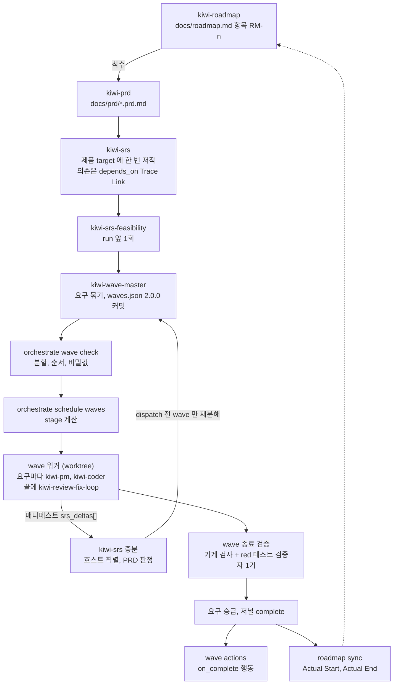

# 5.3.0 wave-master 고도화와 기능 로드맵: 후속 연구 다섯 편 종합

> **이 문서는 미검증 작업 노트다.** 확정된 사실은 요구(`docs/spec/`)와 그 테스트에 있다.
> 여기의 수치·판단·계획은 검토를 거치지 않았고 틀릴 수 있다. 이 문서를 근거로 구현하지 말고,
> 요구로 승격된 뒤 그 요구를 근거로 구현한다. — `FR-FLOW-137`

작성일은 2026-11-04 이다. 다섯 연구(A~E)는 모두 저장소를 읽기만 하고 썼고, 그때 작업 트리에는 다른 세션의 5.2.0 미커밋 변경이 있었다(HEAD `3fd6476`). 이 문서는 다섯 연구를 합친 것이며 새 측정을 하지 않았다. 수치마다 `(연구, 측정)` 또는 `(연구, 추정)` 을 붙였다. 연구가 스스로 [추측]·[추정] 으로 표시한 판단은 `추정` 으로 옮겼다. 파일 좌표(`파일:줄`)는 그 시점 작업 트리 기준이다.

---

## 0. 요약

**결론.** 사용자와 합의한 순서 `kiwi-roadmap` → `kiwi-prd` → `kiwi-srs`(제품 target 에 한 번) → `kiwi-wave-master`(요구 묶기) → wave 마다 pm·coder·review → 증분 SRS → 로드맵 sync 는 지금 도구 위에서 대부분 만들 수 있다. `wave-{n}` target 이라는 전제는 거의 전부 스킬 산문에 있고, `orchestrate schedule waves` 는 요구를 작업 공간 전체에서 ID 로 찾는다(A, 코드 확인). 바꿀 것은 네 덩어리다.

1. **분해:** 문서 머리글로 wave 를 나누던 장치를 걷어 내고, 요구 집합을 크기 상한이 있는 결정적 탐욕 병합으로 묶는다(B).
2. **실행과 증분:** wave 안에서 요구를 의존 순서로 하나씩 TDD·커밋하고, 워커가 찾은 새 요구는 `srs_deltas[]` 로 신고해 호스트가 `/kiwi-srs` 증분으로 반영한다. 검증은 기계 검사와 red 테스트를 쓰는 검증자 1기로 옮긴다(A·B·C).
3. **작업 그래프:** 새 파일을 만들지 않고 `waves.json` 을 `schema_version: "2.0.0"` 으로 넓힌다. 진행 상태는 지금 저널 `kiwi/waves.jsonl` 에 두고, 읽기 전용 도구 4개(`wave status`·`show`·`check`·`actions`)로 본다(D).
4. **로드맵:** `docs/roadmap.md` 를 SRS 처럼 구조화된 Markdown 원본으로 두고, 상태와 진행률은 SRS 에서 계산한다. CLI·MCP 짝 6개와 작은 스킬 `kiwi-roadmap` 을 둔다(E).

**가장 중요한 발견.**

- **의존 데이터가 도구가 읽는 형태로 거의 없다.** `depends_on` Trace Link 를 가진 요구는 171/702(24%)이고 5.2.0 은 0/17 이다(B, 측정). 5.2.0 의 의존은 "Depends on B1" 같은 외부 문서 별칭이라 도구가 풀지 못한다. 분해 알고리즘보다 `/kiwi-srs` 가 의존을 Trace Link 로 쓰게 하는 일이 먼저다(B·D).
- **예상 수정 파일은 SRS 필드로 예측할 수 없다.** 충돌을 일으키는 기존 비-테스트 파일 기준으로 본문·AC 경로의 재현율은 0~5%, 본문 식별자 단순 검색은 51~65%(정밀도 16~19%)였다(B, 측정). 파일 예측은 LLM 영향 분석이 하고 도구는 확인만 한다.
- **연결 요소로 묶으면 사실상 직렬이 된다.** 4.1.0 에서 20개 중 19개가 한 wave 에 들어갔다(B, 측정). 크기 상한 4~6 의 탐욕 병합이 세 표본에서 가장 나았지만, 이득은 아직 측정하지 못한 wave 고정 비용 F 에 민감하다(B, 추정 모형).
- **`kiwi-pm` 은 활성 target 밖의 요구를 lifecycle 검사와 승급에서 조용히 건너뛰고, 한 실행에 커밋 하나만 만든다**(A, 스킬 본문 확인). 그래서 "요구마다 TDD 와 커밋" 은 지금 구조로 되지 않는다.
- **검증 계층에 심각도 라벨이 남아 있다**(`verify-loop.md:85`, `verification-gate.ts:14-20`, `parallel-waves.md:81,155,163`, `kiwi-coder` §4.3)(A·C, 확인). 사용자 지시("실제로 문제를 드러내는 테스트로만 결함을 남긴다")와 5.0.0 keep/drop 에 어긋난다.
- **컴팩션 뒤 wave-master 는 Phase 흐름을 잃는다.** 앞 5,000 토큰이 616행 중 83행(§0.G 표 중간)에서 끝난다(A·C, 추정 함수로 측정).

**사용자가 정해야 할 것(자세한 목록은 9절).** 로드맵을 5.3.0 에 둘지 별도 target 으로 나눌지, wave 안 순차 구현을 워커가 요구마다 `kiwi-pm` 을 부르는 방식으로 할지 `kiwi-coder` 안의 요구 루프로 할지, wave 종료 검증자를 2기에서 1기로 줄일지, 심각도 판정 제거를 5.3.0 에 넣을지, kiwi-orchestrator 를 같은 구조로 맞출지가 큰 결정이다.

---

## 1. 사용자 요구 원문

배경 문서(`v530-research-context.md`)의 발언 1~7 을 그대로 옮긴다.

> 1. "다이어트는 취소하고 대신 고도화 방향으로 틉니다. speckiwi 5.3.0 목표로 잡고 이것은 따로 연구를 진행하겠습니다."
> 2. "우선 내가 기대하는 /kiwi-wave-master 는 AC 들을 묶어서 하나의 wave 로 만들고 각각의 wave 는 각 기능들을 순차적으로 구현합니다. wave 는 자신에게 할당된 작업에 대하여 /kiwi-pm ( /kiwi-coder 와 /kiwi-review-fix-loop 등) 를 실행합니다. 그리고 각각의 wave 를 순차적으로 처리할지 또는 병렬로 처리할지 그래프 관계를 정의합니다. 맞나요?"
> 3. "기능 요구사항 분석 -> SRS 기록 -> 웨이브 마스터가 작업 분해. 이 순서로 가는 것이 더 효율적일까요?"
> 4. "소프트웨어 공학적으로 봤을 때 어떻게 작업을 분해하는 것이 좋을까요?"
> 5. "좋습니다. 당신의 의견을 반영하고 후속연구를 진행하여 디테일을 잡습니다."
>
> 6. "그리고, 추가 요구사항입니다. wave 마스터가 설계한 작업 그래프를 json 으로 저장합니다. 각 노드를 나타내는 형식과 엣지로 다음 노드를 가르키도록 합니다. 
> 이것을 mcp 와 cli 도구로 만들어서 json 파일에 직접 접근하지 않고도 빠르고 편하게 작업 상황(wave 진행상황) 을 판단할 수 있도록 합니다. 
> 각 작업 (노드)에는 디스크립션을 붙일 수 있고 github 이슈 번호와 주의사항을 붙일 수 있습니다. 또 반드시 노드에는 AC 번호들을 붙여야 합니다. 그래야 작업이 제대로 완료 되어있는지 추적 가능합니다.  
> 작업에 대한 완료 조건도 기록해야 합니다. 또 작업의 목적에 대해서 간단히 기록해야 합니다. 또 작업이 끝날때마다 무엇을 해야하는지도 기록해야 합니다. (예: 구글 챗으로 작업 완료 메세지를 보낸다) 
> 추후 이것을 이용하여 그래픽 데시보드를 출력할 계획이 있습니다. 서브에이전트로 연구고 파일로 기록하시오."
>
> 7. "다른 요구사항도 있습니다. 기능 로드맵과 마일스톤(큰 작업 단위) 에 대해서 기록하는 스킬과 json 파일 형식, 그리고 예상 시작 일정과 작업 완료 상태등등을 기록하는 구조가 있었으면 합니다. 기능 로드맵을 도구를 통하여 기록하거나 가져올 수 있었으면 합니다. json 보다는 SRS 처럼 구조화된 md 를 사용하면 더 좋겠지만요."

---

## 2. 제안 구조

### 2.1 전체 흐름



### 2.2 산출물 계층

참조는 위에서 아래로만 간다. 아래 계층은 위 계층을 가리키지 않는다(E §1.3 "역방향 링크는 두지 않는다"). 대시보드가 계층을 잇는 키는 target 이름과 `<REQ-ID> AC-<n>` 이다(E §6, D §6).

| 계층 | 파일 | 단위와 ID | 쓰는 주체 | 상태의 원본 | 연구 |
|---|---|---|---|---|---|
| 로드맵 | `docs/roadmap.md` (커밋) | `RM-<n>`, Kind `milestone`·`feature` | `speckiwi roadmap` 도구만 | 계획 날짜·`Lifecycle` 만 적고 나머지는 계산한다 | E |
| target | `docs/spec/00.index.md` Target Map | target 이름 | 기존 target 도구 | Target Map 의 Status | E |
| PRD | `docs/prd/*.prd.md` | `PRD-<n>` | `kiwi-prd` | PRD 판정(FR-FLOW-204·205) | C |
| 요구·AC | `docs/spec/*.srs.md` | `<REQ-ID>`, `AC-<n>` | `kiwi-srs`(MCP) | 요구 Status, AC 체크·만료 | A·B·C |
| 작업 그래프 노드 | `docs/analysis/kiwi-wave-master-{run_id}/waves/waves.json` (커밋) | `wave-<n>`, 노드마다 `acs` 필수 | wave-master(분해·재분해 때) | 담지 않는다 | D |
| 저널 | `kiwi/waves.jsonl` (git 무시, `.gitignore:11-13`) | `run_id` 별 append-only 줄 | 호스트만, `orchestrate journal append` 로 | 노드 진행 상태와 행동 기록 | D |

### 2.3 연구 사이에 엇갈리는 주장

| 주제 | 한쪽 | 다른 쪽 | 근거가 더 강한 쪽 |
|---|---|---|---|
| wave 안 순차 구현 방식 | A: 워커가 요구마다 `kiwi-pm --req-filter <한 요구>` 를 부르면 된다. `--sds` 조각을 순서대로 부르는 패턴이 PW-6 에 이미 있다(`parallel-waves.md:68`, `:134`) | 배경 문서 8번·B 방식 B·C: `kiwi-pm` 한 번 안에서 요구를 순차 처리하고 요구마다 커밋한다. 요구마다 pm 을 띄우는 것보다 쌀 것이라고 추정한다 | 비용은 어느 쪽도 측정하지 않았다. A 는 구현 경로가 이미 있는 패턴이라는 사실이 근거이고, B 의 비용 우위는 추정뿐이다(B §7 이 스스로 미측정이라고 적었다) |
| wave 종료 검증자 수 | A: 엔진(`verify-loop.md`)은 분모를 모르므로 검증자 2기를 그대로 쓰고 분모와 판정만 바꾼다 | C: 기계 검사 + red 테스트를 쓰는 검증자 1기로 바꾸고 `--max` 에서만 2기를 둔다 | C 쪽이다. 저장소 정책(FR-FLOW-180, `CLAUDE.local.md` §2-1)과 사용자 지시에 맞는다. A 는 2기를 유지해야 할 이유를 따로 대지 않았다. 다만 "판정이 red 테스트면 교차반박이 필요 없다" 는 C 의 추정이다 |
| 의존 선언이 없을 때 | B·C: 1.0.0 기본값대로 앞 wave 전부에 의존한다. 의존이 없는 wave 는 `depends_on: []` 을 명시해야 병렬이 된다 | D: 2.0.0 은 암묵 의존을 없애고 `edges` 를 필수 키로 둔다. `[]` 도 명시한 선택이 된다 | D 가 B 의 우려(빠뜨림)를 필수 키로 흡수했다. 그러나 D 가 든 대체 안전 장치 넷 가운데 WG-05 는 의존이 Trace Link 에 있을 때만 동작한다(D 프로토타입에서 `dependency-in-prose-only` 확인). 의존 저작 규칙(9절 8번)이 먼저 정해져야 D 안이 안전하다 |
| wave 크기 하한 | B: 요구 2개. 친화도 있는 이웃이 없으면 혼자 둔다 | C: 요구 3개 이상 또는 kiwi-coder 1시간 이상 | B 쪽이 근거가 조금 더 있다. B 는 세 표본 시뮬레이션(가정한 F)에서 나왔고, C 는 kiwi-coder 평균 21분과 wave 당 회귀 5회에서 추론했다. 둘 다 F 를 측정하기 전의 값이다 |
| 분할 검사의 진입점과 단위 | A: 새 명령 대신 `schedule waves --waves` 에 `--run-requirements` 옵션을 붙여 진입점을 덜 늘린다. 요구 단위다 | C: `orchestrate` 아래 읽기 전용 동사 하나, 요구 단위다. D: `orchestrate wave check` 의 WG-03, AC 단위다 | D 쪽이다. 프로토타입으로 돌려 보았고, AC 단위 분할은 요구 단위 분할을 함의한다. A 의 "진입점을 늘리지 않는다" 는 원칙은 D 가 기존 `wave` 명령 무리 안에 둔 것으로 일부만 지켜진다 |
| 그래프를 누가 만드는가 | A·B: 도구가 요구 집합에서 초안을 계산한다(`orchestrate propose waves`, 이름 미정). 결정성 때문이다 | D: 그래프 편집 명령은 만들지 않고, wave-master 가 분해·재분해 때 파일로 쓰고 커밋한다 | 서로 배타적이지 않다. D 는 "편집 명령" 을 거절했을 뿐 초안 계산을 다루지 않았다. 도구가 묶음·엣지·`files` 를 계산하고 에이전트가 `purpose`·`description` 같은 메타데이터를 채우는 조합이 두 주장을 함께 만족한다(종합 판단) |
| draft 요구의 처리 | A: `schedule waves` 가 `draft` 를 거절하므로(`orchestrate.ts:1087-1088`) run 앞 feasibility 1회가 필수다 | C 위험 1: 뒤쪽 요구는 일부러 `draft` 로 두고 wave 진입 직전 증분으로 `evolving` 으로 올린다. D WG-09 는 draft 를 오류가 아닌 경고로 두어 이 전략을 허용한다 | 둘 다 도구 동작(FR-NODE-216 AC-10)과 맞는다. 거절은 dispatch 시점에 일어나므로 C 전략도 기계가 막아 준다. 어느 쪽을 기본으로 할지는 9절 15번이다 |
| 통합 항목의 출처 | A·C: wave 를 가로지르는 요구 사이 `depends_on` trace 간선을 통합 항목으로 쓴다. A 는 통합 동작을 요구로 쓰게 강제하는 안도 낸다 | D: `from`·`to` 노드에 서로 다른 요구가 있는 그래프 엣지가 그 간선이고, 엣지 `reason` 이 검증자 입력의 설명이 된다 | trace 간선은 기계로 뽑히지만 trace 기록률이 24% 다. 그래프 엣지는 늘 있지만 분해하는 쪽이 선언한 값이다. 두 출처를 함께 쓰는 쪽이 놓침이 적다(종합 판단) |
| B 연구 안의 요약과 표 | B 요약: 상한 4~6 이면 wave 5~16개, ALL 대비 1.13~1.43배, "F≈5~10 이면 요구 4~6개 상한이 세 표본 모두에서 1 보다 크다" | B 표: 3.1.0 상한 4 는 wave 18개다. 5.2.0 상한 6 은 F=10 에서 0.94배다(허브를 빼면 1.31) | 표가 원자료다. 세 표본 모두에서 F=5~10 일 때 1 보다 큰 것은 상한 4(1.13~1.65)뿐이다 |

---

## 3. wave-master 고도화(연구 A·B·C)

### 3.1 바뀌는 것, 사라지는 것, 유지되는 것

| 장치 | 운명 | 내용 | 근거 |
|---|---|---|---|
| 문서 머리글 기반 분해(3~8 하위 목표) | 사라짐 | 분해 대상이 문서 섹션에서 요구 집합으로 바뀐다 | A §2, `wave-decomposition.md:33-36` |
| wave 별 `/kiwi-srs`(PW-1)와 `wave-{n}` target | 바뀜 | 저작은 run 앞에서 제품 target 에 한 번 한다. PW-1 은 wave 종료 증분 저작만 남는다 | A §2 |
| 배정 집합(저작 전후 스냅샷 차집합) | 사라짐 | `waves.json` 의 요구 목록 자체가 배정 집합이 된다. `allocation.ts` 는 `src/` 안에 호출자가 없다 | A §1.2, `allocation.ts:96-106` |
| `srs_authored` 표식, 3단계 재개 | 바뀜 | "워커 / 검증" 두 단계가 된다 | A §2 |
| 설계 기준선, `design_items` 전량 고정 | 사라짐(기준선은 얇아짐) | 설계를 요구로 번역하는 일은 run 앞의 `kiwi-srs` 와 PRD 판정이 맡는다. `existing_modules`·`constraints_path` 는 남는다 | A §2 |
| `integration_items` | 바뀜 | 출처가 wave 를 가로지르는 의존 간선으로 바뀐다(2.3 참조) | A §2, C §2.3 |
| 분해 커버리지 검사 | 바뀜 | "run 범위의 모든 AC 가 정확히 한 노드에" 로 바뀐다(D WG-03) | A §2, C §1.2, D §2.3 |
| out_of_scope 사용자 동의 | 축소 | "이번 run 에서 일부 요구를 뺀다" 한 경우만 남는다 | A §2 |
| 이월(`carried_into`) | 바뀜 | "남은 wave" 를 "아직 dispatch 하지 않은 wave" 로 다시 정의한다 | A §2, C §1.2 |
| 에픽 진입(FR-FLOW-030) | 바뀜 | 에픽 → PRD → SRS → 분해 순서가 되고, 하위 이슈는 PRD 항목의 힌트가 된다 | A §2 |
| wave 종료 상호검증 | 바뀜 | 3.6 절 | A §2, C §2 |
| 위험 옵션 거부, 회귀 기준선 pin, 워크트리·병합·재생·반납(PW-3~PW-12), 테스트 충분성, 승급(PW-16), `--sds` 경로, 재진입 `r{m}`, run 창 리뷰, 최종 검증 | 유지 | 요구 출처와 무관하다. 승급 집합은 착지한 wave 의 요구 목록이다 | A §2 |

고쳐야 할 verified 요구는 FR-FLOW-029/030/044/045/188/195/204, FR-NODE-216/133 이고 FR-FLOW-049 는 implemented 다(A §6, 모두 Stability `evolving`). verified 요구는 하향 → 수정 → Change Notes → 재승격 순서를 밟는다. 새 구조와 부딪치는 계약 테스트는 A §6 표에 약 20건 있고, 가장 강하게 고정된 것은 핵심 규칙 문단을 원문 그대로 고정하는 `test/skills/kiwi-prd.fr-flow-204.test.ts:518-527`, `:591` 이다.

### 3.2 분해 알고리즘(도구가 계산)

입력은 run 요구 집합 R 이다. 요구마다 예상 파일 `files(r)`(LLM 영향 분석이 만들고 도구가 경로를 확인한다), 살아 있는 AC 수 `acs(r)`, R 안을 가리키는 `depends_on` Trace Link `deps(r)`, 의존이 아닌 본문 인용 `soft(r)` 을 받는다(B §2.2).

1. **허브 파일 표시.** R 의 25% 이상(최소 3개) 요구가 건드리는 파일을 허브로 보고 친화도에서 뺀다. 수렴 레지스트리 레시피가 있으면 `files[]` 에서도 뺀다. 표본의 허브는 `src/cli/commands/orchestrate.ts`(4.1.0)와 `src/mcp/server.ts`(5.2.0)였다.
2. **순환 압축.** `deps` 그래프의 강결합 요소(SCC, Tarjan 1972)를 한 단위로 만들어 같은 wave 에 넣는다.
3. **친화도.** `w = 3·(의존 수) + 1·(soft 인용 수) + (공유 비허브 파일 수) + 0.5·(공유 모듈 디렉터리 수)` 로 계산한다. 모듈 디렉터리는 경로 앞 세 마디다. 가중치는 손으로 정한 출발점이다(B, 추정).
4. **탐욕 병합.** `w ≥ θ`(θ=1), 합친 요구 수와 AC 수가 상한 이하, 합쳐도 단위 그래프에 순환이 생기지 않는다는 세 조건을 만족하는 쌍 가운데 정렬 키 `(−w, 합친 요구 수, 합친 요구 ID 를 정렬해 이은 문자열)` 이 가장 작은 쌍을 합친다. 합칠 쌍이 없을 때까지 반복한다.
5. **하한 처리.** 요구가 2개 미만인 단위는 같은 모듈 디렉터리(`w ≥ 0.5`) 이웃에 상한 안에서 합치고, 없으면 혼자 둔다.
6. **정렬과 이름.** 위상 순서로 정렬하고 같은 층은 가장 작은 요구 ID 순으로 `wave-1…wave-N` 을 붙인다. wave 의존은 요구 의존을 wave 단위로 올린 것이다.
7. **stage 계산.** 기존 `orchestrate schedule waves`(`lane-plan.ts` `computeLanePlan`)가 의존 층 → 쓰기 집합 first-fit → stage 당 lane 4개 상한으로 나눈다.

**동점 규칙을 명세에 넣는다.** 동점 키를 "가장 작은 ID" 에서 "합친 ID 전체 문자열" 로 바꾸기만 했는데 3.1.0 결과가 1.34배에서 1.26배로 바뀌었다(B, 측정). 결정성은 정렬 키가 전순서일 때만 성립하므로, `lane-plan.ts` 처럼 로케일과 무관한 `compareStrings` 를 쓴다. 입력을 50회 섞어 세 target 에 돌린 결과 불일치는 0이었다(B, 측정).

**탈락한 후보.** 연결 요소는 공유가 사슬로 이어져 거대 요소 하나를 만든다(4.1.0 19/20, 3.1.0 23/31, 5.2.0 11/17, B 측정). DSM 클러스터링(Thebeau 2001 계열)은 무작위 선택에 기대므로 "같은 입력에 같은 결과" 를 만족하지 못한다(B, 2차 문헌 확인, 원문은 열람 실패).

**wave 안 순서.** 위상 순서를 따르고, 동점은 ① 그 wave 안에서 그 요구에 기대는 요구 수가 많은 것, ② `IR-` 요구, ③ ID 순으로 푼다. Risk 필드는 62%(432/702)가 medium 이고 5.2.0 은 전부 medium 이라 순서를 가르지 못한다(B, 측정). 걷는 뼈대(walking skeleton)는 도구가 계산할 수 없으므로 분해 단계가 고른 요구를 첫 항목으로 고정하는 선택 입력으로 둔다(B, 추정).

**순환.** 상한 안의 순환 묶음은 한 wave 에 넣는다. 상한을 넘는 순환은 도구가 거부하고, 인터페이스를 앞 wave 로 떼어 내는 SRS 변경을 LLM 이 제안하며 사용자나 위원회가 정한다. 표본 세 개에는 요구 순환이 없어서 이 규칙은 데이터로 확인되지 않았다(B §4.1).

**LLM 과 도구의 경계.** 의존을 Trace Link 로 쓰는 일, 요구별 예상 파일, soft 인용이 실제 의존인지, 순환을 끊는 방법, wave 이름과 설명은 LLM 이 맡는다. 경로 확인(`files-not-grounded`), 허브 판정, SCC·친화도·병합·상한·순환 검사·층·stage, 구현 뒤 쓰기 집합 밖 변경 감지(PW-8 `out_of_lease_paths`)는 도구가 맡는다(B §2.3).

**크기 상한·하한 후보(실측 전 기본값, B §4.4).**

| 항목 | 후보 | 근거 |
|---|---|---|
| wave 당 요구 수 상한 | 5(시험 범위 4~6) | 표본마다 4 와 6 이 엇갈려 최선이었고 8 은 세 표본 모두 최선보다 나빴다(B, 추정 모형) |
| wave 당 살아 있는 AC 상한 | 25(20~30) | 위와 같다. 요구 하나의 AC 는 최대 16개라 혼자 상한을 넘는 요구는 없다(B, 측정: 중앙값 5, 90분위 8, 최대 16) |
| wave 당 예상 비-테스트 파일 상한 | 25 | 상한 4~6 결과의 최대 파일 수 16~25(B, 측정) |
| 리뷰 범위 상한 | 측정 후 결정 | `kiwi-review-fix-loop` 에는 줄·파일 수 상한이 없다. 사람 리뷰 기준 200~400 LOC(SmartBear)를 LLM 에 옮길 근거는 없다(B) |
| 하한 | 요구 2개(B) 또는 3개(C) | 2.3 절의 엇갈림 |

### 3.3 실험 결과(B, 비용 모형은 추정)

비용 모형은 "wave 비용 = 고정 비용 F + AC 수, stage 비용 = stage 마다 가장 비싼 wave 의 합" 이고 F=10(AC 10개 분량)을 기본으로 했다. F 는 측정하지 못했다(`kiwi/pipeline.jsonl` 41건에 시간 필드가 없다). 파일 귀속은 4.1.0 이 한 커밋 안의 ID 인용으로, 3.1.0 이 커밋 메시지 인용으로 근사했다. 5.2.0 은 진행 중 작업 트리와 제목으로 판단한 값이 섞여 있다(B §7).

| target(요구/AC) | 방법 | wave | stage | 최대 병렬 | 최대 AC | ALL 대비 배율(F=10) |
|---|---|---|---|---|---|---|
| 4.1.0 (20/142) | 요구 1개 = wave 1개 | 20 | 9 | 4 | 11 | 0.89 |
| | 하나의 wave(ALL) | 1 | 1 | 1 | 142 | 1.00 |
| | 연결 요소 | 2 | 1 | 2 | 138 | 1.03 |
| | 탐욕 상한 4/20AC | 10 | 5 | 4 | 19 | 1.13 |
| | **탐욕 상한 6/30AC** | 7 | 3 | 4 | 29 | **1.36** |
| | 탐욕 상한 8/40AC | 5 | 3 | 2 | 37 | 1.15 |
| 3.1.0 (31/221) | 요구 1개 = wave 1개 | 31 | 10 | 4 | 12 | 1.22 |
| | 하나의 wave(ALL) | 1 | 1 | 1 | 221 | 1.00 |
| | 연결 요소 | 8 | 2 | 4 | 176 | 1.11 |
| | **탐욕 상한 4/20AC** | 18 | 6 | 4 | 20 | **1.34** |
| | 탐욕 상한 6/30AC | 15 | 5 | 4 | 30 | 1.26 |
| | 탐욕 상한 8/40AC | 14 | 4 | 4 | 39 | 1.24 |
| 5.2.0 (17/66) | 요구 1개 = wave 1개 | 17 | 6 | 4 | 7 | 0.86 |
| | 하나의 wave(ALL) | 1 | 1 | 1 | 66 | 1.00 |
| | 연결 요소 | 5 | 2 | 4 | 40 | 1.19 |
| | **탐욕 상한 4/20AC** | 5 | 2 | 4 | 20 | **1.43** |
| | 탐욕 상한 6/30AC | 4 | 3 | 2 | 27 | 0.94 |
| | 탐욕 상한 8/40AC | 3 | 3 | 1 | 28 | 0.79 |

- 허브를 쓰기 집합에서 빼면 4.1.0 상한 4 는 1.13 → 1.43, 5.2.0 상한 6 은 0.94 → 1.31, 상한 8 은 0.79 → 1.29 가 된다. 허브를 호스트가 병합 뒤에 처리하게 하는 지금 장치(PW-12)가 병렬도에 직접 영향을 준다.
- **F 민감도:** F 가 AC 20개 분량을 넘으면 나눠서 얻는 이득이 거의 사라진다. 요구 1개 = wave 1개는 F=0 에서 1.77~2.46배지만 F=10 에서 0.86~1.22배로 떨어진다. 상한 4 는 F=5~10 에서 세 표본 모두 1.13~1.65배다.
- **5.2.0 상한 4 의 실제 묶음:** 검색(FR-NODE-239 → FR-CLI-001 → FR-MCP-071 → FR-FLOW-207), 진단 축소(FR-NODE-231 → FR-MCP-070), scope 이름 변경(FR-PARSE-043 → FR-NODE-232 → FR-NODE-233 → IR-CLI-110), AC 만료·target 이름 변경(FR-PARSE-044 → FR-NODE-243, IR-CLI-112), PRD + rename_scope MCP(FR-NODE-240 → 241 → 242, IR-MCP-006) 다섯 wave 다. IR-MCP-006 이 공유 파일 때문에 PRD 묶음에 붙어 의존이 없던 PRD 묶음 전체가 stage 2 로 밀린 결함이 보였다. "의존 없이 합치는 두 단위는 같은 층이어야 한다" 는 규칙을 더하면 5.2.0 은 1.43 → 1.21, 3.1.0 은 1.34 → 1.28 로 나빠져서 기본값에 넣지 않고 선택지로만 기록했다(B §3.3).

### 3.4 wave 안의 요구별 TDD 와 커밋

**지금 동작(B §5.1, A §4.3).** `kiwi-pm` 은 "호출 하나 = kiwi-coder 실행 하나" 이고 `--commit-lane-work` 가 있을 때 실행 하나당 커밋 1개를 만든다. `kiwi-coder` 는 요구 집합 전체의 테스트를 먼저 쓰고(Phase 1) 전체를 한꺼번에 구현한다(Phase 2). 그래서 테스트를 먼저 썼다는 증거는 git 순서가 아니라 매니페스트 `red_evidence[]` 에만 남는다(`parallel-waves.md:144`). Task 단위 순차 실행은 4.0.0 에서 지웠다(FR-FLOW-113).

| | 방식 A: 워커가 요구마다 `/kiwi-pm` 을 부른다 | 방식 B: `kiwi-coder` 안에서 요구를 하나씩 돈다 |
|---|---|---|
| 바꿀 곳 | 워커 절차(PW-6)만 바꾼다. SDS 조각 순차 호출 패턴을 요구에 적용한다 | `kiwi-coder` Phase 흐름, `kiwi-pm` 커밋 규칙, 상태 스키마를 바꾼다 |
| 요구마다 커밋 | 실행 하나 = 커밋 하나라서 저절로 생긴다 | 새 규칙이 필요하다 |
| 요구마다 고정 비용 | pm 부팅·Stability 확인, coder 생성, 회귀 기준선 캡처와 마지막 전체 회귀(전체 스위트 2회), MCP 일괄 처리, 보고서가 요구 수만큼 든다 | 요구마다 그 요구의 테스트만 돌고 전체 스위트는 실행당 2회다 |
| 컨텍스트 | 요구마다 새로 시작한다 | 한 세션에 쌓이므로 요구별 커밋과 재개 커서가 있어야 컴팩션 뒤 재개된다 |
| 판단 | 지금 바로 가능하고 비용은 요구 수에 비례해 늘어난다(B, 추정) | 더 쌀 것으로 본다(B, 추정, 미측정) |

방식 B 를 택하면 바꿀 것(B §5.3)은 다음과 같다. 노드의 `acs` 첫 등장 순서(D) 또는 요구 목록 순서(B)를 구현 순서로 정의하고 도구가 위상 순서인지 확인한다. `kiwi-pm` 은 `run_id` 를 정렬한 REQ ID 로 만드므로 순서가 거기서 사라지지 않게 한다. `kiwi-coder` 는 Phase 0 을 한 번 하고 요구마다 테스트 작성 → red 확인 → 구현 → green → 체크포인트 커밋을 반복하며, 까칠 리뷰와 Phase 3 은 끝에 한 번 한다(B, 추정). 커밋 pathspec 은 그 요구 단계의 경로만이고 trailer 에 `Orch-*` 좌표와 요구 ID 를 싣는다. 요구당 커밋 2개(테스트 → 구현)를 두면 테스트 선행이 git 순서로 드러나 PW-6 의 "매니페스트에만 남는다" 한계가 풀리지만 커밋 수가 두 배가 된다. 재개 커서의 진실은 요구 ID trailer 커밋이고, 요구 k 가 실패하면 wave 를 멈추고 k 에 기대는 뒤 요구는 보류한다. 착지한 요구만 승급할 수 있다. 영향 테스트를 고르는 규칙은 지금 정의되어 있지 않아 새로 정해야 한다. 4.0.0 이 지운 손으로 쓴 Task 집합을 되살리지 않고, 순서는 SRS 의 `depends_on` 링크에서 도구가 계산한다.

### 3.5 증분 SRS 와 재분해 규칙(연구 C)

**다시 정의할 세 가지(C §1.2).**

1. "남은 wave" 는 "그 wave 의 `phase="worker"` 줄이 없는 wave" 로 바꾸고 `orchestrate wave status` 로 기계 판정한다.
2. 배정 집합은 분해가 적은 요구(2.0.0 에서는 노드의 `acs`)가 원본이고, 분할 검사가 이를 지킨다.
3. 이월 residual 은 저작 입력이 아니라 요구 ID 로 받는다. residual → `/kiwi-srs` 증분 → 받은 ID 를 받는 wave 에 추가하는 순서다. 요구 목록과 `acs` 는 선언 digest 밖이라(FR-NODE-216 AC-7, `wave-declaration.ts:167-170`) 추가해도 `lane-plan-drift` 가 나지 않는다.

**워커의 신고 통로.** 지금 매니페스트에는 곧바로 중단(`lane-design-refuted`)이 되는 `design_refuted[]` 뿐이다. C 는 멈추지 않는 `srs_deltas[]`(`kind`: `new-requirement`·`ac-change`·`residual`, `about`, `prd_item`, `evidence{test_id, failure}`, `files`, `summary`)를 제안한다. `evidence` 는 red 테스트나 명령 출력이어야 하고, 없으면 호스트가 받지 않는다. 워커는 지금처럼 SRS 를 쓰지 않는다.

**호스트 처리 순서(PW-10 재생 뒤, PW-13 검증 전).** 델타를 `{artifact_root}waves/stage-{s}/srs-deltas.md` 하나로 모으고, `/kiwi-srs REQ_PATH=<델타> PRD_PATH=<run PRD> TARGET=<제품 target>` 을 호스트에서 직렬로 한 번 부른다. PRD 판정이 범위를 지킨다. PRD 항목 인용이나 `fills:` 가 없는 확장은 `prd-residual-user-decision` 으로 멈추고, 이 중단은 `--auto`·`--drive` 에서도 닫혀 있다(FR-FLOW-205 AC-5·AC-7).

| 델타 종류 | 대상 | 처리 |
|---|---|---|
| 새 요구 | | 아래 R1~R5 로 wave 에 배정한다 |
| AC 변경 | 현재 wave 의 verified 아닌 요구 | AC 를 고치고 현재 wave 재진입 `r{m}` 범위에 넣는다 |
| AC 변경 | 완료된 wave 의 verified 요구 | 그 요구를 고치지 않는다. 뒤 wave 에 후속 요구를 만들고 옛 AC 를 FR-NODE-243 으로 만료하면서 후속 ID 를 적는다. 동작 이동이므로 FR-PARSE-044 AC-5 의 금지에 해당하지 않는다 |
| AC 변경 | 완료된 wave 의 요구이고 옛 동작 자체가 틀림 | `wave-verify-cross-wave-fix-required` 중단을 유지하고, 하향 → 수정 → 재승격은 사용자 결정 뒤에만 한다 |
| residual | | 받는 wave 에 증분 저작으로 받은 ID 를 넣는다 |

**dispatch 전 wave 재분해(C §1.4).** 실행 중이거나 끝난 wave 는 바꾸지 않는다. 새 요구의 예상 파일 집합 F 에 대해 다음 규칙을 쓴다. R1: F 가 dispatch 전 wave 하나와만 겹치면 그 wave 에 넣는다. R2: 둘 이상과 겹치면 가장 뒤의 wave 에 넣고 나머지에서 그 wave 로 의존을 더하며, 순환이 생기면 순환에 든 wave 를 합친다. R3: 완료·실행 중 wave 와만 겹치면 새 wave 를 더한다(run 당 추가 상한 3 을 함께 센다). R4: 어느 wave 와도 겹치지 않으면 의존 없는 새 wave 로 두거나 요구의 의존이 가리키는 wave 에 넣는다. R5: 상한을 넘으면 dispatch 전 wave 일 때만 둘로 나눈다. 바뀐 선언은 새 버전으로 쓰고 `phase="redecompose"` 줄을 남기며, 분할 검사와 `schedule waves` 를 다시 통과해야 한다. 이에 맞춰 wave-master §0.5 를 "확정된 wave 가운데 **dispatch 된** wave 의 순서·범위·의존은 바꾸지 않는다" 로 고친다.

**PRD 항목은 계산값이 된다(C §3).** wave 의 PRD 항목 = ⋃{요구 r 이 인용한 PRD 항목 | r ∈ wave} 이다. "모든 in-scope 항목이 어느 wave 에 있다" 는 PRD 커버리지(FR-NODE-242 AC-2)와 분할 검사에서 따라 나온다. 다만 `kiwi-srs` 가 쓰는 인용 형식(`AC-3 ← PRD-4`, `kiwi-srs/SKILL.md:23`)과 FR-NODE-242 AC-1 이 다루는 형식(`docs/prd/<file>.prd.md#PRD-<n>`)이 달라, 5.2.0 구현이 짧은 형식을 세지 않으면 이 계산이 비어 버린다. FR-FLOW-204 AC-9(verified)는 만료 + 후속 요구로 개정한다.

### 3.6 검증의 재배치

**기계 검사로 대체할 수 있는 것(C §2.2).**

| 지금 | 대체 기계 검사 | 상태 |
|---|---|---|
| 배정 집합과 `unallocated-req-id` | 분할 검사(D WG-03) | 없음 |
| 분해 커버리지(`design_items` 전량 배정) | 분할 검사 + `speckiwi prd coverage --target`(FR-NODE-242 AC-2) | 5.2.0 구현 중 |
| AC 마다 증거 포인터 | `coverage --tests` / `check_test_sufficiency`(PW-14, FR-FLOW-186) | 있음 |
| 인용 테스트가 돌고 green 인가 | `verification_cmd` 결과, `kiwi-coder` §5.1(j) | 있음 |
| test-first 증거 | 매니페스트 `red_evidence[]` 비어 있지 않음(PW-8). AC 마다 red 서명으로 강화할 수 있다 | 일부 있음 |
| 보존 계층(파일 삭제·이동, public 심볼, 테스트 파일, 단언 약화) | `kiwi-coder` §0.20·§0.G6 와 같은 diff 규칙을 스크립트로 옮긴다 | 규칙은 있고 검증자가 실행한다 |
| 회귀 신규 실패 0, 스트릭·상한 | `orchestrate_round_record` | 있음 |
| SRS 무결성 | `validate_spec`, `links check`, `sync-index` | 있음 |
| 쓰기 집합 밖 편집, 워커의 SRS 접촉 | PW-8 | 있음 |

**여전히 LLM 이 필요한 것은 셋이다.** 인용한 테스트가 정말 그 AC 를 검증하는지, wave 사이 통합 동작, 코드가 PRD exclusion 을 어기지 않는지다(C §2.3).

**red 테스트를 쓰는 검증자 1기(C 제안).** 매 라운드 새로 띄운 검증자 1기에 사실만 준다(PRD 경로와 wave 의 PRD 항목, 요구 ID 와 AC, wave diff 창, 통합 간선 목록, exclusion 항목). 검증자는 문제를 드러낸다고 보는 테스트를 임시 파일에 쓰고, 테스트마다 `<REQ-ID> AC-<n>`, 통합 간선, `PRD-<n>` 중 하나를 인용한다. 호스트가 돌려 red 인 테스트만 kept finding 이 된다. green 이거나 아무것도 인용하지 않은 테스트는 drop 한다. kept 테스트는 코드 결함이면 범위를 지정한 `kiwi-review-fix-loop` 로, 요구 갭이면 3.5 의 델타 경로로 가고, 그 wave 의 회귀 테스트로 커밋된다. 새 검증자가 red 를 하나도 쓰지 못하고 수정도 없던 라운드에서만 통과하며, 상한 소진은 통과가 아니다. `--max` 에서는 stance 가 다른 2기가 각자 쓰고 kept 를 합집합으로 모은다.

**위험.** v2.4.3 상호검증은 6라운드 동안 매번 새 종류의 결함을 찾았다(메모리 기록, 자연어 계약 테스트 뮤테이션 27건). C 는 그 결함을 잡은 수단이 뮤테이션과 적대적 실행이었으므로 테스트를 쓰는 검증자가 같은 종류의 수단이라고 본다. 이 판단은 실험으로 확인하지 않았다(C 위험 6).

**지금 남아 있는 심각도 판정(C §2.4, A §4.3 (f), 확인한 사실).**

- `verify-loop.md:85` 의 Normal PASS = `CRITICAL=0` + `HIGH=0` + 검증자 1 `ALL_MATCH`, `:86` 의 `--max` "`MEDIUM=0` 2라운드 연속".
- `verification-gate.ts:14-20`, `:100-101`: `round record` 가 행마다 심각도를 받고, 저널 `axis_b.open.{critical,high,…}`(`waves-event.md:230`)까지 걸린다.
- `parallel-waves.md:81,155,163`: 워커 리뷰 `review_outcome` 의 "잔여 CRITICAL·HIGH". 리뷰 루프는 5.0.0 부터 kept finding 0 으로 끝나므로 이 값을 더 이상 만들지 않을 수 있다(실제 값은 확인하지 못했다).
- `kiwi-coder` §4.2 심각도 정의, §4.3 "CRITICAL=0 + HIGH=0 까지", §5.1(g) 심각도별 카운터.
- `kiwi-wave-master/SKILL.md:61,64` 의 `wave-verify-residual-critical`·`final-verify-residual-critical`.

wave 검증을 다시 짜면서 이 다섯 곳을 함께 keep/drop 으로 옮기지 않으면 한 run 안에서 두 판정 방식이 섞인다(C).

**비용(C §4, 호출 수로 센 추정).** wave 하나의 최선 경로 고정 LLM 호출은 지금 약 16회, 새 구조 약 7회다. 줄어드는 몫의 대부분은 wave 마다 반복하던 SRS 저작(6회)과 검증자 2기 교차(4회 → 1회)다. wave 수 N 에 대해 지금 약 16N + 7, 새 구조 약 7N + 10 이고 N=3 이면 55 대 31, N=6 이면 103 대 52 다. 실측 시간은 kiwi-coder 한 번 평균 약 21분(2026-07-10, 23 task 8시간 5분, 2.3.0.1 시절)과 리뷰 루프 한 번(42 파일, 3라운드) 1시간 46분뿐이다(C, 측정). wave 하나에서 전체 회귀 스위트가 약 5번 돌고 이 횟수는 새 구조에서도 남는다(C, 스킬 본문으로 센 값). 스위트 한 번의 시간은 기록에서 찾지 못했다.

### 3.7 kiwi-orchestrator 와의 역할 분담(연구 A §3)

- 두 스킬은 공용 계약(`wave-decomposition.md`, `parallel-waves.md`)을 함께 쓴다. R-ORCH 의 3.b(`/kiwi-srs TARGET=wave-{n}`, `kiwi-orchestrator/SKILL.md:296`, `:524-529`), 3.c′, 3.n 이 모두 "wave 마다 저작" 을 전제한다. 공용 계약을 바꾸면 R-ORCH 도 같이 바뀐다.
- orchestrator 에는 "SRS 먼저" 경로가 없다. intake 소스는 얇은 의도·문서·이슈 셋으로 닫혀 있고(`:600`), 기존 요구로 구현까지 가는 경로는 wave 가 없는 `kiwi-pipeline` §2.5 뿐이다(`kiwi-pipeline/SKILL.md:151`).
- 선택지는 셋이다. (a) 공용 계약에 두 모드(wave 마다 저작 / 기존 요구 묶기)를 둔다. 이는 "한 개념에 진입점 하나" 와 부딪친다. (b) R-ORCH 도 "설계 동결 → SRS 한 번 저작 → 요구 묶기" 로 맞춘다. loop D 는 남고 loop W 와 wave 마다의 3.b 는 사라진다. A 는 이것을 좋은 선택으로 본다(추정). (c) orchestrator 는 intake·라우팅·설계·SRS 저작까지, wave-master 는 요구 집합을 받아 실행만 하도록 나눈다. 중첩 run 금지 근거 4(두 번째 `run_id`·`engine`)가 남으므로 "중첩 호출이 아니라 run 인계" 같은 장치가 따로 필요하다(A, 추정).
- 두 스킬이 겹치는 부분: Preflight 대부분, 회귀 pin, PW-1~PW-17, 검증 엔진, 테스트 충분성, run 창 리뷰, 최종 검증, 워크트리 절차(§11 2,058 토큰 대 §18 2,023 토큰으로 거의 같은 글)다(A, 측정).

### 3.8 컴팩션 대응: 앞 5,000 토큰

| 스킬 | 추정 전체 토큰 | 5,000 토큰이 끝나는 줄 | 출처 |
|---|---|---|---|
| kiwi-wave-master | 27,312 | 83 / 616(§0.G 표 중간) | A, C |
| kiwi-orchestrator | 58,573 | 75 / 1,347 | A |
| kiwi-pm | 30,376 | 98 / 1,121 | A, C |
| kiwi-coder | 28,061 | 48 / 859 | A, C |
| kiwi-review-fix-loop | 25.1k | 59 / 796 | C |
| kiwi-srs | 24.3k | 63 / 877 | C |
| kiwi-prd | 4,707 | 거의 전체 | E |

추정 함수는 `test/skills/skill-token-estimate.ts`(비ASCII 1자 = 1토큰, ASCII 3자 = 1토큰)다. 배경 문서의 orchestrator 57k 는 같은 함수로 다시 잰 A 의 값이 58,573 이다.

- 구조를 바꿔도 wave-master 는 약 23,800 토큰(약 15% 감소)으로 20k 아래로 내려가지 않는다(A, 절 크기로 낸 추정). 크기를 줄이는 것보다 Phase 흐름과 핵심 규칙을 앞으로 옮기는 일이 급하다.
- C 는 맨 앞에 둘 규칙 열 줄을 제안한다(약 1,500~2,000 토큰, 추정). 순서(PRD → 제품 target SRS 한 번 → 요구 분해 → 워커), 분해 단위와 분할, 의존과 병렬(stage 는 도구로 계산), 쓰기 소유(워커는 SRS·저널에 쓰지 않고 `srs_deltas[]` 로 신고), 범위(PRD 인용이나 `fills:` 없는 확장은 사용자 결정), 불변(dispatch 된 wave 불변, verified 동작 이동은 후속 요구 + AC 만료), 검증(심각도 없음, red 만 남음), 승급, 재개(`orchestrate wave status`), 열리지 않는 중단 id 목록이다. D 는 여기에 "진행 상황은 `speckiwi orchestrate wave status --json` 하나로 읽고 저널·그래프 파일을 손으로 열지 않는다" 한 줄을 더한다.
- §0.G 중단 조건 표(약 2,702 토큰)는 뒤로 보내고 id 목록만 앞에 둔다. 이 배치가 앞 5,000 토큰을 재는 테스트(FR-FLOW-204 AC-8/9, FR-FLOW-205 AC-7)와 충돌하지 않는지 확인해야 한다(A).
- `kiwi-pm` 맨 앞에도 "요구마다 TDD 와 커밋" 규칙을 두어야 한다. 워커 안의 kiwi-pm 도 컴팩션을 겪을 수 있기 때문이다(C, 추정).

---

## 4. 작업 그래프(연구 D)

### 4.1 파일 배치

| 안 | 내용 | 판정 |
|---|---|---|
| A. `waves.json` 을 2.0.0 으로 넓힌다 | 같은 경로(`{artifact_root}waves/waves.json`, wave-master 의 `artifact_root` 는 `docs/analysis/kiwi-wave-master-{run_id}/`), 같은 `--waves` 옵션을 쓴다. 파서는 1.0.0 과 2.0.0 을 모두 읽어 같은 `WaveDeclaration` 으로 정규화하므로 `computeLanePlan`·`waveReadiness`·digest 는 그대로다 | **채택** |
| B. 새 `work-graph.json` | wave id·의존·요구가 두 파일에 생겨 어긋나도 아무도 모른다 | 기각 |
| C. 그래프에서 `waves.json` 을 생성 | 생성물이 커밋되면 B 와 같은 문제가 남는다 | 기각 |

**정적 설계와 동적 상태를 나눈다.** 그래프 파일은 커밋되고 lock 의 `declaration_digests` 로 고정되는 입력이다. 상태를 파일에 쓰면 상태가 바뀔 때마다 커밋하거나 digest 제외 규칙을 하나 더 두어야 한다. 저널은 호스트만 도구로 쓰는 append-only 기록이라 `ts` 이력에서 시작·완료 시각과 단계별 소요 시간이 새 필드 없이 나오고, 여러 lane 이 동시에 끝나도 덮어쓰지 않는다. 지금 코드가 이미 이렇게 나뉘어 있다(`wave-declaration.ts:5-6`, `:184-200`). 비용은 저널이 git 이 무시하는 파일이라 다른 기계에는 진행 기록이 없다는 점이다(D §1.3).

### 4.2 스키마 핵심 필드

스키마 초안은 JSON Schema 2020-12 로 썼고, 스키마로 표현할 수 없는 규칙은 `x-tool-checks` 에 WG-01~09 로 적었다(10절 경로).

**사용자 요구 6번과 필드의 대응.**

| 사용자 원문 | 필드 | 타입과 제약 | 필수 |
|---|---|---|---|
| "작업 그래프를 json 으로 저장" | 문서 전체(`schema_version: "2.0.0"`) | `run_id`, `engine`, `title`, `scope`(`{target}` 또는 `{requirements[]}` 중 정확히 하나), `prd`, `defaults`, `nodes`, `edges` | `run_id`·`title`·`scope`·`nodes`·`edges` 예 |
| "각 노드를 나타내는 형식" | `nodes[]` | 노드 id `wave` = `^wave-[1-9][0-9]*$`, 지운 번호는 다시 쓰지 않는다 | 예 |
| "엣지로 다음 노드를 가르키도록" | `edges[{from, to, reason?}]` | `from` 이 끝나야 `to` 를 시작한다. 암묵 의존이 없다 | 예(`[]` 가능) |
| "디스크립션" | `description` | Markdown, 4,000자 이하. 요약 응답에는 싣지 않는다 | 아니오 |
| "github 이슈 번호" | `github_issues` | 정수 또는 `owner/repo#n`. 도구는 GitHub 에 접속하지 않는다 | 아니오 |
| "주의사항" | `cautions` | 300자 이하 문자열 목록. 워커 dispatch 카드에 그대로 싣는다 | 아니오 |
| "반드시 노드에는 AC 번호들" | `acs` | `<REQ-ID> AC-<n>` 목록, 1개 이상, 중복 없음. 요구 집합은 여기서 계산하고 따로 적지 않는다. 첫 등장 순서가 노드 안의 처리 순서다 | **예** |
| "완료 조건" | `done_when[{id: "DW-<n>", text}]` | AC 를 다시 적지 않는다. `[]` 는 "AC 기계 조건만" 이라는 명시적 선언이다 | 예 |
| "작업의 목적" | `purpose` | 300자 이하 | 예 |
| "작업이 끝날때마다 무엇을" | `on_complete`, 최상위 `defaults.on_complete` | 닫힌 두 종류: `notify{id, channel, message?, blocking?}`, `instruction{id, text, blocking?}` | 아니오 |
| "그래픽 데시보드" | (그래프에는 좌표를 두지 않는다) | 도구 출력 `depth`·`stage`·상태·시각이 대시보드 입력이다 | |
| (요구 밖, D 가 더함) | `title` | 60자 이하. 대시보드 라벨과 요약 응답용 | 예(9절 18번) |
| (기존 FR-NODE-216) | `files`, `sds` | 상대 경로. 병렬 판정·grounding 에 쓴다 | `files` 예 |

예시 발췌(`v530-work-graph.example.json`):

```json
{
  "wave": "wave-4",
  "title": "진단 상한 표면 연결",
  "purpose": "CLI 와 MCP 가 코어의 상한을 기본으로 쓰고, 전체를 원하면 명시적으로 받게 한다.",
  "acs": ["FR-NODE-231 AC-4", "FR-MCP-070 AC-1", "FR-MCP-070 AC-2", "FR-MCP-070 AC-3"],
  "done_when": [],
  "github_issues": ["hancomins/og-server#14"],
  "files": ["src/cli/commands/read.ts", "src/mcp/errors.ts"],
  "on_complete": [
    { "id": "og-team", "kind": "notify", "channel": "og-team" },
    { "id": "issue-done", "kind": "instruction", "text": "github_issues 의 이슈 상태를 완료로 옮기고 완료 커밋을 댓글로 남긴다." }
  ]
}
```

**1.0.0 에서 바뀌는 점.** `waves[]` 는 `nodes[]` 가 되고, 노드마다의 `depends_on[]`(뒤를 가리킴)은 최상위 `edges`(앞이 다음을 가리킴)로 바뀌며, `requirements[]` 는 `acs[]` 에서 계산한다. digest 는 여전히 `{wave, depends_on(엣지에서 계산), files, sds}` 만 덮으므로 메타데이터와 `acs` 를 고쳐도 `lane-plan-drift` 가 나지 않는다. 같은 내용을 1.0.0 과 2.0.0 으로 적으면 digest 가 같다.

**도구 검사(`wave check`).** WG-01 노드 id 중복·엣지 끝점·자기 엣지·순환 금지(`findDependencyCycle` 재사용), WG-02 AC 존재·discarded 아님·만료 아님(만료면 후속 요구 안내), WG-03 분할(`ac-unassigned`·`ac-assigned-twice`·`ac-out-of-scope`), WG-04 한 요구의 AC 가 여러 노드에 나뉘면 경고(`ac-split`), WG-05 요구 Trace `depends_on` 과 노드 순서의 정합, WG-06 모든 문자열의 비밀값 패턴과 action 필드의 `http(s)://` 거절, WG-07 action id 유일·치환 변수 닫힌 목록, WG-08 저널에 나온 wave 가 모두 그래프에 있음, WG-09 draft 요구 경고다.

**프로토타입 결과(D §2.4, 측정).** 저장소 `node_modules` 의 ajv 8.20.0 과 실제 SRS(`speckiwi show`)로 돌렸다. 예시는 통과하고, `acs` 없음·빈 배열·`FR-NODE-216/AC-1` 형식·노드의 `status` 필드·`x` 좌표·1.0.0 모양·`scope` 이중 지정·channel 없는 notify 는 모두 거절되었다. 예시에서 `ac-split`(FR-NODE-231 이 wave-3·wave-4 에 나뉨)과 `dependency-in-prose-only`(FR-NODE-231·FR-MCP-070)가 나왔다. 노드 4개 요약 응답은 1,273 바이트였다.

### 4.3 완료 판정 규칙

AC 하나는 다음 넷이 모두 참일 때 끝난 것이다(D §5.1). ① 체크박스가 `[x]` 다(`ac-parser.ts:80`). ② 그 요구의 Verification Evidence 에 그 AC 를 덮는 행이 있다(`Covers` 가 `all` 이거나 `AC-<n>` 토큰을 포함한다). ③ 인용 테스트가 있다(`checkTestSufficiency` 의 `cited`). ④ 만료되지 않았다. `AC-1..AC-11` 같은 범위 표기는 지금 토큰 두 개로만 읽히므로 금지하거나 해석 규칙을 정해야 한다.

노드 상태는 도구가 계산하고 파일에 쓰지 않는다(D §5.2).

| state | 조건 |
|---|---|
| `done` | 저널 최신이 `complete` 이고 모든 AC 가 끝났고 `done_when` 이 모두 확인됨 |
| `unverified` | 저널은 `complete` 인데 위 조건 중 하나가 거짓이다. "제대로 완료됐는가" 를 드러내는 상태다 |
| `running` | 저널 최신이 `in_progress`(`phase` 함께 냄) |
| `failed` | 저널 최신이 `failed` |
| `blocked` | 조상 노드 중 `failed` 가 있다 |
| `ready` | 시작 전이고 앞 노드가 모두 `complete` 다(`waveReadiness` 와 같은 술어) |
| `waiting` | 시작 전이고 앞 노드가 아직 끝나지 않았다 |

`done_when` 확인은 그 노드의 `complete` 줄에 새 선택 필드 `done_when_confirmed: ["DW-1"]` 로 싣는다. 지금은 승급(PW-16)이 `complete` 줄보다 먼저이므로 정상 run 에서는 `complete` 시점에 AC 가 이미 체크돼 있어야 하고, `unverified` 는 그 순서를 어긴 run 을 드러낸다.

### 4.4 끝날 때 할 일: 실행 모델, 비밀값, 멱등

**실행 모델.** 자유 문장(에이전트가 읽고 수행)은 수행 여부와 멱등을 기계로 알 수 없다. 도구가 셸·HTTP 를 실행하면 커밋된 파일의 명령을 호스트 권한으로 실행하게 되고, speckiwi 는 지금 네트워크를 쓰지 않는다(`src/` 에서 `fetch(`·`node:https` 0건, D 확인). D 는 세 번째 모델을 채택한다. 닫힌 종류의 선언형 행동을 적고, 도구는 언제 해야 하는지와 보낼 문장과 멱등 키만 계산하며, 실행은 호스트 에이전트가 하고 저널에 intent/result 짝으로 기록한다.

**실행 순서(호스트만).** ① 노드가 `done` 이 된다(`unverified` 면 행동은 `held-unverified` 로 남아 완료를 거짓으로 알리지 않는다). ② `speckiwi orchestrate wave actions --json` 으로 due 행동과 키·문장·채널 별칭·intent/result 견본을 받는다. ③ `journal append` 로 intent 줄을 쓴다(verb `node-complete-action`, 필드 `wave`·`action_id`·`completion_ref`·`attempt`). ④ 실행한다. notify 면 에이전트가 별칭을 주소로 바꿔 보낸다. ⑤ result 줄(`sent`·`failed`·`waived`, 비밀값을 지운 `error`)을 쓴다. 워커는 저널에 쓰지 않으므로 하지 않는다. 새 verb 는 닫힌 verb enum(`journal-schema.ts:79-126`)과 orchestrator 본문의 `§V.node-complete-action` 절, `waves-event.md`·`run-ledger.md` verb 표와 parity 테스트 갱신이 함께 든다. 복구 등급은 `externally-visible` 이다.

**비밀값.** 그래프에는 채널 별칭(`^[a-z][a-z0-9-]{0,39}$`)만 적는다. 별칭을 주소로 바꾸는 표는 저장소 밖(사용자 전역 지침, `~/.kiwi/channels.json`, 환경 변수 후보)에 두고 도구는 읽지 않는다. 비밀값 패턴은 `src/core/mutation/synthesis.ts:42-66` 에서 공용 모듈로 옮겨 하나만 둔다. 프로토타입에서 형식만 같은 가짜 Google Chat 웹훅을 `message` 에 넣으면 `secret-in-graph` 와 `url-in-action` 이 둘 다 걸렸다. 그러나 `key=` 만 있는 URL 은 지금 패턴(`api[_-]?key`)이 `description` 에서 놓친다(D, 측정).

**멱등.** 키는 `{run_id}:{wave}:{action_id}:L{그 노드의 최신 complete 줄 번호}` 다. 같은 키의 마지막 줄이 `sent`·`waived` 면 due 가 아니고, 짝 없는 intent 면 `interrupted` 로 보고 자동으로 다시 보내지 않는다(at-most-once). 재진입으로 다시 `complete` 되면 키가 새로 생겨 다시 due 가 된다. 프로토타입에서 세 경우를 모두 확인했다. Google Chat API `spaces.messages.create` 의 `requestId` 가 서버 쪽 중복 제거를 한다고 문서에 있지만, 웹훅 URL 에서도 통하는지는 실험하지 않았다(D, 추정).

**실패.** `failed` 는 노드 완료를 되돌리지 않고 자동 재시도도 없다. `blocking: false`(기본)면 run 완료를 막지 않고 최종 보고와 `summary.actions.failed` 에 남는다. 알림 실패로 무인 실행이 멈추는 것이 더 나쁘다고 본 기본값이고 사용자 확인이 필요하다(D, 추정).

### 4.5 CLI·MCP 명령

MCP `orchestrate_*` 도구는 CLI 바인딩 표 하나(`orchestrate.ts:261-330`, `read-tools.ts:177-187`)에서 생성되므로 CLI 명령을 더하면 MCP 도 생긴다.

| CLI | MCP | 종류 | 하는 일 |
|---|---|---|---|
| `orchestrate wave status [--waves <f>] [--run-id] [--engine]` | `orchestrate_wave_status`(있음, 넓힘) | 읽기 | 상태별 노드 수, AC 진행, 행동 수, `ready`·`running`·`attention`, 노드마다 한 줄. 인자 없이 부르면 run 을 고르고 저널 첫 줄의 `graph{path,digest}` 로 그래프를 찾는다 |
| `orchestrate wave show (--wave <id> \| --ac "<REQ> AC-n" \| --req <id>) [--full]` | `orchestrate_wave_show` | 읽기 | 노드 하나의 정적 필드, 계산한 요구·PRD 항목, AC 행별 판정, `done_when`, 행동, 시각, 앞뒤 노드 |
| `orchestrate wave check --waves <f> [--run-id] [--all-diagnostics]` | `orchestrate_wave_check` | 읽기 | WG-01~09 와 lock 을 쓰지 않는 stage 미리보기 |
| `orchestrate wave actions [--waves <f>] [--run-id]` | `orchestrate_wave_actions` | 읽기 | due·interrupted·failed 행동, 키, 문장, intent/result 견본 |

- **만들지 않는 것:** 노드 상태 갱신 명령(쓰기는 `journal append` 하나로 둔다), AC 추적 전용 명령(`checkTestSufficiency`·summary 증거 판정을 다시 쓴다), 그래프 편집 명령.
- **응답 크기:** `status` 는 노드마다 작은 고정 필드만 내고 `description`·`cautions`·AC 행을 싣지 않는다. `show` 는 AC 행에 인용 수와 첫 인용만, 저널 이력은 최근 20줄까지 싣고 잘랐으면 `{total, returned, limit}` 을 붙인다. `check` 진단은 기본 50개다(FR-NODE-231·FR-MCP-070 과 같은 모양).
- **속도(D, 이 기계에서 각 1회 측정):** `speckiwi show` 1.06초, `coverage --tests --ids`(테스트 파일 814개) 2.2~2.45초다. 그래서 `status` 는 SRS 만 읽고 테스트 인용 스캔은 `show`·`check`·`status --with-tests` 에만 두며, `status` 에는 `cited_checked: false` 를 함께 싣는다(D, 추정).
- **호환:** 기존 키(`waves[].status/phase/sds_id/stage/lane/ts`, `run`, `ready`)는 두고 새 키를 더한다. 그래프가 있으면 `waves[]` 가 저널에 나온 wave 가 아니라 그래프의 모든 노드를 내도록 바뀌므로 IR-CLI-104 에 새 AC 가 필요하다.

### 4.6 대시보드 대비와 재개

- 대시보드는 파일이 아니라 `wave status/show --json` 을 읽고, 출력에 `report_version` 을 둔다. 노드 id 는 추가만 하고 다시 쓰지 않는 `wave-<n>` 이다. 진행률은 원값(상태별 노드 수, AC `total/done`, 행동 수)만 내고 백분율·가중치·예상 시간은 표시 쪽이 정한다. 좌표는 그래프에 넣지 않고 레이어 계산용 `depth`·`stage` 만 낸다. 변경 감지는 `graph.digest` 와 저널 줄 수로 한다.
- 저널이 git 밖이라 대시보드는 run 을 돈 기계에서 읽어야 한다. 원격 대시보드는 스냅샷 내보내기를 그때 정한다(D, 추정).
- 컴팩션 뒤 복원은 인자 없는 `wave status` 한 번으로 된다. 다른 기계나 새 clone 에서는 AC 진행률만 커밋된 SRS 로 다시 계산되고 노드 상태는 알 수 없다. 이때 `wave actions` 는 오류로 끝내고 아무것도 due 로 내지 않아야 한다. 그러지 않으면 끝난 노드의 알림이 모두 다시 나간다(D §7).

---

## 5. 로드맵·마일스톤(연구 E)

### 5.1 왜 별도 문서인가

target 에는 날짜가 없고, Target Map 은 순서가 없는 4열 표이며(`index-parser.ts:201-207`), 요구 하나는 target 하나에만 속하므로 여러 target 을 묶거나 target 일부만 가리킬 수 없다(규칙 `:820-823`). SRS 를 쓰기 전의 구상을 둘 곳도, 계획 변경 이력을 구조로 남길 곳도 없다. 5.1.0 은 태그가 있는데도 Target Map 에서 `completed` 로 남아 있어 target 상태가 실제보다 늦게 반영되는 사례도 있다(E §1.2).

| 안 | 결정적 단점 | 판정 |
|---|---|---|
| A. index 확장(Target Map 열 또는 `### Target:` 라벨 추가) | Target Map 을 고치는 쓰기 코드 둘이 4열을 위치로 다시 써서(`set-target-status.ts:34-36`, `set-active-target.ts:37-39`) 상태를 바꿀 때마다 새 열이 지워진다. 같은 이유로 FR-PARSE-018 이 Goal 열을 기각했다. target 은 묶음 단위를 만들 수 없고, 구상 항목이 Target Map 을 오염시킨다 | 기각 |
| B. 별도 로드맵 문서 | 새 파서·도구·스킬이 든다 | **채택** |
| C. 섞기(target 일정은 index, 묶음 일정은 로드맵) | 일정이라는 책임이 두 곳으로 갈린다 | 기각 |

두 번째 요구 원본이 생기지 않도록, 로드맵에는 요구 상태·target 상태·target goal·AC·요구 문장을 쓰지 않는다(`Status` 행은 `ROADMAP-E017`). 역방향 링크를 두지 않고, 일대일 target 항목의 `Purpose` 가 `-` 면 target goal 을 빌려 보여 준다. index 안에 로드맵 절을 넣는 안도 `### Target:` 블록 탐색이 `#{1,3}` heading 에서 멈추는 문제 때문에 기각했다(`index-parser.ts:249-256`).

### 5.2 문법 요약과 예시 발췌

`docs/roadmap.md` 한 파일이고 `docs/spec` 밖에 둔다. `speckiwi init` 은 만들지 않고 처음 `roadmap add` 할 때 머리말과 함께 만든다. 항목 heading 은 SRS 와 같은 구분자를 쓰는 `^### (RM-([1-9]\d*)) — (\S.*)$` 이고, 그 아래 `| Field | Value |` 메타 표와 `#### Purpose`·`#### Description`·`#### Features`·`#### Change History` 절이 온다. 모든 행이 필수이고 빈 값은 `-` 다(E §2).

| 필드 | 값 | 쓰는 주체 |
|---|---|---|
| `Kind` | `milestone`·`feature` 두 단계뿐 | `add` |
| `Milestone` | `-` 또는 milestone 항목 ID | `add`·`update` |
| `Targets`·`Requirements`·`PRD` | target 이름 목록, REQ-ID 목록, `docs/prd/<file>.prd.md` | `add`·`update`, `kiwi-srs`·`kiwi-prd` 이후 연결 |
| `Depends On` | RM-ID 목록 | `add`·`update` |
| `Owner`·`GitHub Issue` | 자유 문자열, `#N` 목록 | `add`·`update` |
| `Planned Start`·`Planned End` | `-`·`YYYY-MM-DD`·`YYYY-MM`·`YYYY-Qn` | 사람(도구로) |
| `Actual Start`·`Actual End` | `-`·`YYYY-MM-DD`(일 단위만) | `roadmap sync`, 사람이 `update` 로 바로잡음 |
| `Lifecycle` | `open`·`paused`·`cancelled`, 사유 필수 | 사람(도구로) |

예시 발췌(`v530-roadmap.example.md` 의 RM-2):

```markdown
### RM-2 — 한영 혼합 순위 검색

| Field | Value |
|---|---|
| Kind | feature |
| Milestone | RM-1 |
| Targets | - |
| Requirements | FR-NODE-239 |
| PRD | - |
| Depends On | - |
| Owner | - |
| GitHub Issue | - |
| Planned Start | - |
| Planned End | 2026-11-10 |
| Actual Start | - |
| Actual End | - |
| Lifecycle | open |

#### Purpose

AC 가 한글과 영어로 섞여 있어도 검색 한 번으로 후보 요구를 찾게 한다.

#### Change History

| Date | Field | From | To | Reason |
|---|---|---|---|---|
| 2026-11-04 | Created | - | - | 예시 항목(연구 E 초안) |
| 2026-11-04 | Planned End | 2026-11-07 | 2026-11-10 | 예시: 일정 재조정 1회 |
```

파싱 규칙은 P1~P18 이고 진단 코드는 `ROADMAP-E001`~`E017`(오류)과 `ROADMAP-W009`~`W016`(경고)이다. 번호 결번·중복(E002), 순환(E008), 모르는 target(W009), 잘못된 날짜(E005), 손 편집으로 마지막 이력과 값이 어긋남(W016), `Status` 행과 AC 줄(E017) 등을 잡는다. **검사는 시계를 읽지 않는다.** 지연은 진단이 아니라 계산 값이라서 날짜가 지나도 `check` 가 실패로 바뀌지 않는다. 파서는 디스크를 읽지 않는 순수 함수이고 공용 표 파서 `parseMarkdownTableResult` 를 다시 쓴다(lite SDS 와 같은 구조).

**Markdown 원본 대 JSON 원본.** 사용자는 "json 파일 형식" 을 말하면서도 md 를 더 낫다고 했다. E 는 md 를 원본으로 두고 JSON 은 도구 출력 계약(`schema: 1`)으로 고정하는 안을 권한다. PR diff 로 읽히고, "md 가 원본이고 JSON 은 생성물" 이라는 저장소 원칙과 맞기 때문이다. 디스크 JSON 파일이 꼭 필요하면 `roadmap list --json > roadmap.json` 으로 만든 생성물로 둔다. 이 해석은 확인이 필요하다(9절 23번).

### 5.3 상태 계산 규칙

항목의 요구 집합 `R` 은 `Targets` 에 속한 요구 ∪ `Requirements` 에 적은 요구 ∪ (milestone 이면 cancelled 가 아닌 자식 feature 의 `R`) 이고 discarded 는 뺀다. target 집합 `T` 도 자식까지 모은다. 위에서부터 처음 맞는 규칙을 쓴다(E §3.2).

| 순서 | 조건 | 상태 |
|---|---|---|
| 1 | `Lifecycle=cancelled` | `cancelled` |
| 2 | `Lifecycle=paused` | `paused` |
| 3 | `R` 과 `T` 가 모두 비었다 | `idea` |
| 4 | `T` 가 비지 않았고 모든 target 이 `released` | `released` |
| 5 | `R` 이 비지 않았고 모두 `verified`, 또는 `T` 가 비지 않았고 모든 target 이 `completed`·`released` | `done` |
| 6 | `R` 중 하나라도 `in_progress`·`implemented`·`verified`·`blocked`, 또는 `T` 중 하나라도 `active`, 또는 `Actual Start` 가 있다 | `in-progress` |
| 7 | 그 밖 | `planned` |

- `blocked` 는 상태가 아니라 표시다. `archived`·`frozen` target 은 완료 쪽에 넣지 않는다(이 저장소의 `archived` 에는 접은 target 도 있다, E 추정). released 는 사람이 정할 일이라 git 태그로 추론하지 않는다.
- **진행률**은 만료되지 않은 AC 의 체크 비율이고 total 이 0 이면 `null` 이다. 작업 그래프 노드도 AC 를 단위로 쓰므로 두 화면의 숫자가 같은 AC 집합에서 나온다.
- **실제 날짜**는 SRS 만으로 다 알 수 없다. Change Notes 는 `reason` 을 줄 때만 붙고(5.1.0 세 요구에 `in_progress` 행이 없다), 완료 작업 로그는 5.1.0 에 0건이며, git 태그는 version target 에만 맞는다(E §3.3, 확인). 그래서 `roadmap sync` 가 관찰한 날에 빈 칸만 제안하고(근거 규칙·요구와 더 이른 날짜 후보 함께 표시), 기본 dry-run 이며 `--apply` 로 쓴다.
- **계획 변경:** 일정·`Lifecycle`·`Milestone`·`Targets` 를 바꾸는 `update` 는 `--reason` 이 필수이고 도구가 이력 행을 붙인다. 기준선은 그 필드 첫 이력 행의 `From`, 재계획 횟수는 `Planned End` 이력 행 수다.
- **지연(`schedule.health`):** `unscheduled`·`on-track`·`late`·`done`·`done-late` 다섯 값이고 `slipDays` 를 함께 준다. `asOf` 는 기본 오늘(`todayStamp`)이며 `--as-of` 로 고정할 수 있다. 예측 판정(at-risk)은 넣지 않는다.

### 5.4 도구 6개

| CLI | MCP | 종류 | 하는 일 |
|---|---|---|---|
| `speckiwi roadmap list [--status] [--kind] [--target] [--milestone] [--as-of] [--limit/--offset] [--json]` | `list_roadmap_items` | 읽기 | 항목 목록과 계산 상태·진행률·일정 |
| `speckiwi roadmap show <RM-n> [--as-of] [--json]` | `get_roadmap_item` | 읽기 | 항목 하나, 범위 요구 ID, 이력, 날짜 후보 |
| `speckiwi roadmap check [--json]` | `check_roadmap` | 읽기 | 문법 진단, 시계를 읽지 않음 |
| `speckiwi roadmap add --kind --title … [--from-target t] --reason [--dry-run]` | `add_roadmap_item` | 쓰기 | 다음 번호 할당, 파일이 없으면 머리말과 함께 만듦, `Created` 이력 행 |
| `speckiwi roadmap update <RM-n> … --reason [--dry-run]` | `update_roadmap_item` | 쓰기 | 바뀐 필드마다 이력 행, 같은 값이면 no-op |
| `speckiwi roadmap sync [--apply] [--as-of]` | `sync_roadmap_actuals` | 쓰기(기본 dry-run) | 실제 날짜 빈 칸 채우기 |

쓰기는 모두 `withSrsMutationLock`(`srs-lock.ts:519`)으로 감싸고 `createPatchPlan` → `applyPatchPlan({ dryRun })`, `mutationEnvelopeFromPlan` 봉투, `renderRowByHeader`(줄 주입 방지), `assertOpensNoBlockBoundary` 를 쓴다. 로드맵 쓰기는 드물고 짧아서 SRS 락을 같이 쓰고, 병목이 실측되면 나눈다(E, 추정). "가져오기" 는 읽기(`list`·`show`)와 기존 target 에서 항목 만들기(`add --from-target`) 두 뜻으로 읽어 새 명령 없이 처리한다. MCP 읽기 셋은 per-call `workspaceRoot` 를 받는 query 도구 목록에 넣고 쓰기 셋은 받지 않는다.

### 5.5 스킬 `kiwi-roadmap`

기존 스킬은 이 일을 맡을 수 없다. `kiwi-prd` 는 요청 하나를 PRD 로 만드는 스킬이고, `kiwi-wave-master` 는 실행 스킬이며 이미 81,520 바이트다(E §5.1).

- **흐름 6단계:** 읽는다(`list_roadmap_items`, `get_active_target`, 한영 혼합 `search_requirements`) → 말을 분류한다(새 항목·일정 변경·연결·멈춤·취소·조회) → 빈 칸을 처리한다(필수는 제목·Kind 뿐이고 날짜를 말하지 않았으면 `-`, 질문은 한 번에 하나) → 일정 변경·취소의 사유에 사용자 원문을 따옴표째 넣는다 → `--dry-run` 결과를 보이고 승인받아 쓴다(`--auto` 면 바로 쓰되 `cancelled` 는 사용자 말이 있어야 한다) → 착수를 말하면 `/kiwi-prd` 로 넘긴다.
- **넘겨받기:** 착수 때 항목 제목·Purpose·Features 를 `kiwi-prd` 의 `REQ_PATH` 로 넘기고, `kiwi-srs` 에 `ROADMAP_ITEM=RM-n` 을 넘겨 target 을 새로 만들면 끝에서 `update_roadmap_item --targets` 를 부른다. wave-master 는 `get_roadmap_item` 으로 `Planned End` 를 읽어 계획 보고에만 쓰고, run 의 시작·끝에 해당 항목에만 `sync_roadmap_actuals --apply` 를 부른다(항목 필터 `--item` 이 새로 필요하다). 로드맵 파일을 쓰는 것은 roadmap 도구뿐이다.
- **크기:** 문법을 본문에 넣지 않으면 추정 3,000 토큰 이하로 컴팩션 뒤에도 통째로 남는다(E, 추정). 맨 앞 10줄 안에 ① 로드맵은 도구로만 쓴다 ② 상태는 적지 않는다 ③ 일정 변경에는 원문 사유를 단다 ④ 취소는 사용자 말이 있어야 한다 네 규칙을 둔다.

### 5.6 시제품 결과(E §7, 측정)

의존성 없는 Node 스크립트(약 170행)로 P1~P11·P16·P17, 상태 계산, health 를 구현해 예시 문서와 실제 `speckiwi list`·`targets` 출력에 돌렸다. RM-1(5.2.0)은 in-progress, 요구 17·AC 67·0%, RM-3(5.3.0)은 요구 0이라 진행률 `null`, RM-5 는 cancelled 로 나왔다. `--as-of 2026-11-20` 이면 RM-1·RM-2 가 `late` 로 바뀌고 진단은 0건 그대로였다. 같은 입력의 두 출력은 바이트가 같았고, 결함 6종을 넣은 문서에서 각 진단이 정확한 줄 번호와 함께 나왔다. 실제 구현은 300~450행으로 본다(E, 추정, lite SDS 는 737+179행).

---

## 6. 선행 조건과 도구 공백

| # | 항목 | 내용 | 근거 연구 | 위치 |
|---|---|---|---|---|
| 1 | `/kiwi-srs` 가 의존을 Trace Link 로 쓰게 하기 | 도구는 `Requirement`·`depends_on` Trace Link 만 의존으로 읽는데 기록률이 24%, 5.2.0 은 0/17 이다. 링크 없는 "Depends on" 문장과 요구 ID 가 아닌 의존 대상(예: B1)을 진단으로 잡는다 | B §0·§1.3, D §1.2·위험 1 | `src/core/orchestrator/readiness.ts`(`hardDependencyIds`), `docs/rule/SRS-MD-Rules-v2.5.0.md:1117`, `:1142`, `:1157` |
| 2 | `kiwi-pm` 의 활성 target 전제 | lifecycle 검사와 최종 승급이 활성 target 의 요구만 읽고 나머지를 조용히 건너뛴다. 지금 wave-master 도 `kiwi-srs` 가 다른 target 요구를 update 로 고치면 그 요구를 어느 워커에도 배정하지 않는다(A, 추정) | A §4.3 (a) | `skills/claude/kiwi-pm/SKILL.md:585-605`, `:812-821` |
| 3 | `kiwi-pm` 한 실행 = 커밋 하나 | 요구마다 TDD·커밋을 막는다 | A §4.3 (b), B §5.1, C §1.3 | `kiwi-pm/SKILL.md:174`, `:191`, `:218`, `parallel-waves.md:144` |
| 4 | 검증 엔진의 심각도 판정 | `round record` payload 와 저널 `axis_b` 까지 걸린다 | A §4.3 (f), C §2.4 | `src/core/orchestrator/verification-gate.ts:14-20`, `:100-101`, `verify-loop.md:83-86`, `waves-event.md:230` |
| 5 | `replay apply --frozen-target` 이 값 하나만 받음 | wave 요구가 여러 target 에 걸치면 `target-not-frozen` 이 날 수 있다. 유예 대상 도구가 target 을 싣는지는 확인하지 않았다 | A §4.3 (c) | `src/core/orchestrator/replay-admission.ts:62-79` |
| 6 | 선언 파서가 요구 중복을 보지 않음 | 같은 요구가 두 wave 에 들어도 통과한다(코드 읽기로 확인, 테스트 미확인) | A §4.2 | `src/core/orchestrator/wave-declaration.ts:132-138` |
| 7 | 호출자 없는 `allocation.ts` | 스냅샷 차집합과 `design_item_map` 연언이 새 구조에서 필요 없다. FR-NODE-133(verified)을 고쳐야 한다 | A §1.2·§4.3 (g) | `src/core/orchestrator/allocation.ts:15-106` |
| 8 | 흩어진 요구 그래프 계산 | `computeBlastRadius`(CLI 노출 없음)와 step 전용 위상 정렬이 따로 있다. 요구 그래프 계산을 한 곳으로 모은다 | A §4.2 | `src/core/mutation/records.ts:63-117`, `src/core/query/list-steps.ts:75-170` |
| 9 | kiwi-orchestrator 에 "SRS 먼저" 경로 없음 | intake 소스가 셋으로 닫혀 있다 | A §3.4 | `kiwi-orchestrator/SKILL.md:600` |
| 10 | PRD 인용 형식 불일치 | 짧은 형식을 FR-NODE-242 가 세지 않으면 wave PRD 항목 계산이 빈다 | C §3, D §5.3 | `kiwi-srs/SKILL.md:23`, FR-NODE-242 AC-1 |
| 11 | 5.2.0 의존 | FR-NODE-239(검색), FR-NODE-240~242(PRD 도구), FR-PARSE-044·FR-NODE-243(AC 만료), IR-CLI-112(target 이름 변경)가 아직 planned 다. 5.3.0 요구는 이들을 의존으로 명시하고 5.2.0 착지 전에는 draft 로 둔다 | C 위험 7, E §4.4 | `docs/spec/` 5.2.0 요구 |
| 12 | `targets` 의 MCP 짝 부재 | MCP 에는 `get_active_target` 만 있다 | E §4.4 공백 2 | `src/cli/commands/read.ts:473`, `src/mcp/tools/read-tools.ts:366` |
| 13 | planned 로 target 을 등록하는 명령 부재 | `set-active-target --create` 는 곧바로 active 로 만든다. 로드맵이 미래 target 을 잡으려면, 그리고 별도 target 을 만들려면 필요하다. 5.3.0 도 우회로 등록한 것으로 보인다(E, 추정) | E §1.2·§4.4 공백 1 | `src/core/mutation/set-active-target.ts:125-130` |
| 14 | `rename-target` 이 로드맵 참조를 바꾸지 않음 | 이름을 바꾸자마자 `ROADMAP-W009` 가 난다 | E §4.4 | `src/core/mutation/rename-target.ts:61-88`(5.2.0 작업 중) |
| 15 | 비밀값 패턴 비공개와 `key=` 누락 | `synthesis.ts` 안에서만 쓰고 export 하지 않는다 | D §1.1·§2.4 | `src/core/mutation/synthesis.ts:42-66` |
| 16 | 닫힌 verb enum | 새 verb 는 스킬 절, verb 표, parity 테스트 갱신을 함께 요구한다 | D §3.2 | `src/core/orchestrator/journal-schema.ts:79-137` |
| 17 | 증거 `Covers` 범위 표기 | `AC-1..AC-11` 이 토큰 두 개로만 읽힌다 | D §5.1 | `src/core/mutation/add-evidence.ts:62` |
| 18 | 시간 기록 부재 | `kiwi/pipeline.jsonl` 에 시작·종료 시각이 없고 `kiwi/waves.jsonl` 실행 기록도 없다. F 측정의 선행 조건이다 | B §3.2·§4.4, C §4.1 | `kiwi/pipeline.jsonl` |
| 19 | 앞 5,000 토큰을 고정하는 계약 테스트 | 핵심 규칙 문단을 원문 그대로 고정하므로 재배치하면 바로 red 가 된다 | A §5·§6 | `test/skills/kiwi-prd.fr-flow-204.test.ts:518-527`, `:591` |

루트 `CLAUDE.md` 는 도구 공백을 "next tool-improvement target (currently 5.2.0)" 에 SRS 작업으로 기록하라고 정한다. 12·13·14 는 그 대상이지만 5.2.0 은 다른 세션이 구현 중이라, 다섯 연구는 기록하지 않고 후보로만 적었다(E §4.4). 기록할 곳은 9절 26번에서 정한다.

---

## 7. 5.3.0 요구 후보 목록

**아래는 SRS 에 등록하지 않은 후보다.** 요구 ID 를 새로 만들지 않았고, 옮길 때 `/kiwi-srs` 로 저작한다. 접두어는 연구가 붙인 가칭이다.

**묶음 1: 요구 단위 분해(A·B·C)**

1. 요구 집합에서 초안 작업 그래프를 계산하는 명령(SCC, 친화도, 크기 상한 탐욕 병합, 전순서 동점 규칙, 허브 제외)
2. `kiwi-srs` 가 의존을 `depends_on` Trace Link 로만 쓰고, 링크 없는 의존 문장과 요구 ID 가 아닌 의존 대상을 진단한다
3. wave-master 분해 절 재작성: 문서 머리글 분해, `wave-{n}` target, wave 별 저작(PW-1)을 제거한다(FR-FLOW-029 개정)
4. `wave-srs-registration.md` 를 처음 저작 한 번과 증분 호출 계약으로 다시 쓴다
5. run 앞 feasibility 1회와 뒤쪽 요구의 draft 전략
6. 배정 커널 `allocation.ts` 를 분할 검사로 교체한다(FR-NODE-133 개정)
7. 에픽 진입을 에픽 → PRD → SRS → 분해로 바꾼다(FR-FLOW-030 개정)
8. kiwi-orchestrator R-ORCH 를 같은 구조로 맞추거나 역할을 나눈다(9절 6번 결정에 따름)

**묶음 2: wave 안 순차 구현**

9. wave 안에서 요구를 의존 순서로 하나씩 TDD 하고 요구마다 체크포인트 커밋을 남긴다(방식 A 또는 B)
10. 요구별 재개 커서, 실패 시 뒤 요구 보류, 착지한 요구만 승급
11. `kiwi-pm` 이 활성 target 이 아니라 요구 ID 로 요구를 읽는다

**묶음 3: 증분 SRS**

12. 워커 매니페스트 `srs_deltas[]` 와 호스트의 증분 반영 순서
13. "남은 wave" 재정의와 dispatch 전 wave 재분해 규칙 R1~R5, wave-master §0.5 개정
14. verified 요구의 동작 이동을 후속 요구와 AC 만료로 기록한다
15. wave 의 PRD 항목을 계산값으로 바꾸고 FR-FLOW-204 AC-9 를 개정한다
16. PRD 인용 형식을 하나로 맞춘다

**묶음 4: 검증**

17. wave 종료 검증을 기계 검사와 red 테스트를 쓰는 검증자 1기로 바꾼다(`--max` 는 2기)
18. 남은 심각도 판정을 keep/drop 으로 옮긴다(`verify-loop.md`, `parallel-waves.md` PW-8, `kiwi-coder` §4·§5.1(g), `round record`, 저널 `axis_b`, 중단 조건 id)
19. 통합 항목을 wave 를 가로지르는 의존 간선과 그래프 엣지에서 뽑는다
20. 보존 계층 diff 검사를 스크립트로 옮긴다

**묶음 5: 작업 그래프(D)**

21. `waves.json` 2.0.0 파서(1.0.0 과 같은 `WaveDeclaration` 으로 정규화, FR-NODE-216 확장)
22. `orchestrate wave check` 와 MCP(WG-01~09, stage 미리보기, 진단 상한)
23. `orchestrate wave status` 확장(그래프의 모든 노드, 파생 state, 요약, 무인자 실행, `report_version`, IR-CLI-104 확장)
24. `orchestrate wave show` 와 MCP(`--wave`·`--ac`·`--req`, AC 판정 행, `--full`)
25. `orchestrate wave actions` 와 MCP, verb `node-complete-action`, 저널 필드 `action_id`·`completion_ref`·`attempt`·`done_when_confirmed`, 저널이 없으면 due 0
26. 비밀값 패턴을 공용 모듈로 옮기고 그래프와 저널 `error` 에 적용한다
27. wave-master·orchestrator 가 2.0.0 을 쓰고, `wave check` 통과 뒤 dispatch 하며, 노드 완료 뒤 행동을 실행한다

**묶음 6: 로드맵(E)**

28. 로드맵 문법과 검사(순수 함수 파서, 시계를 읽지 않음)
29. 로드맵 상태·진행률·일정 계산(`--as-of`, 결정적 출력)
30. 로드맵 쓰기와 변경 이력(`add`·`update`·`sync`, 락·patch plan·dry-run, 사유 필수)
31. 로드맵 CLI·MCP 짝 6개
32. `rename-target` 이 로드맵 참조도 바꾼다(IR-CLI-112 확장)
33. `kiwi-roadmap` 스킬과 넘겨받기(`kiwi-prd`·`kiwi-srs` 의 `ROADMAP_ITEM`, wave-master 의 `sync --item`)

**묶음 7: 컴팩션과 측정**

34. wave-master·kiwi-pm 의 앞 5,000 토큰 재배치(핵심 규칙 열 줄, `wave status` 한 줄)
35. 이벤트에 시작·종료 시각을 싣고 wave 단계별 소요 시간을 집계한다

**묶음 8: 도구 공백(도구 개선 target 후보)**

36. target 을 활성화하지 않고 planned 로 등록하는 명령
37. `targets` 목록의 MCP 짝

### 7.1 target 배치 선택지

| | 선택지 1: 5.3.0 한 target | 선택지 2: 5.3.0 + 로드맵 별도 target | 선택지 3: 선택지 2 + 검증 재편도 분리 |
|---|---|---|---|
| 5.3.0 에 드는 것 | 묶음 1~8 전부 | 묶음 1~5, 7. 로드맵 쪽은 잇는 키(target 이름, `<REQ-ID> AC-n`)만 맞춘다 | 묶음 1~3, 5, 7. 묶음 4 는 따로 둔다 |
| 장점 | 흐름 전체(`kiwi-roadmap` → … → `roadmap sync`)를 한 번에 맞춘다 | 5.3.0 Goal(오케스트레이터 고도화, `00.index.md:130-132`)과 범위가 맞는다. 로드맵은 독립 기능이고 MCP 도구 6쌍의 비용(E §7.3)이 wave-master 의 verified 요구 개정과 섞이지 않는다 | 5.3.0 이 더 작아진다 |
| 단점 | 범위가 가장 크다. 기존 요구 10개(verified 9, implemented 1, A §6) 개정과 새 명령 10여 개(작업 그래프 4, 초안 계산 1, 로드맵 6)가 한 target 에 든다 | 별도 target 을 만들려면 planned 등록 명령(묶음 8 의 36번)이 없어 지금처럼 우회해야 한다. wave-master 의 `sync --item` 호출은 로드맵 target 이 착지한 뒤에 연결한다 | 한 run 안에서 두 판정 방식이 섞이는 기간이 길어진다(C §2.4). 사용자 지시와 어긋난 상태가 남는다 |

---

## 8. 아직 측정하지 못한 것과 필요한 실험

| # | 무엇 | 지금 아는 것 | 필요한 실험 | 출처 |
|---|---|---|---|---|
| 1 | wave 고정 비용 F 와 AC 당 비용 | B 는 F=10 을 가정했고 결과가 F 에 민감하다. C 는 호출 수로 16회 → 7회를 추정했다. 시간 기록은 없다 | 이벤트에 시작·종료 시각을 넣고, 처음 몇 run 에서 저널 `phase` 줄의 `ts` 차이를 wave 단계별로 집계한다 | B §4.4, C §4.4 |
| 2 | 전체 회귀 스위트 1회의 시간 | wave 당 약 5회 돌고 테스트는 9,287개(4.0.0 기준)다. 다른 세션 때문에 직접 재지 않았다 | 저장소가 비었을 때 스위트를 몇 번 돌려 잰다. PW-8·PW-9·PW-13 이 같은 커밋에서 돌면 합칠 수 있는지 본다 | C §4.3 |
| 3 | 리뷰 범위 상한 | 리뷰 루프에 수치 상한이 없다. 연구 31 사례는 235~513줄 diff 였다 | 정답 결함을 심은 diff 를 500·1,500·3,000·6,000줄로 만들어 발견율이 꺾이는 크기를 찾는다 | B §4.4 |
| 4 | pm 한 번 순차 대 요구마다 pm | 양쪽 비용 모두 미측정이다 | 같은 wave 를 방식 A 와 B 로 돌려 시간·토큰·커밋·재개 동작을 비교한다 | A §7-1, B §5.2 |
| 5 | LLM 영향 분석의 파일 예측력 | 단순 검색 하한은 재현율 51~65%·정밀도 16~19% 다 | 표본 요구에 영향 분석 서브에이전트를 돌려 B §1.2 와 같은 방식으로 잰다 | B §7 |
| 6 | 검증자 2기 → 1기 전환이 놓치는 것 | "판정이 red 테스트면 교차반박이 필요 없다" 는 추정이다 | 이미 결함이 알려진 wave 에 두 방식을 돌려 kept 결함을 비교한다 | C §2.3·위험 6 |
| 7 | 이월 빈도 | 재정의 전에는 모든 이월이 wave 추가(상한 3)로 떨어질 수 있다 | 저널에서 이월·재분해·충돌 재실행 횟수를 센다 | C §1.1·위험 3 |
| 8 | 친화도 가중치와 문턱값 | 3·1·1·0.5, 허브 25%, θ=1, 하한 2 는 표본 셋으로 고른 값이라 과적합일 수 있다 | 다른 target 표본으로 다시 돌린다 | B §7 |
| 9 | 웹훅 `requestId` 멱등 | API 문서에는 있으나 웹훅 URL 에서 되는지 모른다 | 사용자에게 시험용 채널을 받아 같은 `requestId` 로 두 번 보낸다 | D §3.4·위험 3 |
| 10 | `status` 에 테스트 인용 스캔을 넣는 비용 | 이 기계에서 약 +1.2초(1회 측정)다 | 대형 저장소에서 다시 잰다 | D 위험 5 |
| 11 | 스킬 크기 변화 | wave-master 약 23,800 토큰(A), 새 verb 절 크기 미측정(D), kiwi-roadmap 3,000 토큰 이하(E)는 모두 추정이다 | 문장 단위로 다시 쓴 뒤 같은 추정 함수로 잰다 | A §5, D 위험 4, E §5.4 |
| 12 | FR-NODE-242 의 짧은 인용 형식 인식 | SRS 문장만으로는 알 수 없다 | 5.2.0 구현이 착지하면 `← PRD-4` 형식 요구로 `prd coverage` 를 돌린다 | C §3 |
| 13 | Code Trace 기록률이 22% 에 그치는 이유 | `kiwi-commit-auto-push` 가 `add_trace_link(type:"Code")` 를 부른다고 적혀 있으나 결과가 적다 | 최근 커밋과 Trace 행을 대조한다 | B §1.3 |
| 14 | 상한 넘는 요구 순환 처리 | 표본 셋에 요구 순환이 없었다 | 순환을 넣은 합성 입력으로 규칙 2 의 거부와 제안 경로를 돌린다 | B §4.1 |

---

## 9. 사용자가 정해야 할 것

다섯 연구의 결정 항목을 겹치지 않게 합쳤다. 권고는 근거 연구를 붙인 종합 판단이고, 근거 연구가 스스로 추정으로 표시한 경우 그 사실을 밝혔다.

1. **로드맵 기능의 target 배치.** 선택지: 5.3.0 한 target / 로드맵을 별도 target 으로 / 검증 재편까지 분리(7.1 표). 권고: 로드맵을 별도 target 으로 나눈다. 근거: 로드맵은 5.3.0 Goal 과 이어지지만 독립된 기능이고 도구 6쌍의 비용이 크다(E §7.3·§10-2).
2. **wave 안 순차 구현 방식.** 선택지: 방식 A(워커가 요구마다 `kiwi-pm` 호출) / 방식 B(`kiwi-coder` 안의 요구 루프). 권고: 8절 4번 실험 전에는 방식 A 로 시작하고 실측 뒤 B 를 검토한다. 근거: A 는 PW-6 의 기존 SDS 조각 순차 패턴만 넓히면 되고, B 의 비용 우위는 미측정 추정이다(A §4.3 (b), B §5.2).
3. **요구당 커밋 수.** 선택지: 1개 / 2개(테스트 커밋 → 구현 커밋). 권고: 2개. 근거: 테스트 선행이 git 순서로 드러나 "red 증거가 매니페스트에만 남는다" 는 PW-6 한계가 풀린다. 비용은 커밋 수 두 배다(B §5.3-3).
4. **wave 종료 검증자 수.** 선택지: 2기 엔진 유지 / red 테스트 검증자 1기(`--max` 2기). 권고: 1기. 근거: 저장소 정책 FR-FLOW-180 과 사용자 지시에 맞는다. 놓침 위험은 8절 6번 실험으로 확인한다(C §2.3, A §2).
5. **심각도 판정 제거를 5.3.0 에 넣는가.** 선택지: 넣는다 / 별도 target. 권고: 넣는다. 근거: wave 검증을 다시 짜면서 함께 옮기지 않으면 한 run 안에서 두 판정 방식이 섞인다(C §2.4).
6. **kiwi-orchestrator 와의 관계.** 선택지: (a) 공용 계약에 두 모드 / (b) R-ORCH 도 SRS 먼저로 맞춤 / (c) orchestrator 는 앞(intake~SRS), wave-master 는 뒤(실행)로 나누고 run 인계 장치를 새로 둠. 권고: (b). 근거: (a) 는 "한 개념에 진입점 하나" 와 부딪치고, (c) 는 중첩 run 금지 근거 4 를 풀 장치가 아직 없다. A 도 (b) 를 좋은 선택으로 보았다(A §3.1·§3.3, 추정).
7. **여러 target 에 걸친 요구.** 선택지: run 을 제품 target 하나로 제한 / `kiwi-pm` 을 요구 ID 기반 읽기로 바꿈. 권고: ID 기반 읽기로 바꾸고, 바꾸기 전까지는 그래프 `scope` 를 target 하나로 제한한다. 근거: 지금은 다른 target 요구가 조용히 빠지고, 로드맵 milestone 은 target 여러 개를 묶는다(A §4.3 (a), E §3.2).
8. **의존 기록 규칙.** 선택지: 의존은 `depends_on` Trace Link 로만 쓰고 산문 의존을 진단 / 산문도 허용. 권고: Trace Link 로만 쓴다. 근거: 도구가 이미 이 링크만 읽고, 기록률 24%·5.2.0 0/17 이 분해와 WG-05 를 막는다(B §1.1·§1.3, D §1.2).
9. **예상 수정 파일의 출처와 보관 위치.** 선택지: SRS 필드에 둔다 / 그래프 `files` 와 분해 산출물에 둔다. 권고: SRS 에 두지 않는다. 근거: SRS 필드 재현율이 0~5% 이고 파일 목록은 구현 중에 바뀌어 금방 낡는다(B §1.2·§1.3).
10. **wave 크기 상한과 하한 기본값.** 선택지: 상한 요구 4·5·6, AC 20~30, 비-테스트 파일 25 / 하한 요구 2(B) 또는 3(C). 권고: 상한 요구 5·AC 25·파일 25 를 임시 기본값으로 두고 F 실측 뒤 확정하며, 하한은 2 로 둔다. 근거: 하한 2 는 시뮬레이션에서, 3 은 추론에서 나왔다(B §4.4, C §4.4).
11. **2.0.0 에서 암묵 의존을 없애는가.** 선택지: `edges` 필수 키로 암묵 의존 제거(D) / 1.0.0 기본값(앞 wave 전부 의존) 유지(B·C). 권고: D 안을 채택하되 8번이 먼저 정해져야 한다. 근거: 필수 키가 빠뜨림을 막고, 대체 장치 WG-05 는 Trace Link 가 있을 때만 동작한다(D §1.2).
12. **분할 검사의 진입점.** 선택지: `orchestrate wave check`(AC 단위) / `schedule waves --waves` 옵션(요구 단위). 권고: `wave check`. 근거: 프로토타입으로 확인했고, AC 단위가 요구 단위를 함의하며, stage 미리보기까지 한 명령에서 본다(D §2.3·§2.4, A §4.2).
13. **초안 그래프를 도구가 계산하는가.** 선택지: 도구가 묶음·엣지·`files` 를 계산하고 에이전트가 메타데이터를 채움 / 에이전트가 전부 작성. 권고: 도구가 계산한다. 근거: 결정성 요구가 있고, 손 계산의 커버리지·순환 실수를 잡는 검사가 다시 산문이 된다(B §2.3, A §4.2).
14. **dispatch 전 wave 재분해를 허용하는가.** 선택지: §0.5 를 개정해 R1~R5 로 허용 / 지금처럼 재분해는 처음부터. 권고: 허용한다. 근거: SRS 를 먼저 쓰면 이월을 받을 "저작 전 wave" 가 사라져 모든 이월이 wave 추가 상한 3 을 소진한다(C §1.1·§1.4).
15. **뒤쪽 요구의 draft 전략.** 선택지: run 앞 feasibility 로 전부 evolving / 앞 wave 만 evolving, 뒤쪽은 draft 로 두고 진입 직전 증분으로 승급. 권고: 뒤쪽 draft 전략. 근거: just-in-time 학습을 살리고, `schedule waves` 가 draft 를 이미 거절하므로 새 장치가 필요 없다(C 위험 1, A §4.3 (d), D WG-09).
16. **통합 항목의 출처.** 선택지: trace 의존 간선 / 그래프 엣지 / 통합 요구. 권고: trace 간선을 기본으로 하고 그래프 엣지 `reason` 을 설명으로 함께 쓴다. 근거: trace 는 기계로 뽑히지만 기록률이 낮고, 엣지는 늘 있지만 선언값이다(C §2.3, D §5.3, A §2).
17. **`on_complete` 의 `blocking` 기본값.** 선택지: `false`(run 완료를 막지 않음) / `true`. 권고: `false`. 근거: 알림 실패로 무인 실행이 멈추는 것이 더 나쁘다고 D 가 보았다. D 스스로 사용자 확인이 필요하다고 적었다(D §3.5).
18. **노드 `title` 을 필수로 두는가.** 선택지: 필수 / 선택. 권고: 필수. 근거: 요구 목록 밖이지만 대시보드 라벨과 `description` 을 뺀 요약 응답에 짧은 이름이 필요하다(D §2.2·위험 7).
19. **채널 별칭을 주소로 바꾸는 표의 위치.** 선택지: 사용자 전역 지침 / `~/.kiwi/channels.json` / 환경 변수. 권고: 사용자 전역 지침. 근거: 이미 웹훅이 이름으로 들어 있고, 도구는 이 표를 읽지 않으므로 에이전트가 읽는 곳이면 충분하다(D §3.3).
20. **`wave status` 에 테스트 인용 스캔을 넣는가.** 선택지: 기본 포함 / `--with-tests` 일 때만. 권고: `--with-tests` 일 때만 넣고 `cited_checked: false` 를 싣는다. 근거: `show` 1.06초 대 인용 스캔 2.2~2.45초(1회 측정)다(D §4.3).
21. **증거 `Covers` 의 범위 표기.** 선택지: 금지 / 해석 규칙 정의. 권고: 금지한다. 근거: 지금 증거 행은 AC 를 하나씩 나열하고 있어 바뀌는 행이 적다(D §5.1).
22. **PRD 인용 형식 통일.** 선택지: FR-NODE-242 가 짧은 형식도 센다 / `kiwi-srs` 가 전체 경로 형식으로 쓴다. 권고: 5.2.0 구현이 짧은 형식을 세는지 먼저 확인하고, 세지 않으면 `kiwi-srs` 를 전체 형식으로 바꾼다. 근거: 이 계산이 비면 wave PRD 항목과 PRD 커버리지가 함께 무너진다(C §3).
23. **로드맵 "json 파일 형식" 의 뜻.** 선택지: md 원본 + JSON 출력 계약 / 디스크의 JSON 파일. 권고: md 원본 + JSON 출력 계약. 근거: 사용자가 md 를 더 낫다고 했고 "md 가 원본, JSON 은 생성물" 이라는 저장소 원칙과 맞는다(E §2.6).
24. **거친 날짜(`YYYY-MM`·`YYYY-Qn`)를 받는가.** 선택지: 받는다 / 일 단위만. 권고: 받는다. 근거: 받지 않으면 먼 계획에 가짜 일 단위를 쓰게 된다(E §2.4·§10-3).
25. **로드맵 규칙 문서의 위치와 실제 날짜 기록 시점.** 선택지: SRS-MD 규칙 부록(규칙 판이 올라 모든 사용자에게 `upgrade` 가 뜸) / 별도 규칙 문서. 기록 시점은 wave-master 가 run 시작·끝에 `sync --item` / 사람이 부를 때만. 권고: 규칙은 E 가 권한 부록으로 하되 `upgrade` 비용을 보고 정하고, 기록은 wave-master 가 부른다. 근거: 로드맵은 target 을 기준으로 정의되고, target 상태가 늦게 반영되는 사례(5.1.0)가 있다(E §7.3·§10-4·§10-5).
26. **도구 공백을 기록할 target.** 선택지: 루트 지침대로 5.2.0 / 5.3.0 / 새 도구 개선 target. 권고: 구현 중인 5.2.0 범위를 흔들지 않도록 5.3.0 이후의 도구 개선 target 에 기록하고 루트 지침의 "(currently 5.2.0)" 을 함께 고친다. 근거: 5.2.0 은 다른 세션이 구현 중이다(배경 문서 제약, E §4.4).
27. **`kiwi-prd` 가 긴 설계 문서를 PRD 항목으로 나누는 단위.** 선택지: 규범 문장 1건 = 1항목 / 다른 단위. 권고: 규범 문장 1건 = 1항목. 근거: 설계 기준선이 사라진 뒤 "설계 → 요구 번역 누락" 검사를 PRD 커버리지가 대신하려면 규범 문장이 항목으로 세어져야 한다(C 위험 4, C 가 예로 든 단위).
28. **웹훅 멱등 실험용 시험 채널을 줄 것인가.** 선택지: 준다 / 주지 않고 at-most-once 유지. 권고: 준다. 근거: 서버 쪽 중복 제거가 확인되면 `interrupted` 알림의 자동 재전송을 허용할 수 있다(D §3.4).

---

## 10. 원자료

아래 파일은 모두 이 세션의 scratchpad 에 있다. **scratchpad 는 세션이 끝나면 사라질 수 있다.** 필요한 파일은 세션이 끝나기 전에 옮겨 두어야 한다.

scratchpad 기준 경로: `C:\Users\beom\AppData\Local\Temp\claude\2173d2b67b09e5b5\ae1440b0-4f8c-4d9a-be02-0700979741a3\scratchpad\`

| 자료 | 절대 경로 |
|---|---|
| 배경과 사용자 원문 | `C:\Users\beom\AppData\Local\Temp\claude\2173d2b67b09e5b5\ae1440b0-4f8c-4d9a-be02-0700979741a3\scratchpad\v530-research-context.md` |
| 연구 A(현행 구조와 변경 범위) | `C:\Users\beom\AppData\Local\Temp\claude\2173d2b67b09e5b5\ae1440b0-4f8c-4d9a-be02-0700979741a3\scratchpad\v530-research-A.md` |
| 연구 B(분해 알고리즘, 실험) | `C:\Users\beom\AppData\Local\Temp\claude\2173d2b67b09e5b5\ae1440b0-4f8c-4d9a-be02-0700979741a3\scratchpad\v530-research-B.md` |
| 연구 B 스크립트와 산출물(`parse-srs.mjs`, `cluster.mjs`, `run.mjs`, `tables.md`, `waves-{4.1.0,3.1.0,5.2.0}.json`, `sensitivity.md`, `determinism.mjs` 등) | `C:\Users\beom\AppData\Local\Temp\claude\2173d2b67b09e5b5\ae1440b0-4f8c-4d9a-be02-0700979741a3\scratchpad\resB\` |
| 연구 C(증분 SRS·검증·비용) | `C:\Users\beom\AppData\Local\Temp\claude\2173d2b67b09e5b5\ae1440b0-4f8c-4d9a-be02-0700979741a3\scratchpad\v530-research-C.md` |
| 연구 D(작업 그래프 JSON·도구) | `C:\Users\beom\AppData\Local\Temp\claude\2173d2b67b09e5b5\ae1440b0-4f8c-4d9a-be02-0700979741a3\scratchpad\v530-research-D.md` |
| 연구 D 스키마 초안 | `C:\Users\beom\AppData\Local\Temp\claude\2173d2b67b09e5b5\ae1440b0-4f8c-4d9a-be02-0700979741a3\scratchpad\v530-work-graph.schema.json` |
| 연구 D 예시 | `C:\Users\beom\AppData\Local\Temp\claude\2173d2b67b09e5b5\ae1440b0-4f8c-4d9a-be02-0700979741a3\scratchpad\v530-work-graph.example.json` |
| 연구 D 프로토타입과 결과 | `C:\Users\beom\AppData\Local\Temp\claude\2173d2b67b09e5b5\ae1440b0-4f8c-4d9a-be02-0700979741a3\scratchpad\proto-d\proto.mjs`, `C:\Users\beom\AppData\Local\Temp\claude\2173d2b67b09e5b5\ae1440b0-4f8c-4d9a-be02-0700979741a3\scratchpad\proto-d\proto-out.json` |
| 연구 E(로드맵·마일스톤) | `C:\Users\beom\AppData\Local\Temp\claude\2173d2b67b09e5b5\ae1440b0-4f8c-4d9a-be02-0700979741a3\scratchpad\v530-research-E.md` |
| 연구 E 예시 로드맵 | `C:\Users\beom\AppData\Local\Temp\claude\2173d2b67b09e5b5\ae1440b0-4f8c-4d9a-be02-0700979741a3\scratchpad\v530-roadmap.example.md` |
| 연구 E 시제품 파서와 입력·결과(`roadmap-proto.mjs`, `broken.md`, `out.json`, `records.json`, `targets.json`) | `C:\Users\beom\AppData\Local\Temp\claude\2173d2b67b09e5b5\ae1440b0-4f8c-4d9a-be02-0700979741a3\scratchpad\roadmap-proto\` |
| 연구 A 토큰 추정 스크립트 | `C:\Users\beom\AppData\Local\Temp\claude\2173d2b67b09e5b5\ae1440b0-4f8c-4d9a-be02-0700979741a3\scratchpad\tok\` |
